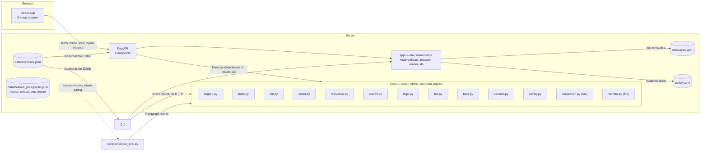

# ProofPilot — High-Level Design v2.14

Team: CVS Ujwal (24BCE0667), Keshav Raj (24BCI0306)
Repo: public, MIT license, GitHub user `ujwal2311`
Status: **APPROVED AND FROZEN** (2026-10-08; v2.3 budget caps, v2.4 config-at-the-edge — both approved change requests). v2.9 applies the Phase-5-gate change request; v2.10 the budget decision and the cache bound; v2.11 the sprint scope decision and the M2 budget bucket; v2.12 the student's post-progress-review change request making Translate universal; v2.13 the student's change request adding 8 grammar productions from the gap-list review (§16); v2.14 the student's professor-approved scope-change request adding first-order logic as a second mode alongside the frozen propositional engine (§18, 2026-10-31).
This document is the source of truth. Any later
design change requires an explicit change request from the student; Claude must not alter the
design unilaterally.

**v2.4 = v2.3 + config-at-the-edge (§16). v2.3 = v2.2 + an approved line-cap change request (§16, budgets only — no behaviour, algorithm,
contract or scope changed).** **v2.2 = v2.1 + the student's §15 decisions** (budget accepted, core cap raised to 975, pilot kept
in M1, hints defined for non-entailing exercises, module ownership recorded). v2.1 itself added
the milestone split, 9 required fixes, and an adversarial re-verification (§17) that found and
fixed **7 BLOCKERs** in the v2.0 design.

**Headline numbers, computed bottom-up in §13, never rounded to fit:** after all approved cuts,
**77.00 person-hours ≈ 38.5 h per member** for a 2-person team. This is **+10.75 h above the
66.25 h figure approved in v2.1**, and every hour of that delta is traceable to two decisions the
student made in this round: keeping the pilot in M1 (**+2.00**) and requiring that *both members
can explain every module* (**+8.75** of cross-module walkthroughs). The second is the right call
for the viva and is budgeted rather than hidden. Core lines land at **~945 against the new 975
cap ✓**, and as of v2.3 **all five line and hour caps are met** (§13.4).

> **v2.9 correction — the paragraph above is superseded and kept only for the record.** The 975
> core cap it reports was lowered to **650 target / 700 ceiling** in the v2.3 and v2.8 change
> requests, but §13.4's bottom-up estimate was never re-derived against the new number. Measured
> at the Phase 5 gate the projection is **~765, not ~945-against-975 and not the 697 quoted in
> §16 v2.8 A4c**, which is not derivable from §13.4's own figures. All three code caps are
> affected. §13.4 and §17.12 now carry the corrected arithmetic; the decision is the student's and
> is open at the Phase 6a gate.

---

## 1. Purpose, Problem, Formative Angle

A student learning propositional logic has to do two hard things: turn an English argument into
formulas, and then prove it. Most tools help with neither — they check a final answer. ProofPilot
reads a short paragraph and a claimed conclusion, shows the student exactly which facts it found
and asks them to confirm, decides by truth table whether the conclusion actually follows, and then
coaches a resolution refutation step by step with exact diagnosis of each mistake and
BFS-computed hints. Bayesian Knowledge Tracing over three skills (four in M2) chooses the next
exercise and decides when to stop.

The system never claims to understand free-form English. It supports one precisely documented
controlled grammar (§3) and refuses anything outside it with a named error and a rephrasing hint.
Refusing is a feature, not a failure: a wrong silent guess about what a sentence means would
corrupt every downstream stage.

## 2. Milestones, Scope, Budgets

### M1 — "English-reading proof tutor" (MUST SHIP, target ≤50 h)

`english.py` (grammar) · `facts.py` (exact-key auto-merge + **manual** merge only; no similarity
suggestions) · `cnf.py` · `entail.py` (truth-table entailment, `INCONSISTENT_PREMISES`,
does-not-follow + counterexample) · `relevance.py` · `logic.py` · `search.py` (exact BFS + node
cap + rule-based fallback hint; **no set-of-support**) · `bkt.py` (3 skills: CLASH, RESOLVE,
STRATEGY) · `tutor.py` · CLI · 4-endpoint API · React with **3 stages** (Read & Facts → Prove →
Explanation panel) · simulation + one graph · held-out parser evaluation · tests · README ·
GitHub · AI log.

### M2 — "Translation coach" (target ≤15 h)

`translation.py` (truth-table equivalence; contrapositive accepted; **exactly 3 diagnoses** —
`CONVERSE`, `MISSING_NEGATION`, `AND_OR_SWAP` — otherwise `NOT_EQUIVALENT`; **always** one English
counterexample row) · `formula.py` (the typed-formula parser: `R -> C`, the five connectives in
ASCII and Unicode, parentheses, named errors) · TRANSLATE as the 4th BKT skill · a typed formula
input with insert buttons, **no drag-and-drop builder** · `narrate.py` (English proof
explanation). Budgeted as `[core_m2]` in `budgets.toml` (v2.11).

### STRETCH (listed only, not designed)

Similarity (Jaccard) merge suggestions · set-of-support search · "Why this score?"
(with it, `mastery_history` and `HistoryItem`, cut from M1 in v2.10) ·
mobile polish · more translation diagnoses · teacher-authored questions.

### Out of scope (all milestones)

Free-form NLP, LLMs, pronoun resolution, tense/time
reasoning, "because/since" causality, multiple languages, a teacher dashboard, accounts, a
database, Docker, A*.

**First-order logic** was on this list through v2.13. The student's 2026-10-31 professor-approved
scope-change request brings it into scope as a second mode, alongside the frozen propositional
engine — see §18. Nothing else in the list above changed.

### Budgets (changed from v1 — justified in §12)

Line budgets are measured in **CODE lines** — blank, comment and docstring lines excluded (v2.5).

**The numbers live in `budgets.toml` and in no other file** (v2.10 item 5). `tools/loc.py` reads
that file, prints the table and fails the build above a ceiling; it runs at every phase gate and
in CI. §13.4 states the policy — which bucket covers what, how the warning band works, and the
overrun rule — without repeating a single figure.

| Budget | Where the number lives | Scope |
|---|---|---|
| Hours | §13.3 (**77.00 person-hours accepted**, ≈38.5 h each; contingency 75.00) | includes review-and-understand time **and** cross-module walkthroughs |
| Core lines | `budgets.toml` → `[core]` | `backend/src/core/*.py`, **excluding `session.py` and the M2 modules** |
| core (session) | `budgets.toml` → `[core_session]` | `session.py` (v2.11) |
| core (M2) | `budgets.toml` → `[core_m2]` | `translation.py`, `formula.py`, `narrate.py` (v2.11) |
| **CORE TOTAL** | `budgets.toml` → `[totals]`, **reported, not enforced** | the three core buckets summed, so a split can never show its cost as three small ones |
| api + cli | `budgets.toml` → `[api_cli]` | `backend/src/api/*.py` + `backend/src/cli.py`, excluding tests |
| scripts | `budgets.toml` → `[scripts]` | `scripts/*.py` — **evaluation** tooling, never shipped |
| Frontend | `budgets.toml` → `[frontend]` | `frontend/src/**` |
| tools | `budgets.toml` → `[tools]`, **reported, not capped** | `tools/*.py` — development tooling |

All four capped buckets were **re-derived bottom-up and frozen on 2026-10-11** (v2.10 item 6)
after the Phase 5 gate found that the caps and the design had contradicted each other for six
revisions. The derivation, the measured actuals behind it and the record of what went wrong are
all in `budgets.toml`.

**Scope decision (team, 2026-10-12, v2.11): M2 is kept in scope for the progress review.** The
frozen `[core]` derivation costed M2 as a single line item placed *outside* the cap, and never
costed `narrate.py` at all — so M2 had a scope but not a budget. It now has its own bucket,
`[core_m2]`, derived bottom-up per module with the same cap + 10% ceiling rule, and `[core]`
excludes those files by name. **The frozen `[core]` cap was not raised**; the only M2 code inside
it is the TRANSLATE transition row and dispatch call in `tutor.py`, which the cap-to-ceiling band
covers. `test_every_core_module_is_measured_by_exactly_one_bucket` fails the build if a new core
module lands in both buckets or in neither.

**Team constraint (approved):** both members must be able to explain every module. This is a
budget line item (§13.3), not an aspiration — it is what the §17.11 three-sentence explanations
and the joint walkthroughs exist to deliver.

**Bank constraint:** every exercise in `data/exercises.json` must reduce to **≤7 relevant clauses
after the relevance filter**. Own-question mode may exceed this; it degrades via the work budget +
rule-based fallback hint, never by hanging (§6.6, measured in
`docs/experiments/search_latency.md`).

---

## 3. Supported-Language Specification (`core/english.py`)

### 3.1 Normalization (whole sentence, before parsing)
**Unicode folding first, in one place** (`english.normalize_text`): curly quotes `‘ ’ “ ”` → ASCII,
en/em dashes `– —` → `-`, non-breaking spaces → space. Then lowercase → expand contractions
(`isn't→is not`, `doesn't→does not`, `won't→will not`, `can't→can not`) → split into sentences.
The order is load-bearing: a curly apostrophe surviving to the contraction table leaves `isn’t`
as a content word and the negation is lost before `facts.py` sees it.

**Sentence splitting (v2.5).** A terminator `. ! ? ;` ends a sentence only when the next
non-space character is uppercase, or nothing follows; and a `.` between two digits never splits.
This keeps `3.5`, `1,000.50` and `e.g.` intact. `Dr. Rao` still splits — distinguishing an
abbreviation from a sentence end needs a lexicon, which is topic knowledge the no-hardcoding
principle forbids, so the fragment stays visible on the Facts screen instead (§14).

### 3.2 Grammar

A `clause` **never contains a connective**. This single property is what makes the whole pipeline
tractable (§6.1) and is also the source of the system's most important limitation (§14.1).

```
sentence := "if" cond ("," | "then")+ junction      # consequent runs to end of sentence
          | "whenever" cond ("," | "then")+ junction  # same production as "if", different head word
          | "provided" "that" cond ("," | "then")+ junction
          | "given" "that" cond ("," | "then")+ junction
          | "unless" clause "," junction             # sentence-initial; ≡ junction ∨ clause
          | "not" "both" clause "and" clause          # NAND; ¬(A ∧ B) -- distinct from "neither … nor"
          | clause "if" cond                         # B if A  ≡  A → B
          | clause "only if" clause                  # A only if B  ≡  A → B
          | clause "unless" clause                   # A unless B  ≡  A ∨ B
          | clause "if and only if" clause           # A ↔ B
          | clause "is" "necessary" "for" clause      # B is necessary for A  ≡  A → B
          | clause "is" "sufficient" "for" clause     # A is sufficient for B  ≡  A → B
          | clause "implies" clause                  # A implies B  ≡  A → B
          | clause "," "otherwise" clause             # A, otherwise B  ≡  A ∨ B; ≡ "unless" family
          | "either" or_junction                     # "either" forces pure-or
          | "both"   and_junction                    # "both"   forces pure-and
          | "neither" clause ("nor" clause)+         # ¬A ∧ ¬B ∧ …
          | junction                                 # fallback

cond         := junction
junction     := clause (("and" | "or") clause)*      # mixing and/or → AMBIGUOUS_AND_OR
or_junction  := clause ("or"  clause)+               # an "and" here → AMBIGUOUS_AND_OR
and_junction := clause ("and" clause)+               # an "or"  here → AMBIGUOUS_AND_OR

clause   := ["not" | "it is not the case that"] FACT_PHRASE
```

**Two corrections to the brief's grammar, applied rather than parked** (both are directly implied
by the brief's own text, so neither is a design fork):

1. The consequent of `if … then …` is a `junction`, not a bare `clause` — otherwise the brief's
   own note *"in 'if A then B and C', the consequent runs to the end of the sentence"* cannot be
   constructed.
2. `either` / `both` are **n-ary disambiguating prefixes**, not fixed 2-clause forms. The brief
   assigns them exactly this job ("mixing and/or without `both`/`either` → AMBIGUOUS"), and
   treating them as prefixes that *force* a pure-or / pure-and junction handles
   "Either A or B or C" with no extra machinery. `neither … nor … nor …` is n-ary for the same
   reason.

**`"Only if B, A"` is REJECTED** (`UNPARSEABLE`, hint: *"rewrite as 'A only if B'"*). English
requires subject-auxiliary inversion here ("Only if B **does** A happen"), which this grammar
cannot detect; accepting the uninverted form risks silently reversing the implication direction.
Rejecting is the never-guess-compliant choice. (`"Unless B, A"` **is** supported — see §3.2 — and
is unambiguous because `unless` is symmetric in neither reading.)

### 3.3 Meanings

| Pattern | Formula | Clausal form |
|---|---|---|
| `if A then B` / `B if A` | A→B | `{¬A, B}` |
| `whenever A, B` | A→B | `{¬A, B}` |
| `provided that A, B` / `given that A, B` | A→B | `{¬A, B}` |
| `A only if B` | A→B | `{¬A, B}` |
| `A unless B` / `Unless B, A` | A∨B | `{A, B}` |
| `not both A and B` | ¬(A∧B) | `{¬A, ¬B}` |
| `either A or B` | A∨B (inclusive) | `{A, B}` |
| `neither A nor B` | ¬A∧¬B | `{¬A}, {¬B}` |
| `A if and only if B` | (A→B)∧(B→A) | `{¬A,B}, {¬B,A}` |
| `A is necessary for B` | B→A | `{¬B, A}` |
| `A is sufficient for B` | A→B | `{¬A, B}` |
| `A implies B` | A→B | `{¬A, B}` |
| `A, otherwise B` | A∨B | `{A, B}` |
| `both A and B` / `A and B` | A∧B | `{A}, {B}` |
| `A or B` | A∨B | `{A, B}` |
| bare clause `A` / `not A` | A / ¬A | `{A}` / `{¬A}` |

**Keyword matching is longest-first**, and this ordering is load-bearing, not cosmetic:
`"if and only if"` (4 tokens) **>** `"only if"` (2) **>** `"if"` (1); and `either…or` /
`neither…nor` are matched **before** a bare `or`. Scanning for `"if"` first would read
*"A if and only if B"* as *"B if A"* — the wrong formula, silently. Tested by
`test_keyword_longest_first_ordering` and `test_either_neither_before_bare_or`.

**Negation composes by XOR, and the two layers are strictly separated** (v2.5 clarification):

- **Structural negation** is a negator that *begins* a clause — `not` or `it is not the case
  that`, exactly as the production above writes it. `english.py` strips it and records a `Not`
  node. Two structural negations cancel rather than stack.
- **Embedded negation** is `not`/`no`/`never` appearing anywhere else inside the phrase.
  `english.py` must **not** touch it; it stays in the phrase text and `facts.py` resolves it when
  it computes the fact's polarity.

So *"It is not raining"* yields `Atom("it is not raining")` from the parser — **not** a `Not`
node — and becomes ¬R only after `facts.py` reads the embedded negation. Whereas *"it is not the
case that it does not rain"* yields `Not(Atom("it does not rain"))`, and the two polarities
cancel to **R** (positive). Getting this boundary backwards would corrupt every later stage, so
it is pinned by `test_embedded_negation_stays_inside_the_fact_phrase`.

### 3.5 Stemming (v2.6) — uniform, and idempotent by construction

Applied by `facts.py` to **every** token unconditionally — never "only if a suffix was stripped" —
and the whole pipeline repeats to a fixpoint, so a base form and an inflected form follow the
same path and `stem(stem(w)) == stem(w)` holds:

1. **suffix**, first match only: `sses→ss` | `ies→i` | `ss→ss` *(no-op; protects class, miss)* |
   `ing→` | `ed→` | `es→` | `s→`
2. **drop a trailing `e`**
3. **collapse a doubled final consonant** (`ll→l`), except `ss`
4. **`y→i` only after a consonant** — `study→studi`, but `stay` is unchanged

Each step is skipped if it would leave fewer than **2** characters. The fixpoint is what makes
base and inflected forms meet: `buses→bus→bu` reaches the same key as `bus→bu`, which a single
pass would not. Measured over 36 pairs: 36 merges, 0 misses, 0 idempotence violations.

**Known false merges, accepted deliberately:** `hoping`/`hopping`, `caning`/`canning`,
`planed`/`planned` all collide, because step 3 cannot tell a doubled consonant that marks a short
vowel from one that does not. These are *safe* because of A1 — a merged fact shows every phrase
it absorbed, so the student sees both and can split them.

### 3.4 Errors (never guess)

| Code | Trigger | Level |
|---|---|---|
| `UNPARSEABLE` | No production matches (incl. `"Only if B, A"`) | per-sentence |
| `AMBIGUOUS_AND_OR` | Junction mixes and/or without `both`/`either` | per-sentence |
| `QUANTIFIER_UNSUPPORTED` | all / every / some / any / none / nobody / everyone | per-sentence |
| `TOO_LONG` | sentence > 30 words | per-sentence |
| `EMPTY_FACT_PHRASE` | a clause's canonical key is empty after normalization (e.g. *"it is"*) | per-sentence |
| `SUSPICIOUS_FRAGMENT` | splitting produced a one-token fragment (`"Dr"` from `"Dr. Rao"`) | paragraph-level, halts |
| `UNKNOWN_PHRASE` | a merge names a phrase no sentence produced | merge-time |
| `SELF_MERGE` | a merge names the same phrase twice | merge-time |
| `CONFLICTING_MERGE` | one phrase pair given two different relations | merge-time |
| `TOO_MANY_FACTS` | > 10 distinct facts across paragraph + conclusion | paragraph-level, halts |
| `TOO_MANY_SENTENCES` | > 12 sentences | paragraph-level, halts |

Per-sentence errors do **not** block the other sentences — the Facts screen shows every sentence
with its status. Every error names the offending sentence and gives exactly one rephrasing hint.

`EMPTY_FACT_PHRASE` is **new in v2.1** (found in the §17.4 normalization audit): a phrase made
entirely of function words would otherwise produce a fact with an empty key, silently merging
with every other such phrase.

---

## 4. Architecture



**Core reads no files.** Every data file is loaded by an edge — the API, the CLI, or a script —
and passed in as plain dataclasses. Core therefore imports nothing outside the standard library
(enforced by the allowlist in `test_smoke.py`) and every module is unit-testable from literals
with no fixture files on disk.

| Module | Owns | Does NOT own | M |
|---|---|---|---|
| `core/english.py` | Normalize, tokenize, longest-first keyword scan, parse → AST, the 7 error codes | Fact identity, CNF | M1 |
| `core/facts.py` | Embedded-negation extraction, function-word + suffix normalization, canonical keys, symbol assignment, manual merges | Parsing, similarity scoring (stretch) | M1 |
| `core/cnf.py` | AST → clauses by the **textbook 3-step algorithm** (§6.2) | Parsing, resolution | M1 |
| `core/entail.py` | Truth-table entailment, inconsistency, counterexample row | Search, resolution | M1 |
| `core/relevance.py` | Fact-graph BFS; which clauses are needed | Search, hints | M1 |
| `core/search.py` | Exact BFS distance, best next step, productivity, the shared work budget, rule-based fallback hint | Diagnosis, mastery | M1 |
| `core/logic.py` | Literal normalization, resolvents, 6-code step diagnosis | Search, CNF | M1 |
| `core/bkt.py` | Single-skill Bayesian update, parameter validation, **the done check** | Which skills to update | M1 |
| `core/tutor.py` | **Policy only:** the stage x action transition table, the evidence mapping, the hint ladders, next-exercise selection | The BKT math, the done check (`bkt.py`), **any `State`** | M1 |
| `core/session.py` | **Mechanics only:** the §7 pipeline (`analyse`), and **every** edit to a `State` — hint-level tracking, clause recording, the v2.7 A4 reset (v2.11) | Deciding what an action means | M1 |
| `core/config.py` | **Every** numeric limit and seed, as named constants | Any logic | M1 |
| `core/translation.py` | Symbolic formula parsing, equivalence, 3 diagnoses, counterexample | The reference parse | M2 |
| `core/narrate.py` | Finished proof → English prose | Step-level feedback (that's `messages.yaml`) | M2 |
| `core/models.py` | The dataclasses crossing the edge↔core boundary (`Exercise`, …). **Not** `types.py`: that shadows a standard-library module, and a core file silently taking precedence over `types` is the kind of bug that costs an afternoon (v2.7 A2) | Reading any file | M1 |
| `messages.yaml` | All user-facing text templates | Any decision logic | M1 |
| `backend/src/app/data.py` | **The only module that reads a data file**: the bank, the bands, `policy.yaml`, `messages.yaml`. Validates each at startup with a named error per failure mode | Any logic — it validates and stops | M1 |
| `backend/src/app/render.py` | Code → wording, by filling a `messages.yaml` template. Shared by the CLI and the API so the two clients cannot say different things about the same outcome | Deciding *which* code (that is `core`) | M1 |
| `backend/src/app/view.py` | The board's clause ids (`c1`, `c2`, …), assigned once and stable for the exercise | Any judgment | M1 |
| `backend/src/app/__init__.py` | `Runtime.load()` — startup validation of every data file — and `prepare()`, the single text entry point every adapter calls | Rendering and loading (its submodules do that) | M1 |
| `backend/src/api` | **A thin HTTP adapter**: parse a body, call `app`, return JSON. Schemas, routing, error status codes, CORS | Any logic, **any wording**, any clause ids | M1 |
| `backend/src/cli.py` | **A thin terminal adapter**: read a line, call `app`, print. Plays a full practice session with no web layer at all — the HARD GATE | HTTP, React, **any wording** | M1 |
| `frontend/src` | Render, post actions, persist to localStorage | Validating anything, computing anything | M1/M2 |

### 4.1 Module ownership

Both members work on the project jointly; the A/B split below assigns **review ownership and the
primary viva explainer** for each module, not exclusive authorship. **Both members review each
other's modules, and both must be able to explain every module** (§13.3 budgets the walkthroughs
that make this true). Name assignment is left blank here and filled in by the team in
`docs/report/CONTRIBUTION_TEMPLATE.md`, which is the document the professor grades on
contribution.

| Owner | Modules | M1 h | M2 h |
|---|---|---|---|
| **Member A** | `english.py`, `facts.py`, `cnf.py`, `entail.py`, `relevance.py` (+ `translation.py` in M2) | 15.00 | 4.75 |
| **Member B** | `logic.py`, `search.py`, `bkt.py`, `tutor.py`, the API, the frontend | 20.25 | 3.75 |
| **Shared** | `config.py`, `messages.yaml`, CLI, scripts, data authoring, experiments, pilot, README, repo/CI, integration debugging, cross-module walkthroughs | 30.25 | 3.00 |

**Load-balance note (planning estimate, not a result).** Owned work alone splits 19.75 h (A) to
24.00 h (B) — B carries the API and the frontend on top of four core modules. To land both members
near 38.5 h, the 33.25 h shared pool should split roughly **19 h to A / 14 h to B**; the natural
allocation is for A to take the CLI, the scripts and the data authoring. This is a scheduling
suggestion, not a contract.

```text
# --- crosses the edge -> core boundary (core/models.py). Core never reads a file. ---
Exercise    = { id: str, paragraph: str, conclusion: str, topic: str }
              # exactly the four fields in data/exercises.json; difficulty is COMPUTED
              # (scripts/difficulty.py), never stored, never hand-labelled

Fact        = { symbol: str, phrases: tuple[str, ...] }
              # EVERY phrase merged into this fact, first-appearance order (v2.6 A1), so the
              # Facts screen can show them all and an auto-merge stays visible and splittable.
MergeChoice = { a: str, b: str, relation: "same"|"opposite"|"different" }
              # a and b are PHRASES, not symbols (v2.6 A1): a symbol cannot name one half of a
              # group it already contains. "different" SPLITS what the stemmer merged.
Clause      = frozenset[str]                        # literals "P" / "~P"; empty clause = frozenset()
ClauseRec   = { id: str, literals: list[str], origin: "given"|"goal"|"derived",
                source_sentence_id: str|None }      # origin trace, used by the Explanation panel
SentenceRec = { id, text, status: "ok"|"error", error_code: str|None,
                formula: str|None, symbols: list[str] }
Translation = { sentence_id, student_formula: str|None,                       # M2
                status: "pending"|"correct"|"correct_contrapositive"|"error",
                diagnosis_code: str|None }
# HistoryItem -- CUT from M1 with mastery_history (v2.10 item 3). It only ever fed the
#              stretch feature "Why this score?"; BKT needs the posterior, not the sequence.

State:
{
  schema_version:  int,                    # bumped on any shape change; localStorage guard
  mode:            "practice" | "own_question",
  exercise_id:     str | null,
  stage:           "read" | "facts" | "translate" | "prove" | "explain",  # v2.12: universal, not just M2
  paragraph, conclusion: str,
  facts:           list[Fact],
  sentences:       list[SentenceRec],      # paragraph sentences in order, conclusion last
  merges_applied:  list[MergeChoice],      # the user's merge/split decisions, replayed in order
  translations:    list[Translation],      # M2 only; empty in M1
  clauses:         list[ClauseRec],        # CNF of the REFERENCE parse, append-only, stable IDs
  relevant_ids:    list[str],              # output of relevance.py; informational, nothing is deleted
  mastery:         { CLASH, RESOLVE, STRATEGY [, TRANSLATE] : float },
  # mastery_history: CUT from M1 (v2.10 item 3) -- stretch only. Re-adding it bumps
  #                  schema_version; the BKT maths is untouched either way.
  hint_level:      int,                    # 0-3; resets on stage change or a clause being added
  done_ids:        list[str],
  solved:          bool,
  entailment:      { status: "entails"|"does_not_follow"|"inconsistent",
                     counterexample: {symbol: bool} | null }
}
```

Clauses always come from the **reference** parse, never from the student's M2 formulas. In M2 the
Translate stage gates progression, so by the time `stage="prove"` every student formula is already
*logically equivalent* to the reference — re-deriving CNF from their formula would create a second
conversion path that could disagree with the first over nothing more interesting than literal
ordering. One CNF source of truth.

---

## 6. Algorithms (each with its correctness argument)

### 6.1 Parsing
Because a `clause` contains no connective, every sentence has **at most one top-level connective
construct**. A single left-to-right longest-first scan therefore finds it without backtracking;
if none is found, the sentence is a `junction`. Correctness: the scan is complete (it tries every
production's keyword) and unambiguous (longest-first resolves the only overlapping keywords,
`if` / `only if` / `if and only if`). Depth is bounded at 3 (connective → junction → clause).

### 6.2 CNF — textbook algorithm, chosen over the 9-case lookup

**v2.0 specified a fixed-case lookup. v2.1 replaces it with the textbook 3-step algorithm.** The
comparison the brief asked for:

| Criterion | 9-case lookup | Textbook 3-step | Winner |
|---|---|---|---|
| Lines | ~70–85. The "9 cases" is a fiction: `cond` and `junction` are *n-ary*, so `(A∨B)→(C∧D)` needs nested loops producing m×n clauses, and each of the 9 shapes needs its own loop | ~55. `eliminate_iff_implies` ~12, `push_negation` (De Morgan) ~15, `distribute_or_over_and` ~15, `to_clauses` (dedupe + drop tautologies) ~13 | **textbook** |
| Explainability | "we enumerated the cases" — a viva examiner asks *"did you prove the enumeration is complete?"* and the answer is a hand-wave | "this is the standard CNF conversion in any logic textbook" — a named, citable algorithm | **textbook** |
| Bug risk | 9 independent hand-derived transformations = 9 independent chances to get a sign wrong; a missed case is a silent wrong answer | 3 generic transformations exercised by every production; a sign error breaks many tests at once, loudly | **textbook** |

The usual objection to general CNF conversion — exponential blow-up from distribution — **does
not apply here**, and this is provable rather than hopeful: formula depth is ≤3, so the worst case
is `(A₁∨…∨Aₘ) → (B₁∧…∧Bₙ)` yielding exactly m×n clauses, with m+n ≤ 10 facts, so **≤25 clauses**.
Bounded, small, no cap needed.

Every grammar production is pushed through CNF and checked in
`test_cnf_every_production` (§10) — the lookup's only real advantage (you can eyeball each case)
is recovered by testing, not by structure.

### 6.3 Fact normalization
Canonical key = **ordered tuple** of stems after (1) embedded-negation extraction, (2) function-word
removal, (3) stemming (§3.5). The key is *ordered*, so *"dog bites man"* and *"man bites dog"* stay
distinct. Exact key match ⇒ automatic merge (safe: identical keys mean identical content words in
identical order). Anything less than an exact match is **never** merged automatically — the user
merges manually on the Facts screen. Risks audited in §17.4.

**The function-word list lives in exactly one place: `facts.FUNCTION_WORDS`** (v2.7 A5). It is not
repeated here, because two copies drift. What belongs in it, and why:

- **Articles** (`a`, `an`, `the`) and **auxiliaries** (`is`, `was`, `does`, `will`, `got`, …) carry
  no propositional content — dropping them lets *"the bus is late"* and *"a bus was late"* name one
  fact.
- **`it` and `there` are included** because in this grammar they appear as *expletive* (dummy)
  subjects — *"it rains"*, *"it is cold"*, *"there is a delay"* — where the word refers to nothing
  at all. Keeping them would leave *"it rains"* and *"rain is falling"* as separate facts for no
  reason, and §3.4's own `EMPTY_FACT_PHRASE` example (*"it is"*) only empties if `it` is dropped.
- **Personal pronouns (`he`, `she`, `they`, `we`, …) are deliberately NOT included.** They *refer
  to an entity*, so dropping them would merge *"he waits"* with *"she waits"*. Resolving who they
  refer to is pronoun resolution, which §2 puts out of scope — so the honest treatment is to leave
  them as ordinary content words and let the student see the result on the Facts screen.
- Nothing topic-specific may ever be added; `test_function_word_list_is_grammar_not_topic_knowledge`
  enforces that.

### 6.4 Entailment
`KB ⊨ goal` ⟺ no row of the truth table over all facts makes every KB clause true and the goal
false — the textbook definition, decided exhaustively over ≤2¹⁰ = 1024 rows. If **no** row
satisfies the KB, the premises are inconsistent; this is checked **first**, because entailment is
vacuously true from a contradiction and hiding that would be dishonest. Rows are enumerated as a
binary counter over alphabetically sorted symbols, so the reported counterexample is deterministic.

### 6.5 Relevance filter — correctness argument
Let R = clauses BFS-reachable from the goal's facts in the graph {clauses as nodes, edge iff they
share a fact}, and U = the rest. By construction facts(U) ∩ (facts(R) ∪ facts(goal)) = ∅.
**Claim:** if KB ⊨ goal then R ∪ {¬goal} is already unsatisfiable, so dropping U removes no needed
clause. *Proof:* suppose σ_R satisfies R ∪ {¬goal}. Since the consistency check passed, KB is
satisfiable by some σ; restrict it to facts(U) to get σ_U. The domains are disjoint, so σ_R ⊎ σ_U
is well-defined and satisfies KB ∪ {¬goal} — contradicting KB ⊨ goal. ∎

**The consistency check must run before the filter.** If KB were inconsistent the contradiction
could live entirely inside U, and dropping U would destroy the only refutation. §7 mandates the
ordering; `test_relevance_requires_consistency_first` locks it.

Nothing is deleted from `state.clauses` — the filter populates `relevant_ids` and the
"not needed for this conclusion" report, and shapes hints only. The student may use any clause.

### 6.6 Search
Exact BFS over states (state = frozenset of clauses; action = add one new non-tautological
single-pivot resolvent; cost 1; goal = `frozenset()` ∈ state), with a visited set and canonical
successor ordering. **Set-of-support is removed** (stretch), so there is one regime and one
invariant.

**`productive ⟺ d(new) = d(old) − 1`** still holds. *Proof:* (≤) any derivation from S works from
S∪{C}, so d(S∪{C}) ≤ d(S). (≥) an optimal length-k derivation from S∪{C} that uses C can be
prefixed by the step deriving C from S (C is a resolvent of two clauses in S, since the step was
valid), giving a derivation from S of length ≤ k+1; hence d(S) ≤ d(S∪{C})+1. So
d(new) ∈ {d(old), d(old)−1}. ∎

**Size bound (the v1 review asked for this and never got it).** Order of additions does not matter
— a state is a *set* — so the number of distinct depth-k states is at most C(D, k) where D is the
count of derivable clauses. For a bank exercise (≤7 relevant clauses, ≤6 facts) D is a few dozen;
C(30, 5) = 142,506 is the pessimistic ceiling and real exercises are orders of magnitude smaller.

**The work budget (v2.9 A3 — replaces the node cap).**
**`MAX_SEARCH_WORK = 60,000`, counted in GENERATED successor states, and one allowance is shared
by one public call.** It replaced `MAX_SEARCH_NODES = 8,000` expanded nodes, which bounded the
wrong quantity twice over and was a product risk, not a test-design detail:

1. one expansion emits every legal successor of a node and **none of them were charged**. Measured
   at the nominal 8,000-node cap: up to **184,058 states generated** and a **46,491-state frontier
   held in memory**, so memory and hashing — not expansions — decided when a search finished;
2. `best_next_step` opened a **fresh full-budget search per candidate step**, and a budget hit is
   deliberately never cached (§M6), so every probe paid the whole allowance again. Measured at
   **12.7 s for one hint** on an input inside the documented limits.

The budget is **deterministic** — generations, never wall-clock seconds — so the same input
consumes the same budget on every machine. A clock-based cut-off would make a hint depend on load,
and a hint that is not reproducible cannot be tested at all.

**Cost is exponential in proof depth and no budget can change that.** Measured
(`docs/experiments/search_latency.md`): a chain proof of length 3/4/5/6/7 costs
28 / 167 / 1,051 / 6,921 / 47,305 units — ≈7× per step. The budget therefore does not buy depth;
it chooses where the fallback begins. 60,000 is **~57× the worst case the bank can present** (a
5-step proof, §9 bands), answers own questions to depth 7, and keeps the worst observed wall time
near 1 s. Doubling it bought one third of a step and cost 3.8 s.

**Latency TARGETS — goals, not guarantees.** Measured on one machine, stated so the project can be
held to something, and never claimed as a property of every machine:

| Goal | Measured 2026-10-10 |
|---|---|
| A hint within **1 s** for any bank exercise | 11.7 ms worst case (~85× margin) |
| A hint **or** an explicit fallback within **1 s** for an own question | 586 ms to depth 7; depth 8+ falls back at 835 ms |
| Every input inside §3.4's limits **terminates** | 500 seeded random states per test run, each returning a count, `None`, or `GoalUnreachableError` |

The automated assertion is a deliberately loose **10 s** ceiling, because a shared CI runner under
unknown load is not a benchmark; its job is to catch a regression of orders of magnitude, which is
exactly what the defect above was.

**The entailment short-circuit (new in v2.1, fixes BLOCKER V-2).** `search.distance` is **never
called when `entailment.status != "entails"`**. Two of the twelve bank exercises have conclusions
that do not follow — for those the empty clause is *unreachable*, so BFS would exhaust the whole
space to the budget on every single hint request. Since entailment is already decided by truth
table before the Prove stage, the system simply knows: hints fall to the ladder in §6.6.1, and
`productive` is `null`. This turns the work budget back into what it should be — a performance
guard for own-question mode — instead of a crutch covering a known-unreachable goal.

V-2 is also why the random sweeps in `docs/experiments/search_latency.md` are *slower than the
product*: they are dominated by clause sets with no refutation at all (165 of 200 at bank shape),
which the product never searches. They are measured anyway, because robustness must not depend on
the caller being correct.

#### 6.6.1 Hints when the conclusion does **not** follow

A student stuck on a non-entailing exercise is stuck for a different reason: there is nothing to
find. The ladder redirects them toward the right action without handing it over at level 1.

| Level | Code | Text |
|---|---|---|
| 1 | `HINT_NOT_FOLLOW_1` | "Before proving, check whether the conclusion really follows." |
| 2 | `HINT_NOT_FOLLOW_2` | "Try to find a situation where all the sentences are true but the conclusion is false." |
| 3 | `HINT_NOT_FOLLOW_3` | "It doesn't follow. Use 'Does not follow'." |

Levels 1 and 2 do not reveal the answer — L2 in particular describes the *method* (look for a
falsifying row) rather than the verdict, so a student who follows it reaches the conclusion
themselves. **Level 3 does reveal it**, deliberately and symmetrically with proof-mode L3, which
hands over the full resolvent. The giveaway is priced by the BKT penalty rather than withheld: a
student who escalates to L3 and then clicks "Does not follow" is scored **STRATEGY wrong** under
the existing hint rule (§9), even though the claim itself is accepted.

**No new evidence rule is needed** — the uniform hint rule already covers this case; §9 now states
it explicitly so it cannot be mistaken for a gap. All three strings live in `messages.yaml` like
every other piece of user-facing text.

**Budget fallback.** When the work budget runs out: `productive = None`, and the hint falls back to
a rule-based suggestion (prefer resolving with the shortest clause, tie-broken canonically),
labelled "a suggestion, not necessarily the best step". This is the documented behaviour for an
own question whose proof is deeper than 7 steps — degraded, bounded and honest, never a hang and
never a guess.

### 6.7 Resolution diagnosis (unchanged from v1)
Order: `NO_CLASH → DOUBLE_CANCEL → WRONG_RESOLVENT → TAUTOLOGY → DUPLICATE → VALID`. Branches are
mutually exclusive by construction: with ≥2 complementary pairs every single-pivot resolvent
retains the other pair and is a tautology, so `WRONG_RESOLVENT` is only ever reached when exactly
one pivot exists (hence exactly one correct resolvent, no ambiguity in "missing/extra"); and the
double-cancel result differs in size from every single-pivot resolvent, so `DOUBLE_CANCEL` can
never collide with `TAUTOLOGY`.

### 6.8 BKT
`P'_correct = P(1−s) / [P(1−s) + (1−P)g]`; `P'_wrong = Ps / [Ps + (1−P)(1−g)]`;
`P_next = P' + (1−P')T`. Validate `0 < g,s,T,P0 < 1` and `g+s < 1`. Parameters are **assumed, not
fitted** (stated in `config.py` and the README). Re-verified in §17.7.

`P_next` is clamped to `[slack, 1−slack]`. The clamp is **required**: the model never reaches 0 or
1 but float64 does, and from `P=1` a wrong answer returns 1 again, freezing the skill. The **size**
of the slack is a teaching decision, not a floating-point one (v2.11, sprint F1): **one or two
wrong answers from a mastered student are slips and must not revoke mastery; a third consecutive
wrong answer must.** That rule admits a narrow window of slacks, and the value in `config.py` is
the only power of ten inside it — derived there from the shipped formulas, and re-derived by
`test_the_slack_is_inside_the_window_the_rule_allows` so a change to `g`, `s`, `T` or the
threshold fails the build instead of silently lengthening recovery.

### 6.9 Translation check (M2)
Equivalence of the student's formula to the reference is decided by a full truth table over the
sentence's facts — exact, never string comparison. If equivalent → `CORRECT`. If equivalent to the
reference's contrapositive *as written* → `CORRECT_CONTRAPOSITIVE` (accepted, with a note).
Otherwise build three mutations of the reference and test equivalence against each in order:
**CONVERSE** (swap antecedent/consequent), **MISSING_NEGATION** (drop one negation), **AND_OR_SWAP**
(toggle the top connective); first match wins, else `NOT_EQUIVALENT`. Always return one
counterexample row in English using the fact labels.

**Why 3 diagnoses lose less than they appear to.** `INVERSE` (¬A→¬B) is logically *equivalent* to
`CONVERSE` (B→A), so a student entering the inverse is already caught — only the label differs.
`ONLY_IF_DIRECTION` (writing B→A for "A only if B") **is** the converse. `UNLESS_ERROR` (writing
A∧B for A∨B) **is** an and/or swap. The three retained codes cover the realistic failure modes of
all six in v2.0's list.

---

## 7. Mandatory Pipeline Ordering

```
parse → facts → consistency → entailment → relevance → proof
```

This order is a correctness requirement, not a convention:
- **consistency before entailment** — entailment is vacuous from a contradiction (§6.4).
- **consistency before relevance** — otherwise the filter can delete the only refutation (§6.5).
- **entailment before any search call** — otherwise an unreachable goal burns the work budget (§6.6).

`test_pipeline_order_enforced` asserts that `relevance` and `search` raise if invoked on a state
whose consistency/entailment has not been resolved.

---

## 8. API Contract and Error Model

Prefix `/api`. Stateless — the full `state` round-trips in every request body. No auth, no
cookies, no server-side session.

| Method | Request | Response |
|---|---|---|
| `GET /api/health` | – | `{ok: true}` |
| `POST /api/next` | `{state?}` | `{state, done}` — practice only; returns a fresh exercise's raw `paragraph`/`conclusion` with `stage="read"`, nothing parsed |
| `POST /api/parse` | `{paragraph, conclusion, merges?}` — each merge is `{a, b, relation}` with **a and b as phrase IDs** (`p1`, `p2`, …), never raw text (v2.7 A3) | `{state, facts, sentences, entailment, removed_sentences, warnings, error?}` — each fact carries `{symbol, phrases: [{id, text}, …]}` so the Facts screen shows every phrase a merge absorbed |
| `POST /api/act` | `{state, action}` | `{code, message, state, extras}` |

`/api/parse` serves both modes and runs the full §7 ordering in one call. The client calls it a
second time with `merges` after the user manually merges facts; merges are **never** inferred.

`action` is a discriminated union on `action.type`:

| `type` | Fields | `extras` | Valid in stage | M |
|---|---|---|---|---|
| `confirm_facts` | – | `{stage}` | `facts` | M1 |
| `step` | `clause_a, clause_b, resolvent: list[str]` | `{valid, productive}` | `prove` | M1 |
| `hint` | `level: 1\|2\|3` | `{available, reason?, text}` | `prove` | M1 |
| `claim_not_provable` | – | `{accepted, counterexample?}` | `prove` | M1 |
| `translate` | `sentence_id, formula: str` | `{diagnosis_code, counterexample}` | `translate` | M2 |
| `confirm` | – | `{stage}` | `translate` | M2 |

**`hint` is valid only in `stage="prove"`** (400 otherwise). This is why TRANSLATE evidence is
never hint-affected (§9) — there is no hint in the Translate stage, by design and by schema.

**`confirm_facts` leaves the Facts stage (§14's safety net) and is never scored (§9) — agreeing
with the facts on screen is not an answer.** A session opens on `stage="facts"`; `step`, `hint`,
`claim_not_provable` and `translate` sent before confirmation raise `FACTS_NOT_CONFIRMED`, a named
error distinct from the generic wrong-stage one, because the pedagogical reason (facts not yet
agreed) is different from any other wrong-stage call. `confirm_facts` is named separately from
Translate's `confirm` (same shape, different stage) so the two exits are never conflated in logs or
tests. A merge or split after confirmation still rewinds to `facts` and re-requires confirmation
(the existing reset-with-confirmation rule, unchanged by this).

### Error model — every condition maps to exactly one place

| Condition | Mapping |
|---|---|
| Malformed JSON, bad type, literal failing `^~?[A-Z]$` | **HTTP 422** |
| Unknown clause ID; symbol not in this exercise; >20 clauses; >6 literals; action sent in the wrong `stage`; mastery outside (0,1) | **HTTP 400** |
| `step`, `hint`, `claim_not_provable` or `translate` sent while `stage="facts"` (not yet confirmed) | **HTTP 400**, `FACTS_NOT_CONFIRMED` — distinct code from the generic `WRONG_STAGE` above |
| Unknown `exercise_id` | **HTTP 404** |
| Any action when `solved` or session `done` is already true | **HTTP 409** |
| `TOO_MANY_SENTENCES`, `TOO_MANY_FACTS` | 200, `/api/parse` top-level `error`, halts |
| `UNPARSEABLE`, `AMBIGUOUS_AND_OR`, `QUANTIFIER_UNSUPPORTED`, `TOO_LONG`, `EMPTY_FACT_PHRASE` | 200, per-sentence `SentenceRec.status="error"` |
| `INCONSISTENT_PREMISES`, `DOES_NOT_FOLLOW` | 200, `entailment.status` |
| `NO_CLASH … VALID` | 200, `code` |
| `CLAIM_ACCEPTED` / `CLAIM_REJECTED` | 200, `extras.accepted` |
| `HINT_1/2/3`, `HINT_UNAVAILABLE`, `HINT_FALLBACK`, `HINT_NOT_FOLLOW_1/2/3` | 200, `extras` — `state` untouched when unavailable |
| `CORRECT`, `CORRECT_CONTRAPOSITIVE`, `CONVERSE`, `MISSING_NEGATION`, `AND_OR_SWAP`, `NOT_EQUIVALENT` (M2) | 200, `extras.diagnosis_code` |

The rule separating HTTP from in-band: *"would this be true regardless of the student's answer?"*
→ HTTP. *"is this itself the teaching content?"* → 200 with a code.

**Limits live in exactly one place:** `core/config.py` holds every threshold (30 words, 10 facts,
12 sentences, 20 clauses, 6 literals, 1024 rows, `MAX_SEARCH_WORK`, `mastery_threshold = 0.95`, all
seeds). API, CLI and scripts import them. No number is retyped anywhere.

---

## 9. Evidence Mapping (complete: code × hint × mode)

M1 observes CLASH, RESOLVE, STRATEGY. M2 adds TRANSLATE. "–" = **no update**.

| Trigger | CLASH | RESOLVE | STRATEGY | TRANSLATE |
|---|---|---|---|---|
| `step` → NO_CLASH | wrong | – | – | – |
| `step` → DOUBLE_CANCEL | right | wrong | – | – |
| `step` → WRONG_RESOLVENT | right | wrong | – | – |
| `step` → VALID, productive=True | right | right | right | – |
| `step` → VALID, productive=False | right | right | wrong | – |
| `step` → TAUTOLOGY | right | right | wrong | – |
| `step` → DUPLICATE | right | right | wrong | – |
| `step` → VALID, productive=None (budget exhausted) | right | right | – | – |
| `claim_not_provable` → CLAIM_ACCEPTED | – | – | right | – |
| `claim_not_provable` → CLAIM_REJECTED | – | – | wrong | – |
| `claim_not_provable` → CLAIM_ACCEPTED **after any `HINT_NOT_FOLLOW_*`** | – | – | **wrong** | – |
| `translate` → CORRECT / CORRECT_CONTRAPOSITIVE (M2) | – | – | – | right |
| `translate` → any of the 4 error codes (M2) | – | – | – | wrong |
| **Any parse failure, any mode** | – | – | – | – |
| **Merge confirmation / decline** | – | – | – | – |
| `hint` action itself | – | – | – | – |

**Hint rule:** if `hint_level > 0` when a `step` or `claim_not_provable` action is submitted, every
skill that *would* be observed in that row is recorded **wrong** instead. Rows with "–" stay "–" —
a hint never creates an observation that wasn't already there.

The explicit `HINT_NOT_FOLLOW_*` row above is that same rule, not an addition: on a non-entailing
exercise the only scoring action is `claim_not_provable`, which observes STRATEGY, so taking any
level of the §6.6.1 ladder turns an otherwise-correct claim into STRATEGY-wrong. It is spelled out
because a reader could reasonably wonder whether a "there's nothing to prove" hint counts at all.

**Per OQ2, parse failures are never evidence** — in either mode. Only deliberate student actions
(`step`, `claim_not_provable`, `translate`) produce evidence. Confirming or declining a fact merge
is also not evidence: the user is the authority on what their own words mean, so there is no
ground truth to score against.

`is_done` ⟺ every **active** skill ≥ `mastery_threshold` (3 skills in M1, 4 in M2).

**Next-exercise selection** (unchanged from v1, now over the active skill set): mean mastery
<0.4 → short band, 0.4–0.8 → medium, >0.8 → long; bands are proof length 2 → short, 3 → medium,
4–5 → long, computed by `scripts/difficulty.py`, never hand-labelled. Unseen exercises first,
sorted by ID; then the nearest band, **ties broken toward the easier band**; then repeats,
**least-recently-seen, ties by lowest ID**.

---

## 10. Test Plan (M1: 27 · M2: 6 · total 33)

**Grammar & errors (M1)** — `test_parse_each_production` (parametrized over all 9) ·
`test_consequent_runs_to_end_of_sentence` · `test_keyword_longest_first_ordering` ·
`test_either_neither_before_bare_or` · `test_sentence_initial_unless_supported` ·
`test_sentence_initial_only_if_rejected` · `test_ambiguous_and_or_rejected` ·
`test_quantifier_rejected` · `test_contraction_and_double_negation_normalized` ·
`test_paragraph_limits_rejected` (TOO_LONG / TOO_MANY_FACTS / TOO_MANY_SENTENCES) ·
`test_empty_fact_phrase_rejected` · **`test_connective_inside_fact_mis_splits_visibly`** (fix B1:
asserts the *documented wrong* behaviour and that both bogus facts surface on the Facts screen)

**Facts & CNF (M1)** — `test_same_key_auto_merge` · `test_near_miss_not_auto_merged` ·
`test_manual_merge_applies` · `test_cnf_every_production` (every production → expected clause set)

**Entailment & relevance (M1)** — `test_inconsistent_premises_detected` ·
`test_not_follows_counterexample_satisfies_kb_and_not_goal` · `test_relevance_drops_distractor` ·
`test_relevance_requires_consistency_first` · `test_pipeline_order_enforced`

**Logic, search, BKT (M1)** — `test_resolve_single_clash` ·
`test_two_clashes_yield_only_tautologies` · `test_diagnose_all_six_codes` (parametrized) ·
`test_bfs_distance_fixture` · `test_productive_iff_distance_drops_by_one` ·
`test_search_not_called_when_not_entailed` (fix V-2) · `test_cap_returns_fallback_hint` ·
`test_hint_ladder_when_not_entailed` (§6.6.1, v2.2) ·
`test_bkt_update_hand_example` · `test_evidence_mapping_complete` (every row of §9) ·
`test_next_exercise_total_and_deterministic`

**System (M1)** — `test_every_exercise_parses_and_is_provable_or_marked_not_following` ·
`test_simulation_deterministic_with_seed` · `test_core_has_no_web_imports` ·
**`test_no_exercise_words_in_core`** (fix B6: greps `src/core/*.py` for content words of **≥5
letters** drawn from `exercises.json`, excluding grammar keywords and the function-word list) ·
`test_messages_yaml_covers_every_code` · `test_health_ok` · `test_parse_endpoint_contract` ·
`test_act_malformed_returns_422`

**M2** — `test_contrapositive_accepted_with_note` · `test_translation_converse_detected` ·
`test_translation_missing_negation_detected` · `test_translation_and_or_swap_detected` ·
`test_translation_counterexample_differs_in_truth_value` · `test_narrate_mentions_every_step`

---

## 11. Evaluation Plan

- **One graph** (`docs/results.png`, matplotlib `Agg`): BKT stopping rule vs a fixed-length
  baseline at a matched budget — 3 bars (baseline, adaptive-matched, adaptive-mismatched), seeded
  from `config.py`, averages only. Caption states it tests **only the stopping rule under the
  model's own assumptions**.
- **T1 — parser generalization on held-out paragraphs.** `data/heldout_paragraphs.json` contains
  15 paragraphs on **new topics, written by humans** — the student and classmates — **after the
  parser is frozen, never by the AI, and never used for tuning** (fix B7). Report as **first-run
  numbers**: % sentences parsed, % paragraphs fully parsed, error counts by type, facts needing a
  manual merge. **Per OQ3 a poor result does not block the report**: the first-run number stands
  as published, any subsequent parser fix is reported as a separate, labelled *"after fixes"* run,
  and the gap goes into §14 Limitations.
- **T2 — hint soundness:** seeded random walks of valid steps across all exercises; every level-3
  hint must be valid and non-worsening. A failure is a bug to fix, never a result to report.
- **T3 — search cost:** per exercise — shortest proof length, nodes expanded, median wall time of
  5 runs, budget exhaustions. Machine stated; times labelled machine-dependent.
- **Pilot (E5) — in M1, scheduled last.** `docs/pilot/template.csv` (anonymous IDs, pre/post,
  1–5 ratings, codes seen), a consent note, `scripts/analyze_pilot.py` producing counts and
  medians only. No significance tests at N≤10. Never fabricate rows. **It runs as the final M1
  activity, after the end-to-end app works** — classmates cannot pilot a half-built tutor, and
  running it earlier would produce data about a system that no longer exists. **If the schedule
  slips it is the first item moved to post-submission** (−2.00 h, §13.3), because it is the only
  M1 deliverable whose absence costs a results table rather than a capability.

Every output file is stamped with date, git commit hash, seed, Python version and OS.

---

## 12. Design Decisions

| Decision | Pros | Cons | Chosen | Reversibility |
|---|---|---|---|---|
| Controlled English vs LLM vs per-exercise word lists | Verifiable by truth table/resolution; no API cost, latency or nondeterminism; works on any topic with zero per-exercise code | Narrower input; honest refusals outside the grammar | **Controlled English** | Hard — the whole pipeline is built on parseable ASTs |
| Truth table vs search for entailment | Exact, bounded (≤1024 rows), trivially explainable; separates *"is it true"* from *"can the student prove it"*, which is what enables the §6.6 short-circuit | O(2ⁿ); unusable past ~20 facts | **Truth table**, capped at 10 facts | Easy — `entail.py` is one isolated module |
| **CNF: textbook 3-step vs 9-case lookup** | Fewer lines (~55 vs ~70–85), a citable named algorithm, generic transformations that fail loudly | Needs a distribution step — but blow-up is provably ≤25 clauses at depth 3 | **Textbook 3-step** | Easy — same signature either way |
| **Exact BFS only (SOS → stretch)** | One regime, one `productive` invariant, one proof; the ≤7-relevant-clause bank constraint plus the entailment short-circuit make the cap a rare path | Own-question mode on large input degrades to a fallback hint | **Exact BFS + cap + fallback** | Easy — SOS is additive, isolated in `search.py` |
| **Manual merge only (similarity → stretch)** | Never silently conflates two facts; no Jaccard threshold to justify; removes a float-comparison determinism risk | More user effort on paragraphs with paraphrases | **Exact-key auto + manual** | Easy — suggestions are purely additive |
| Single `/api/act` discriminated union vs one endpoint per action | One surface to schema, test, document; new action types don't grow the API | Larger schemas; routing bugs hit every action | **One `/act`** | Easy — schema-layer only |
| **Milestone split M1/M2** | M1 is independently demoable and defensible; M2 is a clean additive layer; a schedule slip degrades scope, not quality | Two integration passes; TRANSLATE absent from M1's mastery display | **M1 must-ship, M2 target** | Easy by design |
| **Core line cap raised 450 (v1) → 850 (v2.1) → 975 (v2.2)** | The original 450 was set for a 4-module core that assumed exercises arrived pre-written in CNF. The English pipeline was added *after* that cap, bringing 6 new required modules; v2.2's 975 is the first cap set with knowledge of the real module list. A cap that forces a module out cuts a capability, not fat | Larger surface both members must be able to defend in the viva — which is exactly why the team constraint and its walkthrough hours (§13.3) were added alongside | **975, and now met at ~945 ✓** | Reversible only by cutting a capability |
| Frontend and outside-core caps split by bucket (v2.3), then **re-derived bottom-up and frozen (v2.10)** | The split prices the right thing — shipped code is capped, tooling is not. Re-deriving replaced estimates that had contradicted the enforced caps for six revisions | Five buckets to track instead of three | **Frozen in `budgets.toml`, the single source (§13.4)** | **Hard — the overrun policy forbids raising them again; an overrun cuts M2** |
| **Module ownership A/B with mutual review** (§4.1) | Each module has a named reviewer and a primary viva explainer; neither member has a blind spot | Costs 8.75 h of cross-module walkthroughs that a divide-and-conquer split would not | **Adopted, and budgeted (§13.3)** | Easy — reassign at any gate |
| **`State` stays a core dataclass** rather than moving to `api/schemas.py` (v2.10 item 1) | The **CLI uses core directly** (`python -m src.cli`, the HARD CLI GATE), so an edge-owned `State` would force the CLI through the API or make it build its own parallel object. Core staying usable without the web layer is what lets the whole pipeline be driven and tested with no server at all | Costs ~35 core lines, and the field list is declared twice — once as a core dataclass, once as a Pydantic schema. A schema test keeps the two honest | **Rejected the move. `State` is core; the API converts to and from it in `schemas.py`** | Hard — every core signature would change |
| **Evidence mapping as policy YAML, transitions as code** (v2.10 item 2) | §9's evidence table is a pure lookup — ~18 declarative rows with no control flow — so it is data, loaded and schema-validated at the **edge** and passed into core as a plain mapping (v2.4). Stage × action **transitions are control logic**: they decide what may happen next and raise named errors, which is behaviour a reader must see in code | Two homes for "policy"; a reader must know which is which | **Evidence table → `data/policy.yaml`. Transition table stays in `tutor.py` as one compact table** | Easy — both are one table either way |
| **M2 kept in scope, in its own budget bucket** (v2.11, sprint B0) | The frozen `[core]` derivation priced M2 as one 170-line item placed outside the cap and never priced `narrate.py`, so M2 had a scope with no budget — the next honest option would have been raising a frozen cap, which the overrun policy forbids. A separate `[core_m2]` bucket prices the decision *before* the code exists, and keeps an M2 overrun from being charged against M1 | Five capped buckets to track; two buckets share one directory, so `[core]` needs an exclude list and a test that every core module is owned exactly once | **M2 in scope. `[core_m2]` derived bottom-up per module, cap + 10% ceiling, `[core]` cap unchanged** | Easy — cutting M2 deletes the bucket and three files |
| **`mastery_history` cut from M1** (v2.10 item 3) | It served only the stretch feature *"Why this score?"*; BKT needs the posterior, never the sequence that produced it. Cutting it removes a core field, the `HistoryItem` type, the append path through `tutor`, its API serialization and the history chart in `MasteryBars` | A later *"Why this score?"* must re-add the field and a migration of `schema_version` | **Cut from M1. Listed as stretch** | Easy — append-only data, re-addable without touching the BKT maths |

---

## 13. Budget — Bottom-Up, With Arithmetic

### 13.1 Costing model
Hours are **student wall-clock**, assuming Claude Code generates and the student reviews. Four
columns per module: **Gen** (prompt + generate + iterate), **Rev** (read, understand well enough
to defend in a viva — never zero), **Dbg** (make it actually work), **Tst** (review/extend tests).
Human-authored content (exercises, held-out paragraphs) gets no AI discount.

### 13.2 M1

| Item | Gen | Rev | Dbg | Tst | Total |
|---|---|---|---|---|---|
| `english.py` | 1.00 | 2.00 | 1.50 | 0.75 | **5.25** |
| `facts.py` | 0.75 | 1.25 | 1.00 | 0.50 | **3.50** |
| `cnf.py` | 0.50 | 1.25 | 0.75 | 0.50 | **3.00** |
| `entail.py` | 0.50 | 0.75 | 0.50 | 0.25 | **2.00** |
| `relevance.py` | 0.25 | 0.50 | 0.25 | 0.25 | **1.25** |
| `logic.py` | 0.75 | 1.25 | 0.75 | 0.50 | **3.25** |
| `search.py` | 0.75 | 1.25 | 0.75 | 0.50 | **3.25** |
| `bkt.py` | 0.25 | 0.50 | 0.25 | 0.25 | **1.25** |
| `tutor.py` | 0.75 | 1.00 | 0.75 | 0.50 | **3.00** |
| `config.py` + `messages.yaml` | 0.50 | 0.50 | 0.00 | 0.25 | **1.25** |
| API (4 endpoints, schemas, errors) | 1.25 | 1.50 | 1.25 | 0.50 | **4.50** |
| CLI | 0.50 | 0.50 | 0.50 | 0.00 | **1.50** |
| scripts (difficulty, experiments, held-out eval) | 1.00 | 0.75 | 0.75 | 0.00 | **2.50** |
| Frontend — 5 components, 3 stages, CSS | 2.50 | 2.50 | 3.00 | 0.00 | **8.00** |
| | | | | **Σ modules** | **43.50** |

| Non-module M1 | Hours |
|---|---|
| Experiments run + simulation + graph | 3.50 |
| Authoring 12 exercises (human) | 3.00 |
| Authoring 15 held-out paragraphs (human, post-freeze) | 2.00 |
| Pilot E5 tooling + consent note + analyze script | 2.00 |
| README + `docs/misconceptions.md` | 1.50 |
| Repo, CI, scaffolding | 1.00 |
| Cross-module integration debugging | 3.00 |
| **Σ non-module** | **16.00** |

**M1 = 43.50 + 16.00 = 59.50 h** against a 50 h cap → **over by 9.50 h**.

### 13.3 M2 and total

| Item | Gen | Rev | Dbg | Tst | Total |
|---|---|---|---|---|---|
| `translation.py` (symbolic parser, equivalence, 3 mutations, counterexample) | 1.25 | 1.75 | 1.00 | 0.75 | **4.75** |
| TRANSLATE wiring (`bkt`, `tutor`, `messages.yaml`) | 0.25 | 0.25 | 0.25 | 0.00 | **0.75** |
| `narrate.py` | 0.75 | 0.75 | 0.50 | 0.25 | **2.25** |
| `TranslateStep` frontend (typed input + insert buttons) | 0.75 | 0.75 | 1.00 | 0.00 | **2.50** |
| Translate stage wiring + `/act` action | 0.50 | 0.50 | 0.50 | 0.00 | **1.50** |
| M2 integration debugging | – | – | 1.50 | – | **1.50** |
| M2 docs update | 0.25 | 0.50 | – | – | **0.75** |
| | | | | **Σ** | **14.00** |

**M2 = 14.00 h** against 15 h → **within cap ✓**.
**Total = 59.50 + 14.00 = 73.50 h** against 65 h → **over by 8.50 h**.

**Cuts, applied in the mandated order (inside M2 first, never M1 tests / never-guess errors /
held-out evaluation). The pilot cut proposed in v2.1 is withdrawn — the student kept it in M1:**

| # | Cut | Saves | Running total |
|---|---|---|---|
| 1 | `narrate.py` → stretch (M2's Explanation panel keeps the M1 structured summary) | −2.25 | 71.25 |
| 2 | Insert buttons → plain typed input + a visible symbol legend | −1.00 | 70.25 |
| 3 | Frontend CSS to functional minimum (mobile polish already stretch) | −1.50 | 68.75 |
| 4 | CLI plays practice mode only (no own-question path in the CLI) | −0.50 | **68.25** |
| ~~5~~ | ~~Pilot E5 → post-submission~~ — **withdrawn, pilot stays in M1** (§11) | *(+2.00 vs v2.1)* | 68.25 |

**New in v2.2 — the cost of "both members must explain every module".** This constraint cannot be
met by the per-module `Rev` hours in §13.2, which pay for *one* person to understand each module.
A joint walkthrough of ~20 minutes per module, with both members present, is the cheapest honest
way to close the gap:

| Scope | Modules | Joint time | Person-hours |
|---|---|---|---|
| M1 | 10 core + API + frontend = 12 | 12 × 20 min = 4.00 h | **8.00** |
| M2 | `translation.py` | 20 min = 0.33 h | **0.75** (rounded up) |

| Milestone | After cuts | + walkthroughs | **Total** |
|---|---|---|---|
| M1 | 57.50 | +8.00 | **65.50** |
| M2 | 10.75 | +0.75 | **11.50** |
| **Project** | 68.25 | +8.75 | **77.00 person-hours** |

**77.00 person-hours ÷ 2 members ≈ 38.5 h each.** Reconciling against the 66.25 h the student
approved in v2.1: **+2.00** (pilot kept) **+8.75** (walkthroughs) = **+10.75**. Every hour of the
increase traces to a decision made in this round, and neither decision is wrong — the pilot is
real evidence for the report, and the walkthrough constraint is what makes the viva survivable for
both members. **Documented contingency:** if the schedule slips, moving the pilot to
post-submission returns the project to **75.00 person-hours** (≈37.5 h each).

### 13.4 Lines

**Every line budget lives in `budgets.toml` and nowhere else (v2.10 item 5).** That file holds
the per-bucket and per-module derivation, the measured actuals it was computed from, the frozen
estimate, the ceiling (estimate + 10%), and the record of why the earlier caps were wrong. It is
read by `tools/loc.py`, which is the enforcing authority and runs in CI.

No number from it is repeated here. Three tables in this document (§2, this section and §17.12)
each carried their own copy of the caps for six revisions, all three drifted, and the document
ended up claiming a cap was met while CI enforced a different one. The duplication was the bug,
so `test_no_doc_restates_a_cap_number` now fails the build if a cap number appears in this file,
`CLAUDE.md`, the README or the reading guide.

What belongs here is the policy, not the arithmetic:

- a bucket's **cap** is its frozen bottom-up estimate and only **warns**; its **ceiling** is
  cap + 10% and **fails** the build. The band between them is what a phase gate must justify — a
  hard stop at the estimate would make every honest estimate a lie;
- **an overrun cuts M2 scope first. The caps are never raised again.** (`CLAUDE.md`, GATES.)
- `tools/*.py` is **reported but not capped** (v2.10 item 4): development tooling never ships and
  adds nothing to runtime complexity or the viva surface. Capping it penalised exactly the work
  that makes the other caps trustworthy — hardening the mutation driver after three incidents
  cost 45 lines out of a bucket that also had to hold the evaluation scripts.
- `scripts/*.py` stays capped, and now means **evaluation** tooling only: `difficulty.py`,
  `run_experiments.py`, `heldout_eval.py`.
- **Core is three buckets** (v2.11): `[core]` for M1, `[core_session]` for `session.py`,
  `[core_m2]` for the M2 modules. They share `backend/src/core/`, so `[core]` carries an
  `exclude` list, and `test_every_source_file_is_measured_by_exactly_one_bucket` fails the build
  if a core module ends up in two buckets or in none.
- **Every table prints the combined CORE TOTAL** beside them. Splitting a bucket for a sound
  design reason is legitimate; letting the split present one cost as three small ones is not. The
  total is **reported, not enforced** — it cannot exceed the sum of the ceilings unless a member
  already exceeded its own, so enforcing it would add nothing.
- **NO MORE BUCKETS (team, 2026-10-12).** Three buckets were added in two days, each for a real
  reason and each one also making the next overrun easier to absorb. A new bucket is no longer an
  available answer: **a further overrun is a STOP and ask.**
  `test_the_number_of_capped_buckets_is_frozen` asserts the list.
- **Cutting M2 no longer relieves a `core` overrun.** B0 moved M2 into its own bucket, so the
  frozen remedy "an overrun cuts M2 scope first" cannot be applied to `[core]` any more. There,
  the answer is to simplify or to stop and ask.

---

## 14. Known Limitations (honest)

1. **The grammar is flat.** No connective may nest inside another: *"If A then (B and if C then
   D)"* is unsupported. Write it as two sentences.
2. **A connective word inside a fact phrase cannot be detected.** *"We sell bread and butter"*
   parses as `bread ∧ butter` — two bogus facts ("we sell bread", "butter") — because the parser
   cannot know "bread and butter" is one noun phrase without a lexicon, which would be
   topic-specific knowledge and is banned by the no-hardcoding principle. **The Facts confirmation
   screen is the explicit safety net**: every fact the system extracted is shown to the user before
   any proving begins, so a mis-split is visible, not silent.
   `test_connective_inside_fact_mis_splits_visibly` pins this behaviour so it can never regress
   into something worse (a silent wrong answer).
3. **Fact matching misses synonyms and antonyms with no shared stems** (*"cancelled"* vs *"goes
   ahead"*) unless the user merges them manually.
4. **The suffix stripper is naive**: no double-consonant handling (*"running"* → `runn` vs
   *"runs"* → `run`, a missed merge) and `-es` before `-s` can leave short irregulars unstemmed
   (*"goes"* → `goes` vs *"go"* → `go`). Missed merges only — never a false merge (§17.4).
5. **Tense is deliberately collapsed** (*"the bus came"* ≡ *"the bus comes"*), consistent with
   tense reasoning being out of scope.
6. **`"Only if B, A"` is rejected**, not interpreted (§3.2).
7. **SOS-free search** means own-question paragraphs well beyond 7 relevant clauses fall back to a
   rule-based hint labelled "a suggestion, not necessarily the best step".
7b. **Hints run out at proof depth 8 (v2.9 A3, measured).** Search explores clause *sets*, so its
   cost grows ≈7× per proof step: 1,051 work units for a 5-step proof, 47,305 for 7, past the
   budget at 8. An own question needing eight or more resolution steps gets the rule-based fallback
   instead of the best step. **This is a property of BFS over sets, not of the budget** — raising
   the budget buys a fraction of a step and costs seconds of latency, so it is not the answer. Bank
   exercises are unaffected: the deepest proof the bank contains is 5 steps (§9 bands), which
   leaves ~57× headroom. Numbers and command in `docs/experiments/search_latency.md`.
8. **BKT parameters are assumed, not fitted**; `g,s < 0.5` individually is not enforced beyond the
   required `g+s < 1`.
9. **The simulation tests only the stopping rule** under the model's own assumptions — it is not
   evidence that students learn more.
10. **Held-out results are reported as first-run numbers**, including bad ones (OQ3).

---

## 15. Open Questions — all resolved (2026-10-08)

Both v2.1 questions were answered by the student; the answers are applied throughout v2.2 and
recorded in §16.

1. **Budget — RESOLVED.** Accepted for a 2-person team; core cap raised **850 → 975** and recorded
   as a justified change in §12. Adding the team constraint ("both members must be able to explain
   every module") and keeping the pilot moved the honest total from 66.25 to **77.00 person-hours
   ≈ 38.5 h each** (§13.3). No capability was cut to disguise the increase.
2. **Pilot — RESOLVED.** Kept in M1, scheduled as the **final** M1 activity after the end-to-end
   app works; **first item moved to post-submission if the schedule slips** (§11).

**Two cap deviations remain open by design, both deferred to the gate where real numbers exist:**
backend-outside-core (515 vs 400 — Phase 8 gate) and frontend for M1+M2 (670 vs 600 — M2 gate).
Neither blocks M1. See §13.4.

**Design freeze.** v2.2 is approved and frozen; **v2.3 is the first change request against it**
(budgets only, §16). Any later change requires the same: an explicit request from the student and
a new version with a Change Log entry.

---

## 16. Change Log
<!-- historical: the change log, fenced 2026-10-12. Every entry is dated and describes the
     repository as it
     stood when it was written, so a file it names may since have moved or been renamed.
     Rewriting those names would falsify the record, so this whole section is exempt from
     the dead-reference guard (test_docs_version.py states the rule). -->


### From v2.13 → v2.14 — FOL scope addendum (professor-approved), 2026-10-31

Explicit change request from the student, who confirmed professor approval in person for a scope
change adding first-order logic as a second mode alongside the existing propositional engine. The
full design was first drafted standalone (as `FOL_Architecture.md`) during review and is merged
into this document as §18 so the HLD remains the single source of truth per the header rule — the
standalone file is superseded and must not be treated as authoritative from this point on.

**What does not change:** the propositional engine (`english.py`, `cnf.py`, `logic.py`,
`search.py`, `entail.py`) is frozen exactly as it stood at v2.13; every existing test in
`backend/tests/` must keep passing unmodified; FOL modules live beside the existing ones, never
inside them (§18.0).

**What is deferred, explicitly, not hidden:** `budgets.toml` has no `core_fol` bucket yet. §18.10
carries a pre-implementation line-count *estimate*, labelled as an estimate per rule 10 — it is
not a cap and is not yet committed to `budgets.toml`. Adding the bucket is a separate decision
gate requiring the student to say "approved, add the bucket" (CLAUDE.md sprint-autonomy rule);
this change-log entry authorizes the design merge, not the budget, and not implementation.

**Cost:** zero code lines — this is a documentation-only gate. No FOL implementation exists yet;
§18.12's Phase 1 begins only once this gate and the budget-bucket gate are both separately
approved by the student.

---

### From v2.12 → v2.13 — 8 grammar productions from the gap-list review, 2026-10-25

Explicit change request from the student after a textbook-coverage review against intro
propositional-logic conventions (Russell & Norvig's phrasing among them): `necessary for`,
`sufficient for`, `implies` (stated directly), `not both … and …` (NAND), `whenever`,
`provided that`, `given that`, and `, otherwise` added to §3.2/§3.3. All eight reuse the existing
two-phase dispatch (`_SENTENCE_INITIAL` table / longest-first infix scan) — no new parsing
pathway. `whenever` registers `_initial_if` directly under a second key, since that function never
references the literal word "if"; `provided`/`given` share one new handler that declines (falls
through to plain text) unless immediately followed by "that", parameterizing `_initial_if` with a
`head_len` rather than duplicating its comma/then-split logic. `not both … and …` is the one
genuinely new code path — "not" was not previously a dispatch key — and is pinned distinct from
`neither … nor` by a dedicated test (`test_not_both_is_nand_distinct_from_neither_nor`), since the
two are easy to conflate: NAND negates the whole conjunction, `neither…nor` negates each clause
separately. A regression test (`test_ordinary_leading_not_is_unaffected_by_not_both`) confirms
ordinary leading negation is untouched.

**Two phrases from the same review were explicitly rejected, not silently dropped:**

- **`"X just in case Y"` (↔)** — real textbook usage for biconditional, but the identical
  mid-sentence token sequence is also how the ordinary precautionary idiom is phrased ("Take an
  umbrella just in case it rains" is not a biconditional). No syntactic signal distinguishes the
  two readings; accepting it would mean guessing, which §2's never-guess principle rules out.
- **`"at least one of A or B"` (∨)** — logically identical to the already-supported plain `A or B`,
  so it adds no expressive power. Cut for budget reasons (`core` was within 28 lines of its
  ceiling before this batch) in favor of the seven constructions that are textbook-standard and
  not yet expressible at all.

**Cost:** +21 `core` lines (912 → 933 code lines; `budgets.toml` ceiling unchanged and not
crossed). 10 new tests in `test_english.py`, all using vocabulary not found in any existing
fixture, to demonstrate each production generalizes rather than matching the sentences used to
build it.

---

### From v2.11 → v2.12 — Translate is universal, not conditional, 2026-10-25

Explicit change request from the student, raised at the post-`progress-v1` gate: `("facts",
"confirm_facts")` now routes to `"translate"` for **every** exercise, M1 or M2 alike, rather than
conditionally. `Exercise` carries no per-exercise translation flag and none was added -- a flag
would special-case some exercises as M2 and others as M1, which is exactly what "every exercise
is data through one general pipeline" (the no-hardcoding rule, §2) rules out. The simpler,
uniform rule was always available; it had just never been made explicit.

**What changed:** `tutor.TRANSITIONS[("facts", "confirm_facts")]` from `"prove"` to `"translate"`
-- one dict value, zero net `core` lines. §4's `State.stage` enum and architecture diagram
updated to show all five stages directly (`read → facts → translate → prove → explain`) rather
than carrying the old "M2 inserts translate before prove" hedge, since it is no longer
conditional. `test_tutor.py`'s two assertions pinning the old destination were updated to match.

**What this exposed, and the minimal fix actually shipped:** the `board` fixture used across 17
tests in `test_api.py` / `test_api_hardening.py` / `test_pilot_log.py` could previously reach
`"prove"` with nothing but `confirm_facts`. A real Translate check needs a reference-formula
renderer -- `SentenceRec.formula` is never populated, and the system is stateless across
requests, so there is no existing way to recover a sentence's reference formula on a later
`/api/act` call. Rather than build that renderer tonight, `session.enter_stage` now treats
entering `"translate"` with every sentence's `formula` still `None` as "nothing to translate" and
advances straight through to `"prove"` -- which is every exercise today, so this restores exactly
the pre-v2.12 observable behaviour (2 new lines, `core_session` only).

**Deferred, explicitly, not hidden: the real M2 Translate coach** -- the reference-formula
renderer in `cnf.py`, the six new `messages.yaml` diagnosis entries, `render.py`'s translate
method, and the interactive Translate UI. Building just the renderer and its API wiring would
push `core_session` over its cap and worsen `api_cli`, which is already over its *ceiling*
(`budgets.toml` → `[api_cli]`) from the sprint's acknowledged overrun -- a budget decision for a
calmer moment than a 1am gate, not a 23-line addition to push through unreviewed.

No change to `core/translation.py`, `core/narrate.py`, `core/formula.py`, the evidence mapping
(§9), or the error model (§8) -- those were already correct for a universal Translate stage, and
remain unused until the deferred work above lands.

---

### From v2.10 → v2.11 — sprint scope decision + the M2 budget bucket, 2026-10-12

Raised by the sprint's B0 budget check, which asked one question: does the frozen `[core]`
derivation include the M2 core modules?

**It did not, and it was worse than that.** `budgets.toml` priced M2 as a single 170-line item
(`translation.py` 150 + TRANSLATE wiring 20) and explicitly placed it *outside* the `[core]` cap,
and it never priced `narrate.py` at all — even though §2 has named `narrate.py` as M2 scope since
v1. The typed-formula parser was priced as frontend input, not as the core module it has to be.
So M2 was in scope with no budget, and the only ways to build it were to raise a frozen cap
(forbidden by the overrun policy) or to let an M2 overrun be charged against M1.

1. **New bucket `[core_m2]`**, derived bottom-up per module (`translation.py`, `formula.py`,
   `narrate.py`) with the same cap + 10% ceiling rule. Numbers in `budgets.toml` only.
2. **`[core]` cap unchanged**, and now carries an `exclude` list naming the three M2 files. The
   only M2 code left inside `[core]` is the TRANSLATE transition row and dispatch call in
   `tutor.py` — a transition row in an M1 file — which the cap-to-ceiling band covers.
3. **`tools/loc.py` learned `exclude`**, because the two buckets share one directory.
4. **New test `test_every_core_module_is_measured_by_exactly_one_bucket`** — the risk an exclude
   list creates is a module owned by both buckets or by neither, which is silently uncapped. It
   is checked against the directory as it actually is, so adding a core module without budgeting
   it fails the build.
5. **§2 and §12 record the scope decision**: *M2 is kept in scope for the progress review*, with
   its cost stated before the code was written rather than after.

Then the sprint's S1 block applied three fixes the student set, two of which touch this document:

6. **The mastery clamp is now derived from a teaching rule** (§6.8, §17.7). It was introduced at
   the v2.10 gate as a float-representation guard, and the recovery length it implied — about ten
   consecutive wrong answers — was a side effect nobody had chosen. The rule is now stated: one or
   two wrong answers from a mastered student are slips; a third consecutive wrong answer
   un-masters. The window of slacks that satisfies it is narrow, and `config.py` records the
   derivation. **Behaviour change**, deliberate and student-directed.
7. **The policy table is validated at startup** (§17.7). A new edge loader — already designated in
   §4 — with a `PolicyError` per failure mode and a broken-fixture test for each. No design
   change; it implements what §4 already said. *(historical: it was `backend/src/loader.py` at S1;
   S3 moved it to `backend/src/app/data.py` with the rest of the shared edge.)*
8. **A budget-pattern gap closed.** The `api_cli` bucket matched `cli.py` by name, so
   `loader.py` — which the v2.4 change log placed in that bucket — was unmeasured. The pattern now
   covers `backend/src/*.py`, and `test_every_source_file_is_measured_by_exactly_one_bucket`
   generalises the v2.11 core check to every measured tree, in both directions.

Item 8 also surfaced a **risk, recorded rather than acted on**: the frozen `api_cli` derivation
allowed ten lines for policy loading and no line item for the loader at all, and the policy
validator alone is larger than that. See the sprint report — the projection is checked against the
ceiling at S4, before `main.py` and `schemas.py` are written, and crossing it stops for a decision.

#### S3/S4 — the line caps stop blocking, and two gates replace them

The fifth budget stop of the sprint came from `session.state_of`: estimated at 22 lines, measured
at 42. The student set `core_session` from measurement (the figure is in `budgets.toml`, with the
derivation) and then changed the instrument, because five stops is a pattern in the instrument
rather than in the code.

**The root cause of that fifth miss, stated separately because it is not the same as the earlier
four.** B0, S1, S2 and S3 each missed a whole *component* — the estimate had no line item for it.
`state_of` had a line item; the item was wrong by 90%. It was priced as *the idea of a function
that builds a session*. The code is 42 lines because `State` has 16 fields, so the constructor is
16 lines; the keyword-only signature is 8 parameters; the clause loop is 13. **That is 37
mechanical lines before any logic at all** — lines the language requires, which an estimate of the
idea never counts.

**The caps become REPORTED.** `tools/loc.py` prints the table and exits zero; `--strict` restores
blocking, and the sprint rule expires at `progress-v1`. Every block report still prints the table,
so the totals stay visible. The rationale is that a cap on a bucket was never the goal: §13.3's
team constraint is *both members must be able to explain every module*, and the caps were a proxy
for it. A proxy that halted work five times while the thing it proxies for was never in doubt is
the wrong instrument.

**Two gates replace them, measuring explainability directly, and both block in CI:**

| Gate | Threshold | Found on the day it was switched on |
|---|---|---|
| `ruff C901` (mccabe) | 10, over `backend/src`, `tools`, `scripts` | **2 breaches**: `english.parse_sentence` at 18, `cli.loop` at 11 |
| per-function code lines | 60, `tokenize`-based, docstrings and comments excluded | **0 of 131 functions**; the longest was 48 |

Both breaches were fixed by **genuine extraction, with nothing allowlisted**:

- `parse_sentence` became three phases — refuse bad input, the sentence-initial productions, the
  infix ones — and the five sentence-initial forms became a **head-word dispatch table**
  (`_SENTENCE_INITIAL`). The phase order is a correctness requirement (a leading "if" must never
  be read as an infix keyword), and it is now one visible line rather than an implicit property of
  a long body. All 128 grammar and CNF tests pass unchanged.
- `cli.loop`'s `elif` chain became a `COMMANDS` table, which also lets a reader check the command
  set against the help text in one glance.

The length gate deliberately counts **code** only, so the WHY-comments rule 9 requires are never
charged: a two-statement function wrapped in eighty lines of explanation measures 2, and a test
asserts exactly that. `budgets.toml` carries a `[long_functions]` allowlist, printed on every run
and currently **empty**.

**S11 must report** the bucket totals against every cap version in this change log, both gate
results, and the allowlist.

#### S2 — `core/session.py`, and a conscious one-time decision to exceed the frozen core budget

<!-- measured-numbers: S2 budget decision, measured 2026-10-12 -->

The sprint's S2 block wrote `tutor.py` and it measured **200 code lines against a 95-line
estimate**, taking `core` to **921 against its 886 ceiling**. The block stopped and the team
decided. This is the record of that decision, with the measured numbers rather than a summary.

**The estimate was not wrong about what it covered.** Measured per function, the parts the
derivation priced — the transition table, the evidence lookup, the hint ladders, the A4 reset,
next-exercise selection — came to **~100 lines against 95**. What blew the budget was an omission:

| part of the one module | code lines | line item in the frozen derivation? |
|---|---|---|
| §7 pipeline (`analyse`, `Analysis`) | 47 | **none — in any bucket** |
| transitions table + `allowed`/`advance` | 20 | yes |
| evidence (`step_trigger`/`observe`/`apply_evidence`) | 20 | yes |
| hints (`Hint`, `plan_hint`) | 25 | yes |
| `State` mechanics (hint level, clause recording, A4 reset) | 28 | the reset only (13) |
| selection (`band_of_mastery`, `next_exercise`) | 22 | yes |
| imports and module scaffolding | 15 | no |

**§7's mandatory pipeline ordering is a named correctness requirement with its own test, and it
belonged to no module in §4.1 and to no line item in `budgets.toml`.** That is the third gap of
exactly this shape found in two days — M2's modules at B0, `loader.py` at S1, the pipeline here —
and all three were omissions from the bottom-up estimate rather than code that grew.

**The decision (team, 2026-10-12), taken for the DESIGN reason and not the budget one.** The
pipeline and the `State` edits move to a new core module, **`session.py`**, split from `tutor.py`
along what each one is *about*:

- `tutor.py` is **policy** — what a student's action means, what may happen next, what to hint,
  what to offer next. Pure functions over plain data; it never touches a `State`.
- `session.py` is **mechanics** — the §7 pipeline, and every edit to a `State`.

So **`State` is written by exactly one module.** While both lived together, the module deciding
policy also edited the session, and a change to either could reach the other with nothing to say
so. That boundary is now enforced structurally, not by review:
`test_only_session_writes_a_state` parses every core module and fails if any but `session.py`
constructs a `State` or `dataclasses.replace()`s one, with a companion test proving the guard is
not vacuous.

**Measured after the split**, and the honest total is stated rather than the three small ones:

| bucket | code | cap | ceiling | |
|---|---|---|---|---|
| `core` (11 M1 modules) | 840 | 805 | 886 | warn band, justified here |
| `core_session` (`session.py`) | 85 | 85 | 94 | new bucket |
| `core_m2` | 0 | 245 | 270 | built at S6 |
| **CORE TOTAL** | **925** | **1135** | **1250** | reported, not enforced |

`tutor.py` now measures **96 against its 95-line estimate**. All 85 `tutor`/`session` tests pass
either way — the split moved no logic and changed no behaviour.

**What is being admitted.** The frozen 805/886 was meant to cover M1's core tree. Measured as one
tree that tree now needs **925 lines — 120 over the frozen cap and 39 over the frozen ceiling.**
Three buckets make each number look compliant; the CORE TOTAL row exists so the 925 is never
hidden behind them. **This is a conscious, one-time decision to exceed the frozen core budget in
order to keep full scope (M1 + M2) for the progress review**, not a re-derivation and not a cap
raise.

<!-- /measured-numbers -->

The conditions attached to it:

1. every `tools/loc.py` table and every budget table in the docs prints the combined CORE TOTAL;
2. **no more buckets** — a further overrun is a STOP and ask, asserted by
   `test_the_number_of_capped_buckets_is_frozen`;
3. the `tutor`/`session` boundary is enforced by the `ast` test above;
4. `session.py` joins the reading guide, the §17.11 viva list and the mutation targets (≥10
   mutants at S9), so a new module does not become a module nobody can defend.

It also records a consequence of B0 that the frozen policy does not cover: **cutting M2 can no
longer relieve a `core` overrun**, because M2 now has its own bucket. "An overrun cuts M2 scope
first" is still the rule for M2's bucket, and is structurally unavailable for `core`'s.

No behaviour, algorithm, grammar, data-model or API change.

#### S3 — the sprint re-baseline, and the root cause of four overruns in four blocks

S3 built the bank, the CLI gate and the shared edge, and measured `api_cli` at **457 against a 380
ceiling** — the fourth block in a row to hit a component with no line item. The student called a
stop, took the ceiling raise, and directed a single re-baseline of everything still to build so
that this stops recurring.

**ROOT CAUSE, and it is one thing rather than four.**

| Block | What had no line item | Where it was named |
|---|---|---|
| B0 | M2's three core modules | §2 scope since v1; `narrate.py` never costed at all |
| S1 | the data loader | §4.1's module table; costed at ten lines as "policy load" |
| S2 | the §7 pipeline ordering | §7, a named *correctness requirement* with its own test; no module row |
| S3 | data validation, rendering, clause ids | nowhere — all three sit *between* core and the adapters |

**Every estimate in this document was built by listing the named modules in §4.1 and costing
those.** Anything living *between* named modules — loading, validating, ordering, rendering,
naming, wiring, persisting — was costed at nothing, because the method never went looking for it.
The modules themselves were estimated *well*: `tutor.py` measured 96 against 95, and `main.py` and
`schemas.py` are now projected **under** their original figures. The method was not wrong about
modules. It was wrong about glue, and glue is roughly a third of the system.

**THE FIX.** `budgets.toml` now carries one bottom-up re-derivation covering S4–S11, and **each
bucket lists its glue items explicitly alongside its named modules** — `api.js`, `storage.js`,
`useSession.js` and `vite.config.js` in the frontend; `scripts/report.py` for the commit-stamping
every results table needs; `Board.from_state` and the M2 rendering in the edge; `session.state_of`
in core, which must live there because `session.py` is the only module permitted to write a
`State`. Ceiling = cap + 10%, unchanged.

<!-- measured-numbers: S3 re-baseline, measured 2026-10-12 -->

**Two one-time ceiling raises are recorded here, and called what they are.** Neither is a
re-derivation that happens to come out higher:

| Bucket | Frozen ceiling | Measured | Re-baselined cap / ceiling |
|---|---|---|---|
| `core` | 886 | 842 | 854 / 940 |
| `core (session)` | 94 | 85 | 107 / 118 |
| `core (M2)` | 270 | 0 | 245 / 270 |
| `api + cli` | 380 | 457 | 648 / 713 |
| `scripts` | 242 | 50 | 284 / 313 |
| `frontend` | 732 | 0 | 787 / 866 |
| **CORE TOTAL** | 1250 | 924 | **1206 / 1328** |

Both raises were taken **to keep full scope (M1 + M2) for the progress review**. `api_cli` is the
larger: its frozen 345 priced `main.py` 130 + `schemas.py` 120 + `cli.py` 85 + ten lines for
loading policy, and the shared edge alone measures 286.

<!-- /measured-numbers -->

**The conditions attached.** No further bucket may be added. The caps are not raised again. Every
`loc` table and every budget table prints the combined CORE TOTAL. **After this re-baseline, no
budget stops the sprint unless a bucket crosses its re-baselined ceiling.**

**Also in S3**, and each one found by running rather than by reading:

1. **A spoiler.** Rendering the `ENTAILED` verdict told the student the answer before they decided
   it, and `claim_not_provable` is a *scored* action (§9). `render.entailment()` now returns
   nothing for that verdict.
2. **The bank merge guard was about to pass vacuously.** Run over the real bank it reported five
   collisions, all of which were a phrase and its own negation — correct opposite-polarity merges,
   because the canonical key is computed after the negation is stripped. Made polarity-aware it
   reported *nothing at all*. One exercise now carries a genuine same-polarity merge that its
   author declares, and the guard is checked in both directions (v2.7 A7).
3. **`messages.yaml` startup validation caught two faults on its first run.** One template used a
   placeholder the renderer never supplies — a crash in front of a student. In the other
   direction, the renderer supplied the offending phrase to `CONCLUSION_FACT_UNSEEN` and no
   template used it, so the student was told something was missing without being told what.
4. **The core purity guard could not have seen a violation.** It imported `src.core` — whose
   `__init__` imports no submodule — so `import pydantic` inside `session.py` would have passed.
   It now imports every submodule in a clean subprocess, and the fix was verified by injecting
   `import pydantic` into a core module and watching it fail.
5. **§4.1 gained the `app/` rows and the adapters were re-described as I/O only**, with
   `test_adapters_hold_no_user_facing_wording` parsing `cli.py` and `api/*.py` and failing on any
   string of four or more words. All user-facing prose moved to `data/messages.yaml`.

No algorithm, grammar, data-model or API change.

### From v2.9 → v2.10 — student budget decision + bounded cache, 2026-10-11

The student chose option (c) from the §13.4 Phase-5 analysis, with conditions. Applied in full.

1. **REJECTED: moving `State` out of core.** The CLI uses core directly, so an edge-owned `State`
   would force the CLI through the API or make it maintain a parallel object. `State` stays a core
   dataclass and `api/schemas.py` converts to and from it. Reason recorded in §12.
2. **ACCEPTED: the §9 evidence mapping becomes `data/policy.yaml`** — loaded and schema-validated
   at the edge (v2.4), passed into core as a plain mapping, one readable table.
   **REJECTED: the stage × action transition table as YAML.** Transitions decide what may happen
   next and raise named errors; that is control logic and stays visible in `tutor.py`.
3. **CUT from M1: `mastery_history` and `HistoryItem`.** They served only the stretch feature
   *"Why this score?"*. BKT needs the posterior, never the sequence that produced it. The §4 data
   model, the §2 stretch list and the frontend estimate are updated; re-adding it later bumps
   `schema_version` and does not touch the BKT maths.
4. **Re-bucketed: `tools/` is reported but not capped.** `loc.py` and `mutate.py` moved from
   `scripts/` to `tools/`. They never ship. Capping them penalised exactly the work that makes the
   other caps trustworthy — hardening the mutation driver after three incidents cost 45 lines of a
   bucket that also had to hold the evaluation scripts. `scripts/` stays capped and now means
   `difficulty.py`, `run_experiments.py` and `heldout_eval.py` only.
5. **`budgets.toml` is the single source for every cap.** §2, §13.4 and §17.12 each carried their
   own copy for six revisions and all three drifted. Every figure is removed from this document,
   from `CLAUDE.md` and from the README, and `test_no_doc_restates_a_cap_number` now fails the
   build if one reappears. §17.12 no longer states a verdict — it tells you to compute one.
6. **All four capped buckets re-derived bottom-up and FROZEN**, ceiling = estimate + 10%, with the
   derivation, the measured actuals and the record of the earlier failure kept in `budgets.toml`.
   `test_every_bucket_ceiling_is_the_frozen_estimate_plus_ten_percent` stops a hand-edited ceiling
   becoming a quiet cap raise. **Overrun policy, now in `CLAUDE.md`: an overrun cuts M2 scope
   first; the caps are never raised again.**
7. **The memoised-distance table is bounded** (`MAX_DISTANCE_CACHE`). It was unbounded, and the
   API server is long-running, so it was a memory leak rather than an optimisation: MEASURED over
   200 distinct own-question requests it grew to 1,062 entries — ~5.3 per request, linear and
   without limit — at 1,666 bytes retained per entry. One request confirms only **two** distances,
   because budget hits are never cached, so a bounded table never evicts inside a request and
   every hit worth having still lands. Eviction may cost a hit; a test proves it can never change
   an answer.

### From v2.8 → v2.9 — Phase 5 gate change request (search termination, budgets, bindings), 2026-10-10

No grammar, meaning, contract, endpoint or scope changed. One algorithm bound changed, and three
pieces of bookkeeping that were wrong are corrected rather than carried.

1. **A3 — the node cap is replaced by a shared, deterministic work budget.** `MAX_SEARCH_NODES =
   8,000` expanded nodes becomes **`MAX_SEARCH_WORK = 60,000` generated successor states**, charged
   one at a time and shared by one public call rather than opened afresh per internal search. The
   old cap bounded the wrong quantity twice over: successor *generation* was never charged (184,058
   states generated and a 46,491-state frontier at the nominal cap), and `best_next_step` ran one
   full-budget search per candidate, measured at **12.7 s for a single hint** on a legal input.
   Full reasoning, the depth-cost table and the latency goals are in §6.6; the measurement is in
   `docs/experiments/search_latency.md`. The cost is `search.py` +14 code lines.
2. **A3 — latency figures are stated as GOALS, never as claims** (§6.6 table, §14 item 7b). The
   ≈7×-per-proof-step growth means hints run out at depth 8 for own questions; that is now a
   written limitation with a test behind it, not a surprise waiting in a viva.
3. **A4 — the two differential gaps are closed** (`docs/experiments/differential.md`). D1 no longer
   *skips* inconsistent knowledge bases: it asserts the stronger claim both ways, that resolution
   derives the empty clause from the premises **alone** exactly when the truth table finds them
   unsatisfiable. D2 gains a third generator of **fully-connected** knowledge bases, shuffled, where
   nothing may be dropped — it previously only ever measured the filter's willingness to drop.
4. **A5 — the budget arithmetic is corrected and the breach is reported** (§13.4.1, §17.12). §2,
   §13.4 and §17.12 had been printing the superseded v2.3 caps; the core projection is **~800
   against a 700 ceiling**, the built modules are 90 lines *under* their estimates, and the 697
   figure quoted in v2.8 A4c is not derivable from §13.4. `api + cli`, `scripts` and the frontend
   are in the same position. No cap has been moved; the options are set out and the decision is the
   student's, and `tutor.py` is not written until the plan is chosen.
5. **A6 — rows 38 and 39 are bound to the BANK GATE, not to a phase number** (§17.1.1). The trigger
   is the arrival of `data/exercises.json`, and the freshness check, the bank collision guard and
   the ≤7-clause bank constraint are **BLOCKING** items of that gate.
6. **A1/A2 — mutation runs are isolated** (no design impact, recorded for traceability).
   `tools/mutate.py` applies mutants only inside a detached `git worktree` at HEAD, refuses to
   start on a dirty tree or an untracked target, and fingerprints `backend/src` before and after.
   The committed source was verified clean mutant-by-mutant before the change, and the full set
   re-scored **66/66 caught** on committed code afterwards.

### From v2.7 → v2.8 — approved change request (budget ceiling, derived data), 2026-10-08

1. **A4a — the difficulty *band* moves to `scripts/difficulty.py`.** That script already computes
   each exercise's shortest-proof length from `search`; turning that length into a band is the
   same concern, and it writes the band into the exercise data. **`tutor.py` keeps the decision
   that is genuinely tutoring** — which band to serve for a given mastery. This is a better home
   on the merits, not an accounting move: it also shifts ~15 lines out of a tight bucket (core)
   into one with room (scripts).
2. **A4b — derived data must never go stale.** CI re-runs `difficulty.py` into a temporary copy
   and fails if the committed data would change. Without it, an edit to an exercise or to the
   search could silently leave a wrong difficulty in the bank, and every number downstream — band
   selection, the simulation, the results table — would inherit it.
   **Lands in Phase 6 with `difficulty.py` and `exercises.json`**; writing it now would mean
   inventing the exercise data it reads. Traced as row 38 in §17.1 so it cannot be forgotten.
3. **A4c — core gains a hard ceiling of 700 code lines; the target stays 650.** Between the two
   is a warning band that must be justified at a gate. **Above 700 the answer is to simplify, never
   to raise the ceiling again** — a cap that moves whenever it is reached is not a cap. Recorded
   because the Phase 5 projection (697) lands inside that band.

### From v2.6 → v2.7 — approved change request (identity, naming, reset rule), 2026-10-08

1. **A2 — no core module may shadow a standard-library name.** The planned `types.py` becomes
   `models.py`. A core module that shadows `types` would be imported in preference to the real
   one by anything inside the package, and the failure surfaces far from its cause.
   `test_no_core_module_shadows_the_stdlib` enforces it for every future module too.
2. **A3 — phrases carry stable IDs (`p1`, `p2`, … in first-appearance order).** `MergeChoice` and
   `/api/parse` address phrases by ID, never by raw text. Text is a poor identifier: two sentences
   can produce the same phrase, whitespace differences make it fragile, and a merge instruction
   that quotes text back would break the moment the student edits a sentence.
3. **A4 — changing a merge after the Facts stage resets downstream progress.** Symbols are
   re-assigned from scratch on every merge or split (v2.6 A1), so a translation or proof built on
   the old assignment is no longer about the same propositions. The Translate and Prove progress
   for that question is therefore discarded, and the student must confirm before the change is
   applied. Recorded now; implemented in `tutor.py` and the frontend.
4. **A5 — the function-word list has one home, `facts.FUNCTION_WORDS`,** and §6.3 explains the
   inclusions rather than repeating the list.
5. **A6 — `CONCLUSION_FACT_UNSEEN`** is a **warning**, not an error: a conclusion mentioning a
   fact no premise mentions is usually a typo, but it is also exactly what a "does not follow"
   exercise looks like, so refusing it would make a whole exercise class impossible.
6. **A7 — bank exercises may never rely on a student splitting a false merge.** Any two distinct
   phrases in an exercise that share a canonical key must be declared in that exercise's
   `expected_merges`. The check is written now and runs against fixtures until the bank exists.

### From v2.5 → v2.6 — approved change request (fact extraction), 2026-10-08

1. **A1 — merges are visible and reversible.** An auto-merged fact keeps **all** its original
   phrases: `Fact` carries a `phrases` tuple and `/api/parse` returns it, so the Facts stage shows
   `A: "it is hoping" | "it is hopping"` rather than one phrase chosen arbitrarily. A merge the
   student disagrees with is undone with the existing `different` relation. **`MergeChoice` now
   addresses phrases, not provisional symbols** — a symbol cannot name one half of a group it
   already contains, and phrases are what the student actually sees. After any merge or split,
   symbols are **re-assigned from scratch** in first-appearance order over the paragraph then the
   conclusion, so the mapping is a pure function of (phrases, merges) and never depends on
   history.
2. **A2 — stemming is uniform and idempotent** (§3.5). Every step applies to every token
   unconditionally, and the whole pipeline repeats to a fixpoint, so a base form and an inflected
   form take the same path and `stem(stem(w)) == stem(w)` holds by construction. Verified over 36
   base/inflected pairs with zero misses and zero idempotence violations.
3. **A3 — `TOO_MANY_FACTS` is evaluated after merges.** Before merges the count is a **warning**
   carried in the response, not an error, so a student whose paraphrases inflate the count can
   merge down to the limit instead of being blocked by it.
4. **A4 — suspicious fragments are refused, not turned into facts.** A fragment of one token
   produced by sentence splitting (`"Dr"` from `"Dr. Rao"`) raises `SUSPICIOUS_FRAGMENT` with a
   hint to avoid abbreviations containing a full stop. This closes the one place where the
   documented splitting limitation could have leaked a nonsense fact into a proof.
5. **A5 — hyphenated words are a single token**, so `no-ball` and `well-known` never flip
   polarity; only a standalone `not`, `no` or `never` does. `not only` is therefore read as a
   negation of `only …` — documented as a limitation rather than special-cased, and visible to
   the student on the Facts screen like every other extraction.
6. **New error codes:** `SUSPICIOUS_FRAGMENT`, `UNKNOWN_PHRASE`, `SELF_MERGE`,
   `CONFLICTING_MERGE`. `ParseError` is the pipeline's single error type, covering parsing and
   fact extraction alike, so the API layer has one thing to catch.

### From v2.4 → v2.5 — approved change request (budget metric, grammar clarifications), 2026-10-08

> **Version note.** The student's instruction said "change request → HLD v2.4", but v2.4 was
> already frozen and pushed. Folding new changes into a frozen version would break the audit
> trail, so this is recorded as v2.5. No content differs from what was asked.

1. **The cap metric changes from total lines to CODE lines** (blank, comment and docstring lines
   excluded). The caps exist to bound logic complexity and explainability; docstrings and
   WHY-comments are *required* by engineering rule 9 and make the code more explainable, so
   counting them against the budget penalised exactly the thing the rules ask for. New caps:
   **core ≤650**, **api + cli ≤250**, **scripts ≤180**, **frontend ≤550** code lines. Total lines
   are still reported, but not capped. This also restores consistency with the original project
   scope rule of "300–600 lines of core AI logic".
2. **`tools/loc.py`** measures and enforces this, using `tokenize` rather than regex (a regex
   cannot distinguish a docstring from a string literal that happens to start a line). It prints
   a per-bucket table and exits non-zero on a breach; it runs as a CI step.
3. **Quantifier list extended** to the compound indefinites — `someone`, `somebody`, `anyone`,
   `anybody`, `everybody`, `something`, `anything`, `everything`, `nothing`. Matching is
   token-based, so `everyone` was never caught by `every`; accepting one of these silently turns
   a quantified claim into a propositional atom that misrepresents it.
4. **Negation layering stated explicitly (§3.3).** The rule was already derivable — the `clause`
   production makes the negator a prefix, and §3.3 said the grammar flips polarity only for a
   *leading* negation — but §17.2 labelled *"It is not raining"* as **clause-level** negation when
   that sentence's negation is **embedded** and belongs to `facts.py`. The final formula was
   right, the attribution was not. Row corrected and the rule restated so it cannot be misread.
5. **Sentence-splitting rule defined (§3.1).** A terminator breaks a sentence only when the next
   non-space character is uppercase or nothing follows, and never between two digits. This keeps
   `3.5`, `1,000.50` and `e.g.` intact. `Dr. Rao` still splits, which is recorded as a limitation
   rather than fixed: telling it from a real sentence end needs an abbreviation lexicon, and that
   is topic knowledge the no-hardcoding principle forbids.
6. **Unicode folding happens in exactly one place** — `english.normalize_text`, applied before
   anything else reads the text. Curly quotes, en and em dashes, and non-breaking spaces fold to
   ASCII. Order matters: a curly apostrophe reaching the contraction table would leave `isn’t` as
   a content word and the negation would be lost before `facts.py` ever saw it.
7. **`either`/`both`/`neither` bracket only when their connective is present.** An earlier fix
   rejected them outright, which broke *"Both lights are on"* — a legitimate fact. If the
   governed connective is absent the word is ordinary phrase content; if the *opposite*
   connective is present it is `AMBIGUOUS_AND_OR`, because *"Either A and B"* would otherwise
   parse as the exact opposite of what it says.

### From v2.3 → v2.4 — approved change request (config loads at the edge), 2026-10-08

Raised by the Phase 1 audit. **Architectural boundary only — no algorithm, grammar, contract,
budget or scope changed.**

1. **Core reads no files.** v2.3's architecture diagram had `core` loading `data/exercises.json`
   at startup. That contradicted the project's own principle that configuration is loaded at the
   edge and passed in as plain data — the same principle that keeps YAML out of core. The arrow
   is reversed: the API, the CLI and the scripts load the file; core receives dataclasses.
2. **A new module** holds the dataclasses that cross the boundary, starting with `Exercise`
   (`id`, `paragraph`, `conclusion`, `topic` — §5). This also closes a finding carried since the
   v1 review, where `Exercise` was referenced in a signature but never defined. *(historical: it
   was `core/types.py` here, renamed to `core/models.py` by v2.7 A2 two revisions later — the
   rename is itself recorded below.)*
3. **A new edge loader** is the single module that touches `data/exercises.json`. It validates
   shape and raises; it contains no logic. *(historical: `backend/src/loader.py` then,
   `backend/src/app/data.py` since S3.)*
4. **Why it was worth doing now rather than later:** nothing fails today, because `json` is in the
   standard library and the import allowlist would never have flagged it. The cost of the change
   is a few lines while `core` is still empty, and grows with every module that would have reached
   for the file directly — `tutor.next_exercise` most of all.
5. **Budget effect:** none. `loader.py` (~35 lines) sits in the api+cli bucket and `types.py`
   (~15 lines) inside core's existing estimate. *(This entry originally quoted the bucket totals
   of the day against the cap of the day; both are superseded, and v2.10 item 5 forbids any cap
   figure outside `budgets.toml`, so the arithmetic is dropped rather than left to mislead.)*

### From v2.2 → v2.3 — approved change request (line caps), 2026-10-08

Raised during the independent Phase 1 audit. **Budgets only — no behaviour, algorithm, contract
or scope changed.** The v2.2 freeze held: this is the explicit change request it required.

1. **Core ≤975** — unchanged from v2.2, restated for completeness.
2. **api + cli ≤350** (was folded into a single ≤400 outside-core cap). Both are thin layers by
   design; if either grows past this, logic has leaked out of `core/` and that is the real defect.
3. **scripts ≤250, as a separate cap** (previously inside the ≤400). Build and evaluation tooling
   never runs in the shipped product, so its length adds nothing to runtime complexity or to what
   must be defended in the viva. Counting it against the API budget was pricing the wrong thing.
4. **Frontend ≤700** (was 600). M1 alone is 600; M2's Translate stage pushes it to 670. The v2.2
   deferral to the M2 gate is closed early because the number is already known.
5. **Hours: 77.00 person-hours accepted** (≈38.5 h each), contingency 75.00 by moving the pilot to
   post-submission. No change to the figure — it is now recorded as the budget rather than as an
   overrun against 65.

**Effect: all five caps are met with 30–45 lines / 0 hours of headroom (§13.4).** Nothing was
cut and no estimate was revised downward to achieve this; only the caps moved, with a stated
reason each.

6. **Determinism job extended from Phase 8 (recorded now, implemented then).** Today the CI
   determinism job runs the test suite under `PYTHONHASHSEED=0` and `=4242`. **From Phase 8 it
   also re-runs the experiment scripts under both seeds and diffs their outputs:** CSVs must be
   **byte-identical**, and figures are compared by **hashing the plotted data, not the image
   bytes**. Image bytes carry renderer version, font metrics and compression noise, so comparing
   PNGs would produce false failures while hiding real ones — the claim worth defending is that
   the *numbers* are reproducible, not that two renderers agree.
7. **Infrastructure viva text added to §17.11** so the Phase 1 decisions are explained in the
   same place as the module explanations, and phrased without time-bound claims that expire.

### From v2.1 → v2.2 — student decisions applied, document frozen

1. **Budget accepted for a 2-person team** (§13.3). Core cap **850 → 975**, recorded as a
   justified change in the decisions table (§12) with the reason stated plainly: the original 450
   was set for a 4-module core that assumed CNF-ready exercises, and the English pipeline was
   added after that cap existed.
2. **Team constraint adopted: both members must be able to explain every module** — and
   **budgeted**, not assumed. 12 joint walkthroughs of ~20 min add **8.75 person-hours** (§13.3).
   This is the single largest line in the v2.1→v2.2 increase and it is the right cost to pay.
3. **Pilot (E5) kept in M1**, scheduled as the final M1 activity after the end-to-end app works,
   and named the first item to move post-submission on a slip (§11). The v2.1 cut is withdrawn
   (**+2.00 h**).
4. **Honest total restated: 66.25 → 77.00 person-hours (≈38.5 h each)**, with the full
   reconciliation (+2.00 pilot, +8.75 walkthroughs) shown in §13.3. Nothing was cut to hide the
   rise; the contingency path back to 75.00 is documented.
5. **New: hint ladder for non-entailing exercises (§6.6.1)** — `HINT_NOT_FOLLOW_1/2/3` with the
   student's exact texts. L1/L2 do not reveal the verdict (L2 gives the *method*); L3 does,
   deliberately mirroring proof-mode L3's full resolvent, with the BKT penalty as the price.
   Added to the error table (§8), replacing the single `HINT_NOT_PROVABLE` code.
6. **Evidence table made explicit for that case (§9)** — taking any `HINT_NOT_FOLLOW_*` turns an
   otherwise-correct `claim_not_provable` into **STRATEGY wrong**. This is the existing uniform
   hint rule, written out so it cannot be mistaken for a gap; no new rule was invented.
7. **Module ownership table added (§4.1)** — A owns the language pipeline, B owns logic/search/
   BKT/tutor/API/frontend, both review everything. Names are left blank for
   `CONTRIBUTION_TEMPLATE.md`, since the team works jointly and the contribution statement is the
   document the professor grades. A **load-balance warning** is included: owned work alone splits
   19.75 h / 24.00 h, so the shared pool should split ~19 h (A) / ~14 h (B) to land both near
   38.5 h.
8. **Two cap deviations recorded as open, deferred to the gates where real numbers exist**
   (§13.4): outside-core 515 vs 400 → Phase 8; frontend M1+M2 670 vs 600 → M2 gate. Neither
   blocks M1. They are *recorded as exceeded*, not quietly re-based.
9. **Status changed to APPROVED AND FROZEN.** Later design changes require an explicit change
   request.

### From v2.0 → v2.1 — decisions applied (§A)
1. **OQ1: milestone split adopted.** M1 / M2 / stretch defined in §2; the v2.0 "~99 h, doesn't
   fit" headline is replaced by a bottom-up 73.5 h → 66.25 h floor (§13).
2. **Set-of-support removed** from M1 → stretch. One search regime, one `productive` invariant
   (§6.6), one less code path.
3. **Similarity (Jaccard) merge suggestions removed** → stretch. Exact-key auto-merge + manual
   merge only; eliminates a float-threshold determinism risk.
4. **BKT is 3 skills in M1** (CLASH, RESOLVE, STRATEGY); TRANSLATE arrives in M2 (§9).
5. **React is 3 stages in M1** (Read & Facts → Prove → Explanation); the Translate stage is M2.
6. **M2 translation diagnoses cut 6 → 3** (`CONVERSE`, `MISSING_NEGATION`, `AND_OR_SWAP`), with
   the argument in §6.9 that `INVERSE` and `ONLY_IF_DIRECTION` are *logically* the converse and so
   are still caught.
7. **Typed formula input** with insert buttons replaces the drag-and-drop builder.
8. **OQ2:** parse failures never feed BKT; only student actions are evidence (§9).
9. **OQ3:** a failing held-out run does not block the report; first-run numbers stand, fixes are a
   separate labelled run, failures go to §14 (§11).
10. **OQ4:** `claim_not_provable` → STRATEGY right if correct, wrong if not (§9).
11. **OQ5:** backend outside core ≤400 lines adopted as a cap (§2) — and measured at 530, with a
    principled split proposed in §13.4.
12. **Budget caps raised from v1** and recorded as a justified decision in §12.
13. **Bank constraint ≤7 relevant clauses after filtering**; own-question beyond that degrades via
    cap + fallback (§2).

### From v2.0 → v2.1 — required fixes applied (§B)
14. **B1** — connective-inside-fact documented as §14.2, Facts screen named as the explicit safety
    net, `test_connective_inside_fact_mis_splits_visibly` added.
15. **B2** — longest-first keyword matching specified in §3.3 with the failure it prevents, plus
    `test_keyword_longest_first_ordering` and `test_either_neither_before_bare_or`.
16. **B3** — `"Unless B, A"` added to the grammar as a supported sentence-initial form;
    `"Only if B, A"` **rejected** with a documented reason and a rephrasing hint.
17. **B4** — **CNF switched from the 9-case lookup to the textbook 3-step algorithm**, with the
    three-criterion comparison in §6.2 (fewer lines, citable, lower bug risk) and the proof that
    distribution is bounded at ≤25 clauses. `test_cnf_every_production` added.
18. **B5** — relevance-filter correctness argument added (§6.5) with the disjoint-assignment
    proof; the consistency-before-filter ordering is mandated in §7 and tested.
19. **B6** — anti-hardcoding grep narrowed to content words of **≥5 letters**, excluding grammar
    keywords and function words.
20. **B7** — held-out paragraphs specified as **human-written by the student and classmates after
    the parser is frozen, never AI-written, never used for tuning** (§4 diagram, §11).
21. **B8** — hours re-estimated bottom-up per module with four cost columns **including the
    student's review-and-understand time**; arithmetic shown; nothing rounded down (§13).
22. **B9** — `CLAUDE.md` trimmed to rules and constraints only, pointing at this document.

### From v2.0 → v2.1 — BLOCKERs found by the §17 re-verification
23. **V-1** — M1 listed an "Explanation panel" stage while `narrate.py` sat in M2, leaving M1's
    panel undefined. **Fixed:** M1's Explanation panel is a *structured* summary (ordered step
    list with clause origins, the "not needed" sentence report, the entailment verdict);
    `narrate.py` upgrades it to prose in M2 — and remains correct after narrate is cut to stretch.
24. **V-2** — two bank exercises have non-following conclusions, so the empty clause is
    unreachable and BFS would exhaust its whole budget on **every** hint request. **Fixed:** the
    entailment short-circuit (§6.6) — `search.distance` is never called unless
    `entailment.status == "entails"`; hints return `HINT_NOT_PROVABLE`.
25. **V-3** — the pilot (E5), confirmed in Phase 0, appeared in no milestone list. **Fixed:**
    costed explicitly (§13.2), traced (§17.1), and raised as Open Question 2.
26. **V-4** — v2.0's "exact BFS only when ≤6 relevant clauses" threshold became a dangling
    contradiction once SOS was removed and the bank constraint became ≤7. **Fixed:** no threshold
    exists; exact BFS always, with cap + fallback as the single degradation path.
27. **V-5** — `hint` in a non-`prove` stage was undefined, and v2.0's rule "a TRANSLATE hint counts
    wrong" referenced a hint that M2 does not have. **Fixed:** `hint` is schema-valid only in
    `stage="prove"` (400 otherwise); TRANSLATE is therefore never hint-affected (§8, §9).
28. **V-6** — `"Only if B, A"` had no defined status (B3 asked). **Fixed:** rejected, §3.2.
29. **V-7** — v2.0 never enforced consistency-before-relevance, so the filter could delete the only
    refutation from an inconsistent KB. **Fixed:** §7 ordering + `test_pipeline_order_enforced`.
30. **New error code `EMPTY_FACT_PHRASE`** (found in the §17.4 normalization audit): a phrase of
    pure function words would otherwise yield an empty canonical key that merges with every other
    such phrase.

---

<!-- /historical -->

## 17. Verification Report

*Written as a reviewer who did not author §1–§16, assuming errors exist. 7 BLOCKERs found, all
fixed above and re-checked here.*

### 17.1 Traceability

| # | Requirement (CLAUDE.md) | HLD § | Test | M | Status |
|---|---|---|---|---|---|
| 1 | Core has zero web imports | §4 | `test_core_has_no_web_imports` | M1 | COVERED |
| 2 | API is a thin 4-endpoint layer | §8 | `test_parse_endpoint_contract` | M1 | COVERED |
| 3 | React has no logic | §4 | — | M1 | PARTIAL — code-review discipline only; no automated guard is possible without a JS test runner, which is not in the dependency list |
| 4 | No hardcoding / no per-topic code | §6.3, §14.2 | `test_no_exercise_words_in_core` | M1 | COVERED |
| 5 | Never guess — named errors | §3.4 | `test_ambiguous_and_or_rejected`, `test_quantifier_rejected`, `test_empty_fact_phrase_rejected` | M1 | COVERED |
| 6 | Never merge facts silently | §6.3 | `test_near_miss_not_auto_merged` | M1 | COVERED |
| 7 | Verifiable — truth table / resolution only | §6.4, §6.7 | `test_bfs_distance_fixture`, `test_diagnose_all_six_codes` | M1 | COVERED |
| 8 | 9 grammar productions | §3.2 | `test_parse_each_production` | M1 | COVERED |
| 9 | Longest-first keyword matching | §3.3 | `test_keyword_longest_first_ordering`, `test_either_neither_before_bare_or` | M1 | COVERED |
| 10 | Sentence-initial `unless` / `only if` | §3.2 | `test_sentence_initial_unless_supported`, `test_sentence_initial_only_if_rejected` | M1 | COVERED |
| 11 | Contraction + double-negation normalization | §3.1, §3.3 | `test_contraction_and_double_negation_normalized` | M1 | COVERED |
| 12 | CNF for every production | §6.2 | `test_cnf_every_production` | M1 | COVERED |
| 13 | Truth-table entailment | §6.4 | `test_not_follows_counterexample_satisfies_kb_and_not_goal` | M1 | COVERED |
| 14 | `INCONSISTENT_PREMISES` | §6.4 | `test_inconsistent_premises_detected` | M1 | COVERED |
| 15 | Relevance filter + correctness | §6.5 | `test_relevance_drops_distractor`, `test_relevance_requires_consistency_first` | M1 | COVERED |
| 16 | Pipeline ordering enforced | §7 | `test_pipeline_order_enforced` | M1 | COVERED |
| 17 | Exact BFS, no SOS | §6.6 | `test_bfs_distance_fixture` | M1 | COVERED |
| 18 | `productive ⟺ d−1` | §6.6 | `test_productive_iff_distance_drops_by_one` | M1 | COVERED |
| 19 | Node cap + rule-based fallback | §6.6 | `test_cap_returns_fallback_hint` | M1 | COVERED |
| 20 | Resolution diagnosis order | §6.7 | `test_diagnose_all_six_codes` | M1 | COVERED |
| 21 | BKT formulas + `g+s<1` + hand example | §6.8 | `test_bkt_update_hand_example` | M1 | COVERED |
| 22 | Evidence mapping complete | §9 | `test_evidence_mapping_complete` | M1 | COVERED |
| 23 | Parse failures ≠ evidence (OQ2) | §9 | `test_evidence_mapping_complete` | M1 | COVERED |
| 24 | `claim_not_provable` → STRATEGY (OQ4) | §9 | `test_evidence_mapping_complete` | M1 | COVERED |
| 25 | Next-exercise total + deterministic | §9 | `test_next_exercise_total_and_deterministic` | M1 | COVERED |
| 26 | Limits in exactly one place | §8 | — | M1 | PARTIAL — `config.py` is the single source by construction; no test asserts no number is retyped. **Accepted gap**, cheaper to catch in review |
| 27 | Error model, one mapping each | §8 | `test_act_malformed_returns_422` | M1 | COVERED (full audit §17.8) |
| 28 | Held-out, human-written, post-freeze (B7) | §11 | — | M1 | COVERED by process, not by test (by definition — no test can prove a human wrote a file) |
| 29 | One graph, seeded, averages only | §11 | `test_simulation_deterministic_with_seed` | M1 | COVERED |
| 30 | **Pilot E5 (confirmed Phase 0)** | §11 | — | M1 | COVERED (v2.2) — in M1, scheduled last, first to slip |
| 30a | Hints on a non-entailing exercise | §6.6.1 | `test_hint_ladder_when_not_entailed` | M1 | COVERED (v2.2) |
| 30b | Hint on non-entailing → STRATEGY wrong | §9 | `test_evidence_mapping_complete` | M1 | COVERED (v2.2) |
| 30c | Both members can explain every module | §4.1, §13.3, §17.11 | — | both | COVERED by process + budgeted walkthroughs |
| 31 | 12 exercises, ≤7 relevant clauses | §2 | `test_every_exercise_parses_and_is_provable_or_marked_not_following` | M1 | COVERED |
| 32 | `messages.yaml` covers every code | §8 | `test_messages_yaml_covers_every_code` | M1 | COVERED |
| 33 | Determinism everywhere | §17.10 | `test_simulation_deterministic_with_seed` | M1 | COVERED |
| 34 | Contrapositive accepted | §6.9 | `test_contrapositive_accepted_with_note` | M2 | COVERED |
| 35 | 3 translation diagnoses | §6.9 | 3 named tests | M2 | COVERED |
| 36 | Always one counterexample | §6.9 | `test_translation_counterexample_differs_in_truth_value` | M2 | COVERED |
| 37 | AI log, verified references, no report prose | — | — | both | COVERED by process (CLAUDE.md) |
| 38 | **Derived data is never stale (v2.8 A4b)** | §16, §17.1.1 | CI step re-running `difficulty.py` and diffing | M1 | **PENDING — BLOCKING item of the BANK GATE** (v2.9 A6) |
| 39 | **No bank exercise relies on a student splitting a false merge (v2.7 A7)** | §16 | `test_no_bank_exercise_has_an_undeclared_collision` — runs on fixtures today, must run over `data/exercises.json` | M1 | **PENDING — BLOCKING item of the BANK GATE** (v2.9 A6) |
| 40 | **Search terminates on every input inside §3.4's limits (v2.9 A3)** | §6.6 | `test_every_random_state_terminates_within_its_budget`, `test_a_proof_deeper_than_the_budget_degrades_instead_of_hanging` | M1 | COVERED (v2.9) |

**No VIOLATED rows. No MISSING rows (row 30 closed in v2.2). Two accepted PARTIALs (rows 3, 26),
each with a stated reason.**

#### 17.1.1 The BANK GATE — rows 38 and 39 are bound, not deferred (v2.9 A6)

A deferred check with no owning gate is a check that quietly never happens. Rows 38 and 39 both
depend on `data/exercises.json`, so they are hereby **bound to the phase that creates it** — the
gate that also delivers `scripts/difficulty.py` and the twelve exercises, which the HARD CLI GATE
needs in order to play a full exercise. v2.8 A4b said "lands in Phase 6", but Phase 6 is
`models.py`, `bkt.py` and `tutor.py`; naming a phase number rather than the artefact is how the
binding was lost in the first place, so the trigger is now the **artefact**:

> **The moment `data/exercises.json` enters the repository, these are BLOCKING. That gate cannot
> be reported complete, and nothing may be pushed from it, until all three hold.**

| Blocking item | What must exist | Fails how |
|---|---|---|
| **B1** — row 38, freshness | A CI step that re-runs `scripts/difficulty.py` into a temporary copy and diffs it against the committed bank | Non-zero exit if the committed difficulty data would change. Without it, one edit to an exercise or to `search` leaves a wrong band in the bank, and band selection, the simulation and the results table all silently inherit it |
| **B2** — row 39, bank guard | `undeclared_collisions` moved out of `backend/tests/test_bank_guard.py`'s fixtures and run over every real exercise | Non-zero exit on any undeclared phrase collision. The stemmer over-merges by design (§3.5), which is safe for a student's own paragraph because the Facts screen shows both phrases — but an exercise we ship would hand every student the same confusing screen |
| **B3** — row 31, bank constraint | Every exercise ≤7 relevant clauses after the relevance filter, and provable or explicitly marked as not following | `test_every_exercise_parses_and_is_provable_or_marked_not_following`. §6.6's measured headroom (~57×) is stated for a 5-step proof and is only true if the bank honours this bound |

### 17.2 Grammar audit — positive + tricky per production

| Production | Positive | → | Tricky | → |
|---|---|---|---|---|
| `if cond then junction` | "If it rains then we stay." | R→S = `{¬R,S}` | "If it rains and it is cold, then we stay and we read." | (R∧C)→(S∧D) = `{¬R,¬C,S}, {¬R,¬C,D}` |
| `clause if cond` | "We stay if it rains." | R→S | "We stay if it rains or it snows." | (R∨N)→S = `{¬R,S}, {¬N,S}` |
| `clause only if clause` | "We play only if it is dry." | P→D = `{¬P,D}` | "Only if it is dry, we play." | **`UNPARSEABLE`** + hint |
| `clause unless clause` | "We play unless it rains." | P∨R = `{P,R}` | "Unless it rains, we play." | P∨R — **supported** (sentence-initial) |
| `either or_junction` | "Either the bus comes or we walk." | B∨W | "Either we walk or we ride or we drive." | W∨R∨D — n-ary, one clause |
| `neither … nor` | "Neither the bus comes nor we walk." | ¬B∧¬W = `{¬B},{¬W}` | "Neither does the bus come nor does it rain." | ¬B∧¬R (auxiliaries removed by normalization) |
| `clause iff clause` | "We play if and only if it is dry." | P↔D = `{¬P,D},{¬D,P}` | contains "only if" **and** "if" as substrings | longest-first picks `if and only if` — reading it as `B if A` would be silently wrong |
| `both and_junction` | "Both the bus comes and we walk." | B∧W = `{B},{W}` | "Both A and B and C." | A∧B∧C — n-ary |
| `junction` | "The lights are on." | L = `{L}` | "It rains and it is cold or it is windy." | **`AMBIGUOUS_AND_OR`** |
| negation (**structural**, leading) | "It is not the case that it rains." | `Not(Atom)` → ¬R | "It is not the case that it does not rain." | **R** — two polarities cancel (§3.3) |
| negation (**embedded**, mid-phrase) | "It is not raining." | `Atom` here; ¬R only after `facts.py` reads the embedded *not* (§3.3) | "The bus never comes." | `Atom`; polarity resolved by `facts.py` |
| *(not a production)* | — | — | "We sell bread and butter." | mis-splits to `bread ∧ butter` — **documented** §14.2, visible on the Facts screen |
| *(limit)* | — | — | "It is." | **`EMPTY_FACT_PHRASE`** |

### 17.3 Logic audit — every convention re-derived, every CNF checked by truth table

| Convention | Check | Verdict |
|---|---|---|
| `A only if B ≡ A→B` | "You pass only if you study": passing *requires* studying, so pass→study. Not study→pass | ✔ |
| `A unless B ≡ A∨B` | "We play unless it rains": if it doesn't rain we play (¬B→A ≡ A∨B); both may hold | ✔ inclusive |
| `either A or B ≡ A∨B` | Textbook inclusive reading; natural-language exclusive sense documented as a limitation | ✔ (documented) |
| `neither A nor B ≡ ¬A∧¬B` | De Morgan of ¬(A∨B) | ✔ |
| `A iff B ≡ (A→B)∧(B→A)` | Standard | ✔ |

CNF verified row-by-row (each clause set is false on exactly the rows where the formula is false):

| Formula | Clauses | Falsifying rows agree? |
|---|---|---|
| A→B | `{¬A,B}` | both false only at A=T,B=F ✔ |
| A∨B | `{A,B}` | both false only at A=F,B=F ✔ |
| ¬A∧¬B | `{¬A},{¬B}` | false whenever A=T or B=T ✔ |
| A↔B | `{¬A,B},{¬B,A}` | false at (T,F) via clause 1, at (F,T) via clause 2 ✔ |
| A∧B | `{A},{B}` | ✔ |
| (A∧B)→C | `{¬A,¬B,C}` | both false only at A=T,B=T,C=F ✔ |
| (A∨B)→C | `{¬A,C},{¬B,C}` | both false iff (A∨B)∧¬C ✔ |
| A→(B∧C) | `{¬A,B},{¬A,C}` | both false iff A∧(¬B∨¬C) ✔ |
| A→(B∨C) | `{¬A,B,C}` | both false iff A∧¬B∧¬C ✔ |

**All 9 verified. No sign errors found.**

### 17.4 Normalization audit

| # | Risk | Kind | Example | Resolution |
|---|---|---|---|---|
| 1 | Double consonants not handled | **missed merge** | "running"→`runn` vs "runs"→`run` | documented §14.4 |
| 2 | `-es` leaves short irregulars | **missed merge** | "goes"→`goes` (stem would be <3) vs "go"→`go` | documented §14.4 |
| 3 | Participles | **missed merge** | "the dog bites" vs "the dog is bitten" | documented §14.3 |
| 4 | Word order | **false merge, prevented** | "dog bites man" vs "man bites dog" | key is an **ordered tuple**, not a set ✔ |
| 5 | Phrase of pure function words | **false merge** — empty key merges everything | "it is" | **FIX: `EMPTY_FACT_PHRASE`** (new, §3.4) |
| 6 | `no` as determiner | correct | "no bus comes" → ¬(bus come) | ✔ intended |
| 7 | `no one` / `nobody` | caught upstream | — | `QUANTIFIER_UNSUPPORTED` ✔ |
| 8 | `never` | correct | "it never rains" → ¬rain | ✔ |
| 9 | Plural/singular | **intended merge** | "the lights are on" ≡ "the light is on" | ✔ |
| 10 | Tense collapse | **intended merge** | "the bus came" ≡ "the bus comes" | ✔ consistent with tense being out of scope, documented §14.5 |
| 11 | Over-stemming collision | **false merge, theoretical** | "class"→`clas` could in principle collide | min-stem-3 plus ordered keys make a real collision require two phrases with identical stem sequences — the Facts screen catches it |

**Net: one genuine false-merge defect found (#5), fixed with a new error code. Every other risk is
a missed merge, which is recoverable by manual merge and is documented.**

### 17.5 Correctness arguments (each ≤5 lines) and ordering

**Truth table.** Enumerates all 2ⁿ assignments over the sorted fact symbols as a binary counter;
exhaustive by construction, so any property decided over it (satisfiability, entailment,
equivalence) is exact. n ≤ 10 ⇒ ≤1024 rows. Deterministic row order ⇒ deterministic counterexample.

**Entailment.** `KB ⊨ g` ⟺ no row has all KB clauses true and g false. Exhaustive enumeration
decides this directly. Inconsistency = no row satisfies KB, checked first because entailment is
vacuous from a contradiction.

**Relevance.** Proved in §6.5 by the disjoint-assignment argument; requires consistency first.

**Ordering check: parse → facts → consistency → entailment → relevance → proof.** Each stage's
precondition is produced by the previous one: facts need ASTs; consistency needs clauses; the
§6.5 proof needs consistency; the §6.6 short-circuit needs entailment; search needs the relevant
set. **No stage is reachable before its precondition — the order is forced, not chosen.** ✔

### 17.6 Search re-check

- **BFS correctness:** unit-cost actions ⇒ the first time a goal state is dequeued, its depth is
  minimal. Visited set prevents re-expansion; successors generated in canonical sorted order ⇒
  deterministic tie-breaks. ✔
- **`productive ⟺ d(new) = d(old) − 1` with SOS removed:** re-proved in §6.6 (both inequalities).
  The proof only needs "actions add one clause and the added clause is derivable from the parent
  state" — both still true. ✔ **This invariant was *weakened* in v2.0 to accommodate SOS; removing
  SOS restores the strict form, which is a genuine simplification, not a loss.**
- **Budget:** reachable depth-k states ≤ C(D,k); for bank exercises D is a few dozen (§6.6).
  `MAX_SEARCH_WORK` is set from the Phase-5-gate measurement in
  `docs/experiments/search_latency.md`, in generated states, shared across one public call. The
  v2.8 claim that the Phase-3 node cap was adequate was **WRONG** and is corrected in v2.9 A3: it
  measured expansions while the cost lived in generations, and it was per-search while the caller
  made one search per candidate. ✘ → ✔ (fixed)
- **Termination:** asserted, not argued — 500 seeded random states per run inside §3.4's limits,
  each returning a count, `None`, or `GoalUnreachableError`, with the spend bounded by the
  allowance (`test_search_budget.py`). ✔
- **Depth cliff:** cost is ≈7× per proof step, so proofs beyond depth 7 degrade to the §6.6
  fallback. Stated as a limitation (§14) and pinned by a test, not left to be discovered. ✔
- **Fallback:** on budget exhaustion, `productive=None` (never guessed) and a rule-based hint labelled as a
  suggestion. ✔
- **Unreachable goals:** handled by the §6.6 short-circuit, not by the cap (V-2). ✔

### 17.7 BKT re-check

Hand example, `P=0.3, g=0.2, s=0.1, T=0.15`, recomputed independently:
- **Correct:** `P' = 0.3·0.9 / (0.3·0.9 + 0.7·0.2) = 0.27 / 0.41 = 0.6585366`;
  `P_next = 0.6585366 + 0.3414634·0.15 = 0.7097561` → **0.7098** ✔
- **Wrong:** `P' = 0.3·0.1 / (0.3·0.1 + 0.7·0.8) = 0.03 / 0.59 = 0.0508475`;
  `P_next = 0.0508475 + 0.9491525·0.15 = 0.1932203` → **0.1932** ✔
- Validation `g+s = 0.3 < 1` ✔. Denominators are strictly positive whenever `0<g,s,P<1`, so no
  division-by-zero branch is needed. ✔

**Evidence-table completeness.** Rows cover: 8 `step` outcomes (6 diagnosis codes, with VALID
split 3 ways by `productive ∈ {True, False, None}`) × hinted/not (the hint rule is a uniform
transform, not extra rows) · 2 `claim_not_provable` outcomes · 2 `translate` outcomes (M2) · parse
failures (no evidence, both modes) · merge actions (no evidence) · the `hint` action itself (no
evidence). **Every (code × hint × mode) combination resolves to exactly one row — no gap, no
double counting.** The one combination that looked like a gap in v2.0 — a hinted TRANSLATE — is
now structurally impossible (V-5). ✔

**The table is validated at startup, not trusted** (v2.11, sprint F3). `tutor.py` indexes it with
no default and no fallback — deliberately, since a default would score a skill the action never
tested — so an incomplete table is a `KeyError` in front of a student on whichever trigger is
missing. `backend/src/app/data.py` therefore checks the file once at startup against `logic.Code`
and refuses to start on a bad one. It checks the evidence rule in **both** directions: a scoring
row that observes nothing is a dead feedback path, and one of the three non-evidence triggers that
starts scoring would punish a student for being refused by the grammar rather than for being
wrong (OQ2). Every check has a broken-fixture test. ✔

### 17.8 API audit

**Field → core function.** `/api/next` → `tutor.next_exercise` + exercise load. `/api/parse` →
`english.parse` (×N) → `facts.extract`/`apply_merges` → `cnf.to_clauses` → `entail.check` →
`relevance.filter`. `act[step]` → `logic.diagnose` → `search.productive` → `tutor.apply_evidence`.
`act[hint]` → `search.best_next_step` | cap fallback | the §6.6.1 ladder. `act[claim_not_provable]`
→ `entail.check` result → `tutor.apply_evidence`. `act[translate]` (M2) →
`translation.parse_formula` + `translation.diagnose`. **No response field lacks a producer; no core
function lacks a caller.** ✔

**Discriminated union:** `action.type` is a literal-tagged union; an unknown tag fails schema
validation → 422, never a silent no-op. ✔

**Error uniqueness:** the §8 table has 12 rows; each condition appears exactly once, and the
HTTP/in-band split follows one stated rule. ✔

**Limits in one place:** `core/config.py`, imported by api/cli/scripts. Not test-enforced (row 26,
accepted). ✔

### 17.9 Scenario traces — all 15 defined

| # | Scenario | Expected outcome |
|---|---|---|
| a | 10-sentence paragraph, 3 distractors | Parses (≤12); facts ≤10; entails; relevance reports 3 "not needed" sentences; ≤7 relevant clauses ⇒ exact BFS |
| b | "A only if B" | A→B = `{¬A,B}`; `"Only if B, A"` would instead be `UNPARSEABLE` |
| c | "Unless it rains, we play" | P∨R = `{P,R}` — supported sentence-initial form |
| d | Connective inside a fact | Mis-splits into two facts; **no error**; both appear on the Facts screen; documented §14.2, pinned by test |
| e | Ambiguous and/or | `AMBIGUOUS_AND_OR`, per-sentence, other sentences unaffected |
| f | Quantifier sentence | `QUANTIFIER_UNSUPPORTED` + rephrasing hint |
| g | Inconsistent premises | `INCONSISTENT_PREMISES` at the consistency step; exercise halts **before** relevance and before Prove |
| h | Does not follow + correct claim | `entailment.does_not_follow` with a counterexample row; `claim_not_provable` → `CLAIM_ACCEPTED`, **STRATEGY right** |
| i | Does not follow + **wrong** claim (student claims it on a provable exercise) | `CLAIM_REJECTED`, **STRATEGY wrong**, message points back to the goal clause |
| j | Contrapositive translation (M2) | `CORRECT_CONTRAPOSITIVE`, TRANSLATE **right**, UI note |
| k | Converse translation (M2) | `CONVERSE` + one English counterexample row, TRANSLATE **wrong** |
| l | Cap hit + fallback | `productive=None`, `HINT_FALLBACK` (shortest-clause rule, canonical tie-break), labelled a suggestion |
| **p** | **Merge changed after the Facts stage was confirmed (v2.7 A4)** | Symbols are re-assigned from scratch, so a translation or proof built on the old assignment is no longer about the same propositions. Translate and Prove progress for that question is **discarded**, and the student confirms before the change applies |
| **q** | **Conclusion names a fact no premise mentions (v2.7 A6)** | `CONCLUSION_FACT_UNSEEN` **warning** naming the phrase, never an error — usually a typo, but also exactly what a "does not follow" exercise looks like |
| m | Browser refresh mid-proof | localStorage restore; `schema_version` mismatch or parse failure ⇒ discard and restart cleanly |
| n | Tampered state | 400 — unknown clause ID, foreign symbol, >20 clauses, >6 literals, wrong stage for the action, or mastery outside (0,1) |
| **o** | **Hint on a non-entailing exercise (v2.2)** | No search call at all (§6.6 short-circuit); `HINT_NOT_FOLLOW_1/2/3` ladder; `productive=null`; a subsequent `claim_not_provable` is **accepted but scored STRATEGY wrong** because a hint was used |
| **r** | **A proving action sent while `stage="facts"`, before `confirm_facts` (2026-10-12)** | `FACTS_NOT_CONFIRMED`, not the generic `WRONG_STAGE` — §14's safety net must be explicit even over the API, so a client that skips the Facts screen is refused by name, not silently advanced |

**No undefined outcome remains.** Scenarios (d), (i), (l) and (m) were the ones v2.0 left vague,
(o) was undefined until v2.2, and (r) was undefined until the Facts-stage-skip fix; all are now
pinned by a named test or an explicit error mapping.

### 17.10 Determinism audit

| Risk | Fix |
|---|---|
| `frozenset` / `set` iteration order (randomized per run) | Never iterate a set directly; sort by `tuple(sorted(clause))` at every boundary |
| Dict iteration over facts | `facts` is an **ordered list** by first appearance; symbols assigned A, B, C… in that order |
| BFS successor order | Candidates sorted by `(clause_a_id, clause_b_id, canonical_resolvent)` before expansion |
| Truth-table counterexample choice | Rows enumerated as a binary counter over **alphabetically sorted** symbols; first witness returned |
| Jaccard float ties | **Eliminated** — similarity is stretch, not M1 |
| `glob` / filesystem order | `pathlib` + explicit `sorted()` on every glob |
| JSON written to disk | `json.dump(..., sort_keys=True)` |
| Float formatting drift | All reported numbers rounded to 4 dp at the formatting boundary |
| Simulation randomness | Single `random.Random(seed)` instance, seed from `config.py` |
| matplotlib | `Agg` backend, fixed figsize/DPI, no timestamp in the image |
| Python hash randomization | Covered by rule 1; `test_simulation_deterministic_with_seed` runs twice in-process |

### 17.11 Viva readiness — 3 sentences per module

- **`english.py`** — It lowercases the sentence, expands contractions and scans left to right for
  the longest connective keyword it recognises. Whatever sits between keywords is treated as a
  plain fact phrase, so no sentence ever has more than one top-level connective. Anything it
  cannot match it refuses by name rather than guessing.
- **`facts.py`** — It strips negation words, drops articles and auxiliaries, and chops common
  endings so that "it rains" and "it is raining" reduce to the same key. Identical keys become the
  same symbol automatically. Anything less than an exact match is left for the user to merge, so
  the system never silently decides two different statements mean the same thing.
- **`cnf.py`** — It applies the three textbook steps: remove ↔ and →, push negations inward with
  De Morgan, then distribute ∨ over ∧. Because our grammar never nests connectives, the formula is
  only three levels deep and distribution can produce at most 25 clauses. The result is a set of
  clauses ready for resolution.
- **`entail.py`** — It builds the full truth table over all the facts, at most 1024 rows. The
  conclusion follows if no row makes every premise true while the conclusion is false; if no row
  makes the premises true at all, the premises contradict each other. When it doesn't follow, it
  hands back the exact row that shows why.
- **`relevance.py`** — It treats clauses as nodes joined when they share a fact and does a breadth
  first search outward from the conclusion's facts. Anything it cannot reach is reported as not
  needed. This is safe because we have already checked the premises are consistent, so the
  unreached clauses cannot be hiding the contradiction.
- **`search.py`** — It does breadth-first search where a state is the current set of clauses and a
  move adds one resolvent, so the first time it reaches the empty clause it has found the shortest
  proof. A step is productive if it cuts that distance by exactly one. If the conclusion doesn't
  follow it never searches at all, and if the search gets too big it stops and offers a simple
  rule-based suggestion instead.
- **`logic.py`** — It resolves two clauses on exactly one complementary pair of literals. When the
  student's answer is wrong it works through a fixed order of checks — no clash, cancelled two
  pairs, wrong literals, tautology, duplicate — and reports the first that matches. That ordering
  is what lets it name the specific mistake instead of just saying "wrong".
- **`bkt.py`** — It holds one probability per skill: how likely the student knows it. After each
  answer it applies Bayes' rule using guess and slip rates, then adds a learning term for the
  chance they just learned it. It is three lines of arithmetic and the parameters are assumed, not
  fitted from data; the only subtlety is that the result is kept strictly inside 0 and 1, because
  in floating point a long correct streak reaches exactly 1 and a skill at exactly 1 can never be
  lost again (v2.10).
- **`models.py`** — It is the list of shapes that cross between the web layer and the logic: an
  exercise, a fact, a clause on the board, and the whole session state. Every one is frozen and
  holds tuples rather than lists, so a function that tried to modify its argument crashes instead
  of corrupting the caller's copy. It contains no logic and reads no file.
- **`tutor.py`** — It decides which skills a given outcome is evidence about, then asks `bkt.py` to
  update each one. It also holds the table of which actions are allowed in which stage, and
  works out what each hint level is allowed to reveal. It picks the next exercise by matching
  average mastery to a difficulty band, preferring exercises not yet seen — and it never touches
  the session itself, so every function in it can be tested from plain values.
- **`session.py`** — It runs the whole reading pipeline in one place, in the one order that is
  correct: parse the sentences, group them into facts, check the premises do not contradict each
  other, decide by truth table whether the conclusion follows, and only then work out which
  premises are relevant. It is also the only module that writes a session, so every change to
  what the student has done — a hint used, a clause added, a merge undone — happens here and
  nowhere else. That is why changing a merge can safely throw away the proof built on the old
  symbols: one module decides what survives.
- **`translation.py` (M2)** — It parses the student's typed formula and compares it to the system's
  own formula using a truth table, so two differently written but equivalent formulas both count
  as correct. If they differ, it tries three specific mutations of the correct answer — converse,
  a dropped negation, and/or swapped — and reports the first that matches. It always shows one
  concrete row where the two formulas disagree.

**Every module is explainable in three plain sentences. No module needs simplifying.**

### Infrastructure (Phase 1) — the same test, for the scaffold

- **Pinned runners and action versions.** We name the exact runner image rather than using
  `latest`, because `latest` labels are reassigned to new operating systems over time. A build
  that passes today and fails next month on an unchanged commit is not a build you can trust, and
  the project has to stay reproducible through the viva.
- **Two fixed hash seeds, not an unseeded run.** Python randomises hash ordering per process. An
  unseeded run can reveal a set- or dict-ordering bug but cannot reproduce it; two fixed seeds
  make such a bug fail the same way every time, which is what our determinism requirement needs.
- **Split requirements plus a constraints file.** Serving the API needs four packages; the test
  runner, the plotting library and the linter are development tools, so shipping them with the
  application would misstate what the system requires. `constraints.txt` pins every indirect
  package as well, so a release we never asked for cannot change a build.
- **An allowlist, not a denylist, for core's imports.** The guard records every module that
  importing `core` pulls in and requires each to be standard library or our own package. A
  denylist only catches the packages someone remembered to name — this catches anything, including
  packages pulled in indirectly.
- **A guard is only real if it can fail.** We prove each one by breaking it deliberately —
  importing a third-party package into `core`, or pointing a document at a superseded design
  version — confirming it fails and names the cause, then reverting.

### 17.12 Budget check

**Hours** (unchanged, §13.3): M1 **65.50** against a 50 target, M2 **11.50** against 15, total
**77.00** (≈38.5 h × 2 members) — **accepted by the student** (§15.1). Cuts were applied inside M2
first, as mandated; **no M1 test, never-guess error, or held-out evaluation item was cut**, and the
pilot cut was withdrawn on the student's instruction. The figure rose rather than fell and is
reported at its computed value with a full reconciliation instead of being re-based onto the
target.

**Lines:** run `python tools/loc.py`. It prints the measured code lines for every bucket against
the frozen cap and ceiling from `budgets.toml`, and exits non-zero above a ceiling.

This section used to carry its own copy of the caps, as did §2 and §13.4, and all three drifted —
by v2.8 the document asserted a core cap was met with headroom while CI enforced a cap 275 lines
smaller. **The verdict is no longer written down at all: it is computed.** A table that has to be
updated by hand to stay true is a table that will eventually lie, and the three that existed all
did. The derivation and the frozen numbers live in `budgets.toml`, and
`test_no_doc_restates_a_cap_number` fails the build if either reappears in prose.

---

**Self-verification complete.** (1) every endpoint field maps to a core function ✔ (§17.8);
(2) every error has exactly one mapping ✔ (§17.8); (3) the pipeline order is forced by
preconditions ✔ (§17.5); (4) all 14 scenarios defined ✔ (§17.9); (5) no principle violated — no
hardcoding, no guessing, everything decided by truth table or resolution, simplest correct design
chosen (textbook CNF, one search regime), limitations stated honestly ✔; (6) hours and lines
computed bottom-up with arithmetic shown, nothing rounded down ✔ (§13).

**HLD v2.10 — APPROVED AND FROZEN, 2026-10-11.** Implementation proceeds against this document.
Any design change from here requires an explicit change request from the student.

*(This footer read "v2.4" through v2.5–v2.8 — it was not advanced with the header. Corrected in
v2.9, and `test_docs_reference_current_hld_version` now covers the referring docs.)*

---

## 18. FOL Scope Addendum (v2.14, 2026-10-31)

**Status:** merged into this HLD at v2.14. Carried over from the standalone review draft
`FOL_Architecture.md`; this section is now the single source of truth for FOL — the standalone
file is superseded. Explicit change request from the student, who confirmed professor approval in
person for this scope change. First-order logic becomes a **second mode** of the system, alongside
the propositional engine; the propositional engine's design, code and tests are unaffected
(§18.0). Both gates in §18.13 are cleared (2026-10-31): the doc merge and the `core_fol` budget
bucket are approved, and sprint mode is authorized for Phases 1–10. Implementation proceeds under
that authorization.

### 18.0 What does not change

> The existing propositional engine is frozen. Every existing test (`backend/tests/`) must keep
> passing without modification. New FOL modules live beside, not inside, the existing ones. Shared
> infrastructure (`config.py`, the BFS `Work` budget in `search.py`) is reused, not duplicated.

| Existing module | Role | Changes? |
|---|---|---|
| `english.py` | Propositional grammar | **None** |
| `cnf.py` | Propositional CNF | **None** |
| `logic.py` | Propositional resolution & diagnosis | **None** |
| `search.py` | BFS + Work budget | **None** — FOL search imports `Work` from here |
| `entail.py` | Truth-table entailment | **None** — truth tables don't exist for FOL |
| `session.py` / `tutor.py` | Session pipeline | Tiny wiring only — detect mode from AST |
| `config.py` | All limits & seeds | Add `MAX_FOL_SEARCH_WORK`, `MAX_FOL_CLAUSES` only |

### 18.1 Data model — `core/fol_models.py`

**Term hierarchy:** `Term = Variable | Constant | FunctionTerm`

| Class | Frozen dataclass | Fields | Invariants |
|---|---|---|---|
| `Variable` | yes | `name: str` | lowercase, e.g. `"x"`, `"y1"` |
| `Constant` | yes | `name: str` | starts uppercase or is a quoted individual name, e.g. `"Socrates"`, `"alice"` (normalised by grammar) |
| `FunctionTerm` | yes | `name: str`, `args: tuple[Term, ...]` | `args` non-empty (nullary functions = `Constant`); Skolem functions named `sk_f0`, `sk_f1`, ... |

**Atom / Literal:** `Predicate(name: str, args: tuple[Term, ...])`. A zero-argument
`Predicate("P", ())` is equivalent to a propositional atom — the bridge point that lets
propositional mode stay untouched. A literal is `(polarity: bool, pred: Predicate)`;
`FolLiteral = tuple[bool, Predicate]` (`True` = positive, `False` = negative). `english.py`'s
`Atom` class is not reused for FOL predicates — `Atom.phrase` is a raw string, `Predicate` has
typed term arguments; they stay in separate type unions.

**Formula hierarchy** (all frozen dataclasses; `Fol`-prefixed Boolean nodes avoid name clashes with
`english.py` nodes):

```
FolFormula = Predicate
           | FolNot(body: FolFormula)
           | FolAnd(items: tuple[FolFormula, ...])
           | FolOr(items: tuple[FolFormula, ...])
           | FolImplies(antecedent: FolFormula, consequent: FolFormula)
           | FolIff(left: FolFormula, right: FolFormula)
           | ForAll(var: Variable, body: FolFormula)
           | Exists(var: Variable, body: FolFormula)
```

Quantifier ordering is preserved exactly — `ForAll(x, Exists(y, P(x,y)))` is a different tree from
`Exists(y, ForAll(x, P(x,y)))`. No flattening, no reordering, ever.

**Clause type:** `FolClause = frozenset[FolLiteral]` — a disjunction of literals. After
Skolemization and dropping universal quantifiers, remaining variables are implicitly universally
quantified by convention. `frozenset` makes clauses hashable (needed for the BFS visited set).

**Substitution:** `Substitution = dict[str, Term]` (variable name → Term). Always built fresh and
composed explicitly, never mutated in place. Invariant: a substitution never maps a variable to a
term containing that same variable (enforced by the occurs check during unification).

### 18.2 Controlled grammar — `core/fol_english.py`

Same design principles as `english.py`: bounded, documented, refused (anything outside the listed
patterns raises `FolParseError` with a named code and one rephrasing hint); never guess (two
phrases that might refer to the same individual are never silently merged); no NLP library — pure
regex + token scan.

**Quantified sentences:**

| Pattern | AST produced | Example |
|---|---|---|
| `"Every X is a Y"` | `ForAll(x, Implies(X(x), Y(x)))` | "Every human is mortal" |
| `"Every X is not a Y"` | `ForAll(x, Implies(X(x), FolNot(Y(x))))` | "Every prime is not even (except 2)" — bounded grammar: 2 is excluded by refusing the sentence |
| `"Some X is a Y"` | `Exists(x, FolAnd(X(x), Y(x)))` | "Some student studies" |
| `"No X is a Y"` | `ForAll(x, Implies(X(x), FolNot(Y(x))))` | "No cat is a dog" |
| `"All X that Y are Z"` | `ForAll(x, Implies(FolAnd(X(x), Y(x)), Z(x)))` | "All students that study pass" |

**Ground / relational sentences:**

| Pattern | AST produced | Example |
|---|---|---|
| `"NAME Rs NAME"` | `R(c1, c2)` | "Alice likes Bob" → `Likes(alice, bob)` |
| `"NAME Rs NAME and NAME"` | `FolAnd(R(c1, c2), R(c1, c3))` | "Alice likes Bob and Carol" |
| `"NAME is a Y"` | `Y(name)` | "Socrates is a human" → `Human(socrates)` |
| `"NAME is not a Y"` | `FolNot(Y(name))` | "Tweety is not a penguin" |
| `"NAME VERBs"` (bare intransitive, no object; 2026-11-02) | `V(name)` | "Ravi studies" → `Studies(ravi)` — positive only, no negated form |
| `"A or B"`, A and B each a ground pattern above (2026-11-02) | `FolOr(A, B)` | "Ravi studies or Ravi is lucky" → `FolOr(Studies(ravi), Lucky(ravi))` — at most one `or` per sentence, refused if more |

**Wh-patterns** (for "for all" paraphrases):

| Pattern | AST produced |
|---|---|
| `"If X is a Y then X is a Z"` | `ForAll(x, Implies(Y(x), Z(x)))` |
| `"If NAME Rs NAME then NAME Rs NAME"` | `Implies(R(c1,c2), R(c3,c4))` |

**Predicate name normalisation:** multi-word relations are CamelCased (`"likes"` → `Likes`,
`"is taller than"` → `IsTallerThan`); individual names are lowercased constants (`"Alice"` →
`Constant("alice")`); single-word unary predicates (`"Human"`, `"Mortal"`, `"Student"`) must start
with uppercase in input or get uppercased.

**Refused, named errors:**

| Code | Trigger |
|---|---|
| `FOL_UNKNOWN_PATTERN` | Sentence does not match any listed pattern |
| `FOL_NESTED_QUANTIFIER_IN_GROUND` | "Every X likes every Y" — multiply-quantified relations not in scope |
| `FOL_AMBIGUOUS_INDIVIDUAL` | Same name used both as a constant and a variable in one paragraph |
| `FOL_UNSUPPORTED_ARITY` | Predicate used with inconsistent argument counts across sentences, or an equality sentence ("equals" / "is the same as") |
| `FOL_SENTENCE_TOO_LONG` | Exceeds `MAX_SENTENCE_WORDS` |

**Out of scope for the grammar:** multiply-quantified binary relations (`∀x∀y R(x,y)`), function
terms in English input (Skolem functions are internal only), and equality (`=`).

### 18.3 CNF pipeline — `core/fol_cnf.py`, 8 ordered steps, each its own pure function

Each step is a pure function with its own unit tests before the next is written. The pipeline
function `to_fol_clauses(formula)` calls them in order:

```
FolFormula
  │ step 1: eliminate_iff_implies(formula) → FolFormula        (removes FolIff and FolImplies)
  ▼ step 2: push_negation_inward(formula) → FolFormula         (De Morgan, propositional + quantifier)
  ▼ step 3: standardize_variables(formula) → FolFormula        (α-rename: no two quantifiers share a name)
  ▼ step 4: skolemize(formula, universals=[]) → FolFormula     (Exists → fresh constants / Skolem functions)
  ▼ step 5: drop_universal_quantifiers(formula) → FolFormula   (strip ForAll; remaining vars implicitly ∀)
  ▼ step 6: distribute_and_over_or(formula) → FolFormula       (reach CNF)
  ▼ step 7: flatten_to_clauses(formula) → frozenset[FolClause] (split top-level And into clauses)
  ▼ step 8: standardize_apart_clauses(clauses) → frozenset[FolClause]  (rename vars per clause)
```

**Step 1 — `eliminate_iff_implies`:** `FolIff(A,B) → FolAnd(FolImplies(A,B), FolImplies(B,A))`;
`FolImplies(A,B) → FolOr(FolNot(A), B)`. Recurse into quantifier bodies and all connectives.

**Step 2 — `push_negation_inward`:** propositional De Morgan (`FolNot(FolAnd(items)) →
FolOr(FolNot(i) for i in items)`, and symmetrically for `FolOr`; double negation collapses).
Quantifier De Morgan — the rule most implementations miss: `FolNot(ForAll(x, P)) → Exists(x,
FolNot(P))`; `FolNot(Exists(x, P)) → ForAll(x, FolNot(P))`. `¬∀x P(x)` is **not** `∀x ¬P(x)` — the
quantifier flips. Base case: `FolNot(Predicate(...))` kept as-is (negative literal). This case gets
its own explicit test: `push_negation_inward(FolNot(ForAll(x, P(x)))) == Exists(x, FolNot(P(x)))`.

**Step 3 — `standardize_variables`:** α-rename every bound variable to a globally fresh name. Must
run before Skolemization — failing to standardize causes variable capture (`ForAll(x, Implies(P(x),
Exists(x, Q(x))))` would let the inner `Exists`'s `x` capture the outer `ForAll`'s `x`). Traverse
the formula; on each `ForAll`/`Exists`, generate a fresh variable name (`v0`, `v1`, ...) and
substitute the old name throughout that quantifier's body only, using one counter shared across the
whole call. Required tests: nested `ForAll` reusing a name; mixed `ForAll`/`Exists` nesting; free
variables left untouched.

**Step 4 — `skolemize`:** replace each `Exists` with a fresh Skolem term. No enclosing `ForAll` →
`Exists(y, P(y)) → P[y ↦ c_sk0]` (fresh Skolem constant). One or more enclosing `ForAll`
(`universals = (x1, x2, ...)`) → `Exists(y, P(x1,x2,y)) → P[y ↦ sk_f0(x1,x2)]` (Skolem function of
all enclosing universals). Recurse: `ForAll(x, body) → ForAll(x, skolemize(body, universals +
(x,)))`; other connectives recurse with `universals` unchanged. Skolem names come from a
module-level counter reset at the start of each top-level `to_fol_clauses()` call, for determinism.
Required tests: no-outer-ForAll case (constant); one enclosing `ForAll` (function of x); double
nesting (function of both enclosing variables).

**Step 5 — `drop_universal_quantifiers`:** remove all `ForAll` wrappers. No `Exists` remains after
Skolemization. Remaining `Variable` occurrences are implicitly universally quantified — the
standard convention for clausal form.

**Step 6 — `distribute_and_over_or`:** push `Or` inside `And` to reach CNF (`Or(And(A,B),C) →
And(Or(A,C), Or(B,C))`, and symmetrically). Recurse until no `Or` contains an `And`. Unlike the
propositional case (flat grammar → at most 25 clauses), FOL formulas can produce exponentially many
clauses from distribution — the pipeline counts clauses and raises `FolCNFExplosionError` above
`MAX_FOL_CLAUSES` (new `config.py` constant). This is the complexity/scalability guard (§18.11.2).

**Step 7 — `flatten_to_clauses`:** convert top-level `And` into a set of clauses. Each clause is
`frozenset[FolLiteral] = frozenset[tuple[bool, Predicate]]`. A top-level `Or` → one clause; a
top-level `Predicate` or `FolNot(Predicate)` → one unit clause.

**Step 8 — `standardize_apart_clauses`:** rename variables in each clause so they are globally
unique. Each clause is implicitly its own `ForAll` scope — two clauses sharing a variable name
`x` have independent `x`'s, but the unifier cannot know that unless the names differ. Example:
`{(True, P(x))}` and `{(False, P(x))}` become `{(True, P(c0_x))}` and `{(False, P(c1_x))}`.

### 18.4 Unification — `core/unify.py`

Given two terms, find the Most General Unifier (MGU) — the simplest substitution that makes them
identical. Returns `None` on failure. `Substitution = dict[str, Term]`, never mutated in place.

```python
def occurs(var_name: str, term: Term) -> bool:
    """True if var_name appears anywhere inside term (prevents circular substitutions like x ↦ f(x))."""

def apply_subst(term: Term, subst: Substitution) -> Term:
    """Recursively replace every variable in term per subst. Follows chains (x↦y, y↦c ⇒ x↦c)."""

def compose(s1: Substitution, s2: Substitution) -> Substitution:
    """Apply s1 then s2. Result = {var: apply_subst(t, s2) for var, t in s1.items()} | s2.
    Modifies neither s1 nor s2."""

def unify(t1: Term, t2: Term, subst: Substitution | None = None) -> Substitution | None:
    """MGU of t1 and t2 under existing bindings subst; extended substitution or None.
    Variable x vs t: x==t → unchanged; occurs(x,t) → None (occurs check); else → subst|{x.name:t}.
    Constant vs Constant: equal → subst; else → None.
    FunctionTerm / Predicate vs same: same name+arity → unify args pairwise; else → None."""

def unify_literals(lit1: FolLiteral, lit2: FolLiteral) -> Substitution | None:
    """Unify two literals of OPPOSITE polarity (complementary pair) — MGU of the predicates'
    argument lists, or None. Rejects same-polarity pairs immediately."""
```

Required tests: `unify(Variable("x"), Constant("a"))` → `{"x": Constant("a")}`;
`unify(Variable("x"), FunctionTerm("f", (Variable("x"),)))` → `None` (occurs check);
`unify(FunctionTerm("f",(Variable("x"),)), FunctionTerm("f",(Constant("a"),)))` → `{"x":
Constant("a")}`; `unify(Constant("a"), Constant("b"))` → `None`; a chained `x→y` then `y→a`
composes to `x→a`.

### 18.5 FOL resolution — `core/fol_resolve.py`

Given two FOL clauses, produce all resolvents — clauses derived by resolving on one complementary
literal pair.

```
resolve(clause_a, clause_b) → list[FolClause]
For each literal la in clause_a, lb in clause_b with opposite polarity:
  mgu = unify_literals(la, lb)
  if mgu is not None:
    resolvent_literals = (clause_a - {la}) ∪ (clause_b - {lb})
    resolvent = {apply_literal_subst(lit, mgu) for lit in resolvent_literals}
    if not is_tautology_fol(resolvent): yield frozenset(resolvent)
```

`apply_literal_subst(lit, subst)` applies a substitution to all terms in a literal's predicate.
`is_tautology_fol(clause)` is true if the clause contains both `(True, P(t))` and `(False, P(t))`
for the same `t` (after substitution, terms must be syntactically equal — no further unification).
`canonical_literal` / `canonical_clause` give a stable string representation for sorting, same role
as `canonical()` in `logic.py`, for deterministic output.

**Soundness guarantee:** the substitution is applied to **all** literals in the resolvent, not just
the literals that were resolved on. Applying the MGU only to the surviving literals is the classic
implementation mistake that produces unsound proofs.

### 18.6 Proof procedure — `core/fol_search.py`

```python
class FolProofOutcome(Enum):
    PROVED           = "proved"            # empty clause derived
    BUDGET_EXHAUSTED = "budget_exhausted"   # honest: not the same as "not provable"
    INCONSISTENT     = "inconsistent"       # premises alone derive empty clause (vacuous)
```

> **`BUDGET_EXHAUSTED` must never be presented to the student as "not provable."** FOL is only
> semi-decidable: if the argument is valid, resolution will eventually find a proof given unlimited
> budget. If the budget runs out first, we have learned nothing about validity — the honest answer
> is "no proof found within budget." This distinction appears in `messages.yaml` and the frontend.

Reuses `Work` from `search.py`:

```python
@dataclass
class FolSearchResult:
    outcome: FolProofOutcome
    proof_steps: list[tuple[FolClause, FolClause, FolClause]]  # (a, b, resolvent)
    clauses: frozenset[FolClause]

def fol_prove(premises: list[FolFormula], conclusion: FolFormula, budget: int | None = None) -> FolSearchResult:
    """Resolution refutation:
    1. Negate conclusion.
    2. Clausify all premises + negated conclusion via to_fol_clauses().
    3. standardize_apart_clauses() on the full set.
    4. Empty clause already present → INCONSISTENT.
    5. BFS over clause pairs; each resolvent costs one Work unit; empty clause → PROVED
       (record step); budget exhausted → BUDGET_EXHAUSTED.
    6. BFS space exhausted without the empty clause → BUDGET_EXHAUSTED (not
       GoalUnreachableError — FOL completeness means the budget, not the space, always runs out
       first in general).
    """
```

Differences from propositional search: no truth-table pre-check (truth tables don't exist for
FOL — `entail.py` is unused in FOL mode); budget exhausted maps to `BUDGET_EXHAUSTED`, not
`GoalUnreachableError`, because the clause space is infinite in general; resolvent generation uses
`resolve()` from `fol_resolve.py` (with unification) instead of `logic.py`'s `resolvents()`;
tautology check is `is_tautology_fol()` instead of `is_tautology()`.

**`messages.yaml` additions:**

```yaml
fol:
  proved: "Valid — the empty clause was derived in {steps} step(s)."
  budget_exhausted: >
    No proof was found within the search budget.
    This does NOT mean the argument is invalid — first-order logic is only
    semi-decidable, so a valid argument may require more steps than the
    system's budget allows. Try simplifying your premises.
  inconsistent: >
    The premises alone are contradictory (the empty clause was derived from
    the premises before the conclusion was even used). This means the argument
    is trivially valid but the premises cannot all be true together.
```

### 18.7 Mode selection — revised at the Phase 8 budget gate, 2026-10-31

**Superseded.** This section originally said mode is "stored on `State.mode: Literal['prop',
'fol']` (new field)" and that FOL exercises "go through `fol_prove()` instead of `entail()` +
`distance()`". Neither survived contact with the actual budget: `State.mode` already means
`"practice" | "own_question"` (core/models.py), a name collision the original design text missed
entirely, and `[core]` had 5 lines of ceiling headroom left when Phase 8 started -- not enough to
add a field safely even under a different name. Worse than the name clash: `State.entailment`
holds an `Entailment` (`core/entail.py`) whose `Verdict` has exactly `ENTAILED` / `NOT_ENTAILED` /
`INCONSISTENT_PREMISES` and a `counterexample: dict[str, bool]` boolean assignment -- a shape
`FolSearchResult`'s `PROVED` / `BUDGET_EXHAUSTED` / `INCONSISTENT` genuinely does not fit (no
boolean-assignment counterexample exists for `BUDGET_EXHAUSTED`, and a FOL model isn't a boolean
assignment at all). Stop-and-ask at the gate, student's call:

- **Phase 8 (this gate): detection only.** `is_fol_formula(f)` / `is_fol_sentence(text)` /
  `detect_mode(sentences)` live in `core/fol_english.py` -- inside `core_fol`'s own budget, not
  `core`'s. `session.py`'s `analyse()` calls `detect_mode()` and records the result on `Analysis`
  (a `session.py`-local dataclass, `core_session` bucket, not `State`), purely informational.
  **The pipeline itself is unchanged**: every exercise, FOL-flavoured or not, still runs
  `entail()` + `search()`. A FOL sentence reaching that pipeline is refused per-sentence by
  `english.py`'s existing `QUANTIFIER_UNSUPPORTED` check, exactly as before this sprint -- that is
  not a regression, it is the honest "not wired up yet" state, named rather than hidden.
  **One more correction, found while implementing `is_fol_formula`:** this section's "quantified
  formula OR an arity>0 predicate selects FOL mode" is only half right. An arity>0 GROUND
  predicate with no quantifier is not a reliable signal -- "Alice likes Bob" parses by the exact
  same NAME-verb-NAME pattern as the ordinary propositional sentence "We get wet", and section
  18.2's grammar deliberately never uses capitalization to tell a name from an ordinary word, so
  there is no way to tell the two apart without guessing. `is_fol_formula` therefore checks only
  for `ForAll`/`Exists` -- a quantifier word is unambiguous (it is exactly what
  `QUANTIFIER_UNSUPPORTED` already refuses, so its presence can never legitimately mean
  "propositional") -- and every HLD section 18.9 worked example that needs FOL mode has one.
- **Phase 8b (done, 2026-10-31, same day the student opened the gate): full session
  integration.** `session.py`'s `analyse()` now calls `fol_prove()` for FOL-mode sessions, via a
  new `_fol_attempt()` helper. `State` gained exactly the agreed shape: `fol_result:
  FolSessionResult | None`, with `FolSessionResult` (outcome + step count only, no clause/`Term`
  trace -- that needs a renderer, which is its own scope) owned by `core_fol`'s `fol_search.py`,
  not `core/entail.py`. Re-running the budget check at this gate (as this entry said to) found
  `[core]` a few lines under its ceiling after the field -- not crossed; see `budgets.toml` for
  the live numbers, not restated here -- and `session.analyse()` over the 60-line function gate
  at 64, fixed by extracting
  `_parse_sentences()` (blocking gate, not a reported cap). **No `NextRequest.mode` API field was
  needed**: `api/schemas.py`'s `TypeAdapter(State)` already serialises any new core dataclass
  field generically, confirmed by exercising `FolSessionResult`/`FolProofOutcome` through the
  state-roundtrip property test and a live `/api/parse` call. The frontend shows the raw
  `fol_result.outcome`/`step_count` in `ReadFacts.jsx`, the same convention a sentence's raw
  `error_code` already uses -- a code, not invented prose; the `fol:` wording in
  `data/messages.yaml` (§18.6.4) stays unconsumed, a later polish pass.

### 18.8 Out of scope within FOL (document so it is not silently missing)

| Feature | Status | Reason |
|---|---|---|
| Equality reasoning (`=`, paramodulation) | Out of scope | Separate extension; standard resolution does not include it |
| Function symbols in English input | Out of scope | Skolem functions are internal; user never writes `f(x)` |
| Answer extraction (which bindings prove the goal) | Out of scope | We need satisfiability only, not witnesses |
| Hyper-resolution, SLD/Prolog-style resolution | Out of scope | Standard binary resolution is sufficient and simpler |
| Modal / temporal logic analogy | Out of scope | Separate logics with separate decidability profiles |

We explicitly do **not** add: modal operators, temporal operators, probability, belief, or
equality. Each would push complexity further; the trade-off against §18.11.4 is accepted as-is.

### 18.9 Testing strategy — hand-crafted known-answer tests

No truth-table cross-check exists for FOL; each test is a manually verified entailment or
non-entailment.

**Canonical proof tests:**

- **Test A — Socrates (2-step).** Premises `∀x (Human(x) → Mortal(x))`, `Human(socrates)`;
  conclusion `Mortal(socrates)`. Clauses: `{~Human(x), Mortal(x)}`, `{Human(socrates)}`,
  `{~Mortal(socrates)}`. Step 1 resolves the first two via `{x↦socrates}` → `{Mortal(socrates)}`;
  step 2 resolves that against `{~Mortal(socrates)}` → empty clause. Expected: `PROVED` in 2 steps.
- **Test B — occurs-check failure.** `unify(x, f(x))` → `None` (must not loop).
- **Test C — Skolemization.** `∀x ∃y Loves(x,y)` → standardize → `∀v0 ∃v1 Loves(v0,v1)` →
  skolemize → `∀v0 Loves(v0, sk_f0(v0))` → drop → `Loves(v0, sk_f0(v0))` → clause
  `{(True, Loves(v0, sk_f0(v0)))}`.
- **Test D — variable capture prevention.** `∀x (P(x) ∧ ∃x Q(x))` must standardize to
  `∀v0 (P(v0) ∧ ∃v1 Q(v1))` before Skolemization touches it.
- **Test E — multi-argument predicate, 3-step proof.** Premises `∀x∀y (Teaches(x,y) →
  Knows(y,x))`, `Teaches(alice,bob)`; conclusion `Knows(bob,alice)`. Clauses:
  `{~Teaches(x,y), Knows(y,x)}`, `{Teaches(alice,bob)}`, `{~Knows(bob,alice)}`. Step 1: MGU
  `{x↦alice, y↦bob}` → `{Knows(bob,alice)}`; step 2 → empty clause. Expected: `PROVED`.
- **Test F — non-entailment.** Premises `∀x P(x)`; conclusion `∀x Q(x)`. Expected:
  `BUDGET_EXHAUSTED` (not `PROVED` — P and Q are unrelated).
- **Test G — budget exhaustion doesn't crash.** `MAX_FOL_SEARCH_WORK` set tiny (e.g. 5) on any
  non-trivial entailment → `FolSearchResult.outcome == BUDGET_EXHAUSTED`, no exception.

CNF pipeline unit tests: one per step (§18.3), using the exact examples given there. Regression:
`pytest backend/ -x -q --tb=short` must show 0 failures before any FOL code is written, and after
every phase.

### 18.10 Budget impact — estimate that priced a real bucket (gate cleared 2026-10-31)

> This table is the ESTIMATE that was used to size a cap — it is not itself the cap, and the cap
> is never restated here afterward: see `budgets.toml` → `[core_fol]` for the live number, per
> rule 10 and the single-source-of-truth rule.

| New module | Estimated code lines |
|---|---|
| `core/fol_models.py` | ~90 |
| `core/fol_english.py` | ~220 |
| `core/fol_cnf.py` | ~210 |
| `core/unify.py` | ~110 |
| `core/fol_resolve.py` | ~120 |
| `core/fol_search.py` | ~100 |
| Session wiring (`session.py` additions) | ~25 |
| API schema additions | ~20 |
| Frontend (FOL mode banner + message display) | ~60 |
| New tests (estimate) | ~400 |

**Gate cleared.** The student said "approved, add the bucket" on 2026-10-31. `budgets.toml` now
has a `[core_fol]` bucket (the six core-module rows above, excluded from `[core]`'s pattern the
same way the M2 modules are) and `[core_session]`'s cap/ceiling were raised by the session-wiring
row above, the same treatment `[core]` got for the M2 tutor.py-wiring estimate at B0. The frontend
and API-schema rows above are not separately bucketed — see the note at the end of the
`core_fol`/`core_session` derivation in `budgets.toml` for why.

### 18.11 Four critical system checks — verdict for the FOL addition

**18.11.1 Decidability.** Propositional mode: fully decidable, truth tables always terminate,
unchanged. FOL mode: semi-decidable — resolution finds a proof for a valid argument given unlimited
budget; an invalid argument's search may run forever. Mitigation: `MAX_FOL_SEARCH_WORK` caps the
budget; `BUDGET_EXHAUSTED` is the honest outcome, never reported as "not provable" (§18.6, §18.9
Test F).

**18.11.2 Complexity & scalability.** CNF distribution (§18.3 step 6) is the main explosion risk —
guarded by `FolCNFExplosionError` above `MAX_FOL_CLAUSES`. Unification is O(n) per call with occurs
check; BFS generates O(n²) clause pairs per step, the same shape as propositional search. Deep
recursion on nested formulas is bounded by the grammar's max sentence depth (~4 via
`MAX_SENTENCE_WORDS`) and must be tested at that length. No ML, no NLP library, no database — no
hidden resource consumers.

**18.11.3 Soundness & completeness.** Soundness: resolution is sound by construction — the MGU is
applied to all literals in the resolvent (§18.5), the occurs check prevents circular substitutions,
tautologies are filtered. Completeness: resolution is refutation-complete for FOL — if the clause
set is unsatisfiable, a refutation exists, found by BFS if the budget allows; this is a fact about
the resolution rule, not about this implementation, but the implementation must not prune
structurally distinct clauses as "already seen" or over-filter tautologies. The propositional
truth-table safety net does not exist for FOL — §18.9's known-answer tests are the verification
method instead.

**18.11.4 Expressive vs. computational trade-off.** Variables in clauses require unification per
resolution step (the dominant cost in FOL provers). Quantifiers require the 8-step CNF pipeline
versus 3 propositional steps. Multi-argument predicates need an arity check in `unify`.
Semi-decidability is handled by the budget cap and the honest `BUDGET_EXHAUSTED` outcome. Modal
operators, temporal operators, probability, belief and equality are explicitly not added (§18.8).

### 18.12 Implementation order

```
Phase 1:  fol_models.py + tests          data structures only
Phase 2:  fol_cnf.py steps 1–3 + tests   eliminate, push_negation, standardize_vars
Phase 3:  fol_cnf.py steps 4–8 + tests   skolemize, drop, distribute, flatten, standardize_apart
Phase 4:  unify.py + tests               occurs check, MGU, compose
Phase 5:  fol_resolve.py + tests         resolution with unification
Phase 6:  fol_english.py + tests         grammar (may run in parallel with Phases 2–5)
Phase 7:  fol_search.py + tests          BFS, all outcomes incl. NOT_ENTAILED/BUDGET_EXHAUSTED
Phase 8:  session.py wiring              mode detection, minimal additions
Phase 9:  messages.yaml only              fol: wording, unconsumed until Phase 8b
Phase 10: pipeline-level integration     English text through fol_prove(), not through State/API
```

**Phases 9 and 10 re-scoped at the same Phase 8 gate, for the same reason (§18.7).** The original
text had Phase 9 expose `mode` over the API and add a frontend banner, and Phase 10 run
"full integration tests" through the student-facing session -- both assume the Phase 8b session
wiring this gate explicitly deferred. Phase 9 ships only the `fol:` wording in `messages.yaml`
(data, unconsumed, reviewable ahead of the wiring that will need it). Phase 10 becomes
pipeline-level: real English paragraphs through `fol_english.parse()` → `fol_cnf.to_fol_clauses()`
→ `fol_search.fol_prove()`, end to end -- proving the FOL engine built in Phases 1–7 actually
works from text, which is real integration coverage Phase 7's tests (hand-built `FolFormula`
trees, not parsed text) did not give. At the time this note was written, wiring into `State`/the
API was deferred to Phase 8b -- that gate has since been opened and closed (§18.7); the
session/API-level equivalents of these same tests (Socrates, a ground Teaches/Knows analogue,
unrelated predicates, contradictory facts) live in `test_tutor.py` and `test_api.py`.

Each phase ends with `pytest backend/ -x -q`, `ruff check`, `python tools/loc.py`, a gate report
(≤15 lines), and a local commit — no push until the student says "approved" for that specific gate
(CLAUDE.md GATES rule, unchanged by this addendum).

### 18.13 Gate record for this addendum

- [x] 7-step CNF pipeline design reviewed and merged into this HLD as §18.1–§18.9 — **approved by
  the student, 2026-10-31.**
- [x] `core_fol` budget bucket in `budgets.toml` — **approved, add the bucket**, 2026-10-31,
  sized off the §18.10 estimate; `core_session`'s cap/ceiling raised the same gate for the
  session-wiring row. See `budgets.toml` for the live numbers — not restated here.
- [x] Sprint mode authorized for Phases 1–10, 2026-10-31, same shape as the `progress-v1`
  temporary sprint rule: run back-to-back without a per-phase "approved," commit locally after
  each phase, STOP only for an unrooted test failure, a design ambiguity §18 doesn't answer, or a
  budget *ceiling* cross — report cap overruns and continue. One combined report at the end. No
  push to remote until the student approves the final result.
- [x] Equality reasoning (`=`) confirmed out of scope (§18.8) — carried over from the design
  review; student confirmed explicitly, 2026-10-31: stays out of scope, no change needed.
- [x] Phases 1–10 implementation (§18.12) — all ten phases complete, 2026-10-31 (Phases 9–10
  re-scoped at the Phase 8 gate; see that phase's note above). Committed one commit per phase and
  **pushed** to remote on the student's explicit instruction (`f6fff12..012ed53`), before Phase 8b
  existed, on the student's own call not to wait for it.
- [x] Phase 8b (§18.7) — full session integration, 2026-10-31: `session.py` calls `fol_prove()`
  for FOL-mode sessions, `State.fol_result: FolSessionResult | None` carries the outcome (no
  `core/entail.py` change), the API exposes it (`TypeAdapter(State)` needed no schema change for
  `fol_result` itself), the frontend shows it. Committed and **pushed**
  (`012ed53..0f385fc`), approved explicitly, separately from the Phases 1–10 push above.
- [x] Phase 8b, message rendering (student follow-up, 2026-10-31) — the frontend originally
  showed `fol_result`'s raw outcome/step-count; the student asked for `data/messages.yaml`'s own
  `fol:` wording (added Phase 9) to be rendered instead. `app/render.py` gained `fol_outcome()`,
  `api/schemas.py`'s `ParseResponse` gained `fol_message: str | None` (a genuine schema addition,
  unlike `fol_result` itself), and the frontend shows the rendered sentence. Verified live against
  a running `uvicorn` instance. Committed and **pushed** (`0f385fc..d1843b4`, approved together
  with the log restructuring below).
- [x] Live browser screenshot of a FOL exercise — **closed, 2026-10-31**. The Chrome extension
  was checked three times across this sprint and never connected in this environment, reported
  explicitly each time rather than skipped; the student started the local `uvicorn`/`npm run dev`
  servers themselves and supplied their own screenshot. It shows exactly the designed behaviour:
  "Every human is mortal" still refused by the propositional grammar
  (`QUANTIFIER_UNSUPPORTED`, unchanged), and the FOL result rendered from `messages.yaml` --
  "Valid -- the empty clause was derived in 3 step(s)." -- not a raw code, alongside the
  pre-existing, independent CONCLUSION_FACT_UNSEEN warning firing correctly on the same exercise.

## 18.14 FOL proof trace display (2026-11-02, student-authorized)

**Status:** approved, 2026-11-02. The FOL verdict (`fol_message`) was a one-line outcome with no
visible derivation -- `FolSearchResult.proof_steps` already computes the full resolution trace
inside `fol_prove()`, but `FolSessionResult.of()` discarded it (deliberate at Phase 8b: "building
one is its own scope"). This section is that scope.

This section followed two earlier 2026-11-02 fixes, same day: the Facts-panel fix (a FOL-understood
sentence no longer shows the propositional grammar's refusal, S18.7) and the FOL-aware hint/claim
dispatch (the Prove screen's hint ladder and `claim_not_provable` now consult `fol_result`, not
only the propositional verdict, so a proved FOL argument can no longer be hinted toward or scored
as "does not follow"). Both shipped first; see `AI_USAGE_LOG.md` for their own entries.

### 18.14.1 Data: `FolSessionResult` gains the trace, same shape `fol_prove()` already produces

```python
@dataclass(frozen=True)
class FolSessionResult:
    outcome: FolProofOutcome
    step_count: int
    proof_steps: tuple[FolProofStep, ...] = ()   # NEW. FolProofStep = (a, b, resolvent): FolClause triple
```

No new type invented -- `FolProofStep` is the exact tuple shape `_resolve_round`/`_saturate`
already build. `FolSessionResult.of()` becomes `FolSessionResult(result.outcome,
len(result.proof_steps), tuple(result.proof_steps))`.

**Invariant, stated and tested, every outcome:** `step_count == len(proof_steps)`. Holds by
construction (both read from the same source in `.of()`), asserted explicitly rather than left
implicit.

**Outcome-by-outcome, what `proof_steps` holds and what the renderer must say about it:**

| Outcome | `proof_steps` | What the renderer shows |
|---|---|---|
| `PROVED` | The real derivation, ending in a step whose resolvent is `EMPTY_CLAUSE` | The full step table, captioned as a completed proof (ends in `□`) |
| `INCONSISTENT`, found immediately (empty clause already in the clausified premises) | `()` -- empty | No step table; the clause list alone, captioned "the premises contradict each other directly, before any resolution" |
| `INCONSISTENT`, found by saturating the premises alone | The real derivation among premise clauses only (never touches the negated goal) | The step table, captioned "derived from the premises alone -- the conclusion was never used" |
| `BUDGET_EXHAUSTED` | Partial steps tried before the budget ran out -- never reaches `EMPTY_CLAUSE` | The step table **explicitly captioned as incomplete/inconclusive** -- reusing `fol:budget_exhausted`'s wording, never presented as a completed proof |

### 18.14.2 Rendering: `app/render.py` only, `core_fol` stays data-only

`core_fol` owns clause/term/substitution *structure* only -- no English, no labels. A new
`Renderer.fol_proof_trace(result: FolSessionResult) -> FolTrace` method does the labeling (`F1`,
`F2`, ... in derivation order) and clause→text rendering, extending `fol_english.render()`'s style
to the post-CNF clause shape.

**Skolem-term fallback, explicit, not silent:** a clause's `Predicate` args are
`Variable | Constant | FunctionTerm` (post-Skolemization), but `fol_english.render()` only ever
sees pre-Skolemization formulas and only knows `Variable`/`Constant`. The new term renderer handles
all three: `FunctionTerm(name, args)` → `name(arg, ...)` recursively (e.g. `sk_f0(x)`) -- never a
crash. Whenever a rendered trace contains one, `FolTrace.has_unrendered_terms: bool` is set, and
the UI shows one footnote: *"Some terms above (sk_f0, ...) are internal values the system
introduced to prove this -- they weren't in your original sentences."* The worked examples
currently in scope have no `∃`, so this may never fire in practice -- it is still a deliberate,
stated case, not an unhandled one waiting to surface mid-demo.

### 18.14.3 API: no `State` schema change, same mechanism as `fol_result` itself

`TypeAdapter(State)` serializes the new `proof_steps` field generically -- confirmed at Phase 8b
for `fol_result` itself. The rendered `FolTrace` is edge presentation, not domain state, so
`ParseResponse` gains `fol_trace: FolTraceSchema | None`, the same pattern `fol_message` already
set.

### 18.14.4 Frontend: new, small, FOL-specific view -- not a reuse of `Explanation.jsx`

`Explanation.jsx` is not data-shape-compatible (propositional `ClauseRec` string literals vs. FOL
`Predicate`/`Term` objects; `origin: "derived"` specifically means the student clicked Resolve,
which has no FOL equivalent; `state.conversions` holds CNF-law steps, a different kind of step
than resolution). New `FolExplanation.jsx`, shown on the Explanation tab when
`state.logic_mode === "fol"` (same conditional pattern `folModeNote` already uses), reusing the
*same CSS classes* so it reads as one system. Structure: clause legend + ordered step list,
captioned per 18.14.1's table.

### 18.14.5 Explicitly out of scope

- No interactive step entry -- read-only, the student never resolves a FOL step themselves
  (declined explicitly, 2026-11-02).
- No hint ladder over FOL steps -- `fol_hint_code()`'s existing outcome-level hints are unchanged.
- **Per-step unifier annotation (the worked example's own "Unifier" column) is DEFERRED, not
  attempted** (student instruction, 2026-11-02): the budget exception in 18.14.6 covers exactly
  the render method, the `ParseResponse` field, and `FolExplanation.jsx` -- adding this on top
  without a separate ask would quietly grow an already-granted exception. The resolvent itself
  already reflects the substitution; a future, separately-authorized pass can add the unifier text
  explicitly if wanted.
- Skolem-term English naming (e.g. inferring "the mother of x" from context) -- out of scope; the
  raw term plus the footnote (18.14.2) is the whole treatment.

### 18.14.6 Budget -- exception recorded, same precedent as `core_fol`

Checked before any code, 2026-11-02: `progress-v1` (2026-10-13) is confirmed an ancestor of
`HEAD`; the TEMPORARY SPRINT RULE's "caps reported, not blocking" override is therefore expired,
and `api_cli`/`frontend` are both live ceiling violations, not neutral facts --
`tools/loc.py`'s own "reported, not blocking" message is stale tooling, not evidence otherwise
(tracked as a named open item, `AI_USAGE_LOG.md`, 2026-11-02, scheduled post-demo, not blocking
that night's work). The measured figures live in `AI_USAGE_LOG.md`'s 2026-11-02 entry, not
restated here (`budgets.toml` is the single source for the caps themselves, v2.10 item 5).

**Student-authorized, one-time exception (2026-11-02), same shape as `core_fol`'s exception at the
Phase 8 gate:** §18.14's `app/render.py` method, `ParseResponse` field, and `FolExplanation.jsx`
may land in `api_cli`/`frontend` despite both already being over ceiling. Real before/after line
counts for both buckets are reported in the implementation's own gate report, not estimated here.

## 18.15 Predicate canonicalization, grammar extensions, minimal derivation (2026-11-02, student-authorized)

**Status:** approved, 2026-11-02, as a scoped correctness change after the §18.9 worked example
("All students who study pass the exam. Ravi is a student. Ravi studies or Ravi is lucky. Anyone
who is lucky passes the exam." ⊢ "Ravi passes the exam") was run against the live grammar and
found to be unusable end to end. Three defects, two of them silent. Everything else the student
asked for at the same gate was explicitly deferred (§18.15.4).

### 18.15.1 Grammar extensions — three patterns the worked example needs

| Pattern | Added | AST |
|---|---|---|
| `"All X who Y are Z"` | `who` joins `that` as a relative pronoun; they are interchangeable and carry no logical difference | `ForAll(x, Implies(And(X(x), Y(x)), Z(x)))` |
| `"Anyone/Anybody/Everyone/Everybody who Y Z"` | indefinite quantifier with **no subject class** — the relative clause alone is the antecedent | `ForAll(x, Implies(Y(x), Z(x)))` |
| `"NAME VERBs the OBJECT"` | verb + object phrase is **one unary predicate**, not a relation to an individual named "the" | `VerbTheObject(name)` |

The relative clause's own predicate is **exactly one word, optionally preceded by `is` and an
article** — one bounded rule covering both `"who study"` and `"who is lucky"`. Allowing more would
make the split between the clause and the main predicate (`"...who is lucky | passes the exam"`) a
guess, which §18.2's never-guess discipline forbids. The determiner is what separates
`"Ravi passes the exam"` (unary) from `"Alice likes Bob"` (binary); `the` is deliberately **not**
reserved, so it stays readable inside the predicate it delimits (`PassTheExam`).
An indefinite quantifier without a relative pronoun (`"Anyone passes the exam"`) is **refused**
rather than read as a fact about an individual called "anyone".

### 18.15.2 Predicate canonicalization — this REVERSES §18.2's "no stemming" limitation

§18.2 stated, as a deliberate choice, that `"students"` and `"student"` are different predicate
symbols because merging them would be a guess. The worked example disproved that trade-off: the
rule parses `Student(x) ∧ Study(x) → PassTheExam(x)` while the facts parse `Student(ravi)` and
`Study(ravi)` **only after canonicalization** — without it the symbols were `Students`/`Student`
and `Study`/`Studies`, nothing unified, and a valid argument returned `BUDGET_EXHAUSTED`. That is
a **silent wrong answer**: §18.6 requires `BUDGET_EXHAUSTED` never be read as "not provable", and a
student cannot distinguish the two. Avoiding a merge is not worth producing one.

`_canonical_word` undoes **regular inflection only** — `-ies → -y`, `-es` after a sibilant, and a
plain trailing `-s`, with `ss`/`us`/`is`/`as`/`os` endings never stripped (so `pass` does not
become `pas`). It is a general rule, never a word list (CLAUDE.md principle 1), and it is tested
against vocabulary it has never seen as well as the worked example.

Two invariants:

- **Individual names are never canonicalized.** `Constant("socrates")` is not a plural of
  "socrate". Only predicate words are reduced.
- **The registry key is canonical on both sides.** Predicates register under their canonical
  phrase; constants keep their written name as the *value* but register under the canonical
  *key*, so the cross-role clash in `"Ravi studies or Studies is a person"` is still caught
  (`FOL_AMBIGUOUS_INDIVIDUAL`). Canonicalizing only one side silently broke that check when this
  was first implemented; the regression is now covered by its own test.

**Known gap, stated rather than hidden:** irregular inflection (`person`/`people`,
`child`/`children`) is still two symbols. No general rule reaches it and a word list is
forbidden, so it remains out of scope. See §18.15.4 for the loud-failure question this leaves open.

### 18.15.3 Minimal derivation — `proof_steps` is the proof, not the search log

`_saturate` records every resolvent it generates. That is a **breadth-first search log**, not a
derivation: the worked example saturated in 22 steps where the proof is 4, and Socrates in 3 where
it is 2. §18.14's renderer labelled and printed all of them, which teaches the shape of BFS rather
than the shape of resolution.

`_minimal_derivation(steps)` walks back from the empty clause through each resolvent's two
parents and returns only that subtree, in dependency order. `setdefault` keeps the **first**
derivation of each clause, which under round-by-round saturation is the shallowest, so the
extracted proof is the shortest one the search actually found. Per outcome:

| Outcome | `proof_steps` |
|---|---|
| `PROVED` | the derivation ending in `□` |
| `INCONSISTENT` | the derivation from the premises alone, ending in `□` |
| `BUDGET_EXHAUSTED` | **empty** — there is no proof, so there is no derivation; the partial log stays internal and is never shown as if it were one |

The invariant that makes the returned subtree a proof, and the one asserted by test, is
**closure**: every clause a step resolves is either an input clause or the resolvent of an earlier
step in the list. `FolSessionResult.step_count` continues to equal `len(proof_steps)` and now
reports the derivation length, which is the number a student can check by hand.

**No change to `app/render.py`, `api/schemas.py` or the frontend was required** — they consume
`proof_steps` as before and simply receive a shorter, meaningful list. The student-facing trace
already renames pipeline-internal variables (`c2_v0`) to `x`/`y`/`z` per §18.14.2, so no internal
name reaches the screen.

### 18.15.4 Deferred at this gate, logged not dropped

Each needs either a `core_fol` return-shape change or material new lines in `api_cli`/`frontend`,
both of which are over ceiling (§18.14.6). None is a correctness defect. See `AI_USAGE_LOG.md`.

- Per-step unifier column (still deferred, as in §18.14.5).
- Sentence→clause provenance, and the "Sentence | Working | Clause" CNF table it would enable.
- The Vocabulary panel (the registry already computes it; it is discarded).
- The static FOL Quick Reference panel. When built, rows backed by the engine must be marked as
  such: the engine implements binary resolution with unification **only** — not UI/EI/UG/EG as
  discrete rules, not forward/backward chaining, not Horn-clause reasoning, not factoring, and
  not equality (§18.8). Principle 5 forbids a reference panel that implies otherwise.
- The propositional/FOL mode dropdown. **Decision recorded for when it is picked up:**
  auto-detect with manual override, and a named refusal — never a guess — when a paragraph is
  forced into a mode it does not fit. Student's call, 2026-11-02.
- **Open question, not resolved:** the student asked that canonicalization "fail loudly when
  uncertain" with a named error identifying the two mismatched words. No general relatedness test
  was found that fires on the irregular cases without also false-firing on legitimately distinct
  predicates that share a stem (`Student`/`Study`, `Fly`/`Flyer`, `Pass`/`PassTheExam` all occur
  in the worked examples). Implementing one would have meant guessing, so it was flagged instead
  of built — see `AI_USAGE_LOG.md` for the proposal awaiting a decision.

### 18.15.5 Budget

`core_fol` absorbed all of it and stayed **under its cap** — no exception required, unlike §18.14.
`core`, `core_session`, `api_cli`, `scripts` and `frontend` are **untouched**. Measured
before/after figures are in `AI_USAGE_LOG.md`'s 2026-11-02 entry; `budgets.toml` remains the
single source for the caps themselves.

### 18.15.6 Exam-form proof trace (2026-11-02, student-authorized, six items)

The §18.15.3 derivation was correct but unreadable as an exam answer: it cited `F1..Fn` without
showing what the clauses were, gave no substitutions, no CNF working, no justification for the
negated goal, and no closing sentence. Six additions, built and verified in order.

**1. Full clause legend.** `FolTrace.legend` lists **every** clause — including input clauses the
derivation never used, which a legend built from the step list alone would omit. Inputs are
labelled first, in canonical input order, then derived clauses in derivation order.
`FolSearchResult.input_clauses` carries each input clause tagged `premise` or `negated_goal`;
deciding that tag needs the pre-renaming clause, so `fol_cnf` gained
`standardize_apart_ordered`, which exposes the deterministic `(original, renamed)` pairing
`standardize_apart_clauses` already computes and then discards. The former `_clausify_all` was
replaced by `_clausify_tagged` and deleted rather than left beside it (rule 3).

**2. Negated-goal caption.** The negated-goal legend entry carries a caption from
`messages.yaml` (`fol.negated_goal`). A refutation is unreadable until the reader sees that the
opposite of the goal was assumed deliberately; uncaptioned, that clause reads as one more premise.

**3. Exam-form conclusion.** `FolTrace.conclusion` renders
`fol.conclusion_proved` — "{premises} together with {negated} is unsatisfiable, so {goal} is
proved." The goal is recovered by flipping the polarity of the negated-goal clause, which is exact
for an atomic conclusion (one clause, one literal) and falls back to a neutral phrase otherwise
rather than guessing. **Only `PROVED` earns a conclusion**: asserting one for `BUDGET_EXHAUSTED`
would be precisely the "not provable" overreach §18.6 exists to prevent.

**4. Per-step unifier.** `resolve()` computed an MGU, applied it, and dropped it. It now returns
`list[tuple[FolClause, Substitution]]`, and `FolProofStep` became a 4-tuple
`(left, right, resolvent, mgu)`. This reverses §18.14.5's deferral, on the student's instruction.
The renderer shows each variable under **its own parent clause's** display naming — the same
naming the legend printed that clause with — because looking names up in a combined naming of both
parents would let the trace say "y = bob" about a clause the reader just saw written with an "x".
An empty substitution renders as nothing, never as an invented binding.

**5. Refutation tree.** `FolTrace.tree` is plain indented text, root (`□`) first, each parent two
spaces deeper, leaves being clauses no step produced. Deliberately **not** a drawing: a graphical
tree would mean a rendering library and a frontend dependency for nothing a reader of an exam
answer would notice.

**6. CNF working retained per sentence.** `to_fol_clauses` returned only the final clause set, so
the marks-earning steps were invisible. `to_fol_clauses_traced(formula)` returns
`(trace, clauses)` where the trace is `(step name, formula after that step)` for all six steps.
Steps are named, not positional, so a caller cannot mislabel one. **`to_fol_clauses` now delegates
to it and discards the trace**, so one pipeline exists rather than two copies that would drift.

`fol_english.render` was fixed in the same item: it rendered a term's bare `.name`, so a Skolem
`FunctionTerm` printed as `sk_f0` with its arguments silently dropped — invisible until the CNF
working column started handing it post-Skolemization formulas.

**Existential verification, built on purpose.** No worked example in scope contains an `∃`, so
Skolemization would otherwise have shipped instrumented but never exercised. Two synthetic cases
are tested and verified end to end: `∃y Loves(y)` → `Loves(sk_c0)` (Skolem constant) and
`∀x ∃y Loves(x,y)` → `Loves(x, sk_f0(x))` (Skolem function of the enclosing universal).

**Still deferred** (unchanged from §18.15.4): sentence→clause provenance wiring into the API
response, the Vocabulary panel, the Quick Reference panel, and the mode dropdown. The CNF working
is retained and rendered by the engine; presenting it per sentence in the web UI is the deferred
provenance piece.

**Known display defect, found by item 6 and not fixed here.** `fol_english.render` emits no
parentheses around nested connectives, so an intermediate CNF step prints as
`¬Student(x) ∧ Study(x) ∨ PassTheExam(x)` — correct as a tree, ambiguous as text, and actively
misleading in a working column where precedence is the point. Fixing it changes many existing
expected strings, so it is recorded here for a separate gate rather than absorbed into this one.

**Budget.** `core_fol` absorbed every engine change and stayed under its cap; `api_cli` took the
rendering and is further over a ceiling it already exceeded (§18.14.6's recorded exception).
**CORE TOTAL crossed its cap** at this gate — under ceiling, but over cap, which §13 requires be
justified at a gate rather than absorbed. Measured figures are in `AI_USAGE_LOG.md`'s 2026-11-02
entry; `budgets.toml` remains the single source for the caps.

## 18.16 Interactive FOL proving — REVERSES §18.14.5 (approved 2026-11-02)

**Status:** approved by the student, 2026-11-02.

### 18.16.1 What is being reversed, and why the earlier decision was right at the time

§18.14.5 recorded two explicit declines, both on 2026-11-02:

> - No interactive step entry -- read-only, the student never resolves a FOL step themselves
>   (declined explicitly, 2026-11-02).
> - No hint ladder over FOL steps -- `fol_hint_code()`'s existing outcome-level hints are
>   unchanged.

Those declines were correct **on the runway assumed when they were made**: the FOL trace did not
render at all, `core_fol` had no derivation extraction, `resolve()` discarded its MGU, and the
immediate goal was a demo. Interactive proving on top of that would have been a second
half-finished surface instead of one finished one.

Three things changed since, all landed and verified:

| Then | Now |
|---|---|
| `proof_steps` was a 22-step BFS saturation log | `_minimal_derivation` yields the 4-step proof -- a usable TARGET SEQUENCE for hints |
| `resolve()` discarded the MGU | returns `(resolvent, mgu)` -- the validator can say *which* substitution was wrong |
| nothing rendered in the browser | legend, origins, unifiers, tree and conclusion all render (§18.15.6) |

The student reversed the decision explicitly on 2026-11-02, citing the extended timeline. The
pedagogical argument is the one the propositional engine was built on and §18.14.5 never
disputed: **a student learns resolution by doing a step and being told exactly where it went
wrong**, which is ProofPilot's whole premise (§1). Reading a correct proof is weaker.

### 18.16.2 Scope: a step VALIDATOR, mirroring the propositional model

Interactive FOL proving reuses the propositional shape (pick two clauses, type a resolvent,
get a named diagnosis) and NOT its implementation -- `core/logic.py`'s `diagnose` is built on
string literals with no terms, no variables and no unification.

A new `fol_step` module under `backend/src/core/` (`core_fol` bucket, no new bucket -- the
frozen bucket list stands). It does not exist yet; this section is its contract:

```python
class FolStepError(Enum):
    FOL_STEP_NOT_COMPLEMENTARY  # no literal pair of opposite polarity in the two clauses
    FOL_STEP_NO_UNIFIER         # a complementary pair exists but nothing unifies (occurs check
                                # included -- that is the teachable case, not an internal detail)
    FOL_STEP_SUBST_INCOMPLETE   # the MGU was applied to the resolved literals only, not to every
                                # surviving literal -- the classic unsoundness (§18.5)
    FOL_STEP_DOUBLE_RESOLVE     # two complementary pairs cancelled at once -- unsound, and the
                                # exact propositional DOUBLE_CANCEL mistake `resolve` avoids
    FOL_STEP_WRONG_RESOLVENT    # a legal resolvent exists but this is not one of them

def check_fol_step(a: FolClause, b: FolClause, typed: FolClause) -> FolStepError | None:
    """None if `typed` is one of `resolve(a, b)`'s resolvents; otherwise the most specific
    named error. Decided by `resolve()` itself -- never by re-deriving the rule, so the
    validator and the prover can never disagree about what a legal step is."""
```

**The never-guess rule applies to diagnosis order**: the most specific error that actually holds
is returned, and `FOL_STEP_WRONG_RESOLVENT` is the honest fallback -- never a guess at intent.

Wording for all five codes goes in `data/messages.yaml` under `fol_step:`, matching the
existing propositional `step:` tone. No wording in code, no wording in `labels.js`.

### 18.16.3 Hints: two levels, same structure as propositional

Sourced from what already exists -- no new search, no new budget:

- **Level 1** names the two clauses to resolve next, from `_minimal_derivation`'s next unused step.
- **Level 2** adds the unifier for that step (already carried on `FolProofStep` since §18.15.6).

`fol_hint_code()` keeps its outcome-level hints unchanged; these are step-level and additional.
**`BUDGET_EXHAUSTED` gets no step hints at all** -- there is no known derivation to point at, and
inventing one would be the "not provable" overreach §18.6 forbids.

### 18.16.4 Explicitly still out of scope

- No FOL mastery/BKT update. Evidence mapping is `data/policy.yaml`'s, propositional-only, and
  extending it is a separate gate.
- No student-chosen CNF conversion -- clausification stays automatic.
- No equality, no factoring, no chaining (§18.8 unchanged).

### 18.16.5 Sequencing and budget -- the cleanup comes FIRST

`frontend` and `api_cli` are both over ceiling (§18.14.6, §18.15.6). A FOL prove board is
substantial new surface in exactly those two buckets. **The cleanup is therefore a prerequisite,
not a follow-up**: simplify or split `frontend`/`api_cli` to current numbers, then build the
board against those numbers. Order: (1) bucket cleanup, (2) the `fol_step` module + tests,
(3) API action + messages, (4) the board, (5) hints.

`core_fol` is itself over cap before the `fol_step` module is written. **Simplification is attempted
first, and an exception only if an honest attempt cannot close the gap** (student instruction,
2026-11-02): the bucket took many iterative additions in one night and consolidation is likely
available. A recorded exception, same shape as §18.14.6, is the fallback, not the default.

The Learn view (§18.15.4) is **dropped** -- an interactive board with hints supersedes a passive
walkthrough, and building both would be redundant scope competing for the same strained budget.

### 18.16.6 Budget settlement for the interactive board (2026-11-02)

Two separate decisions, taken after the §18.16.5 simplification attempt was actually made and
its results measured. Neither re-bases a cap; the frozen OVERRUN POLICY is untouched.

**1. `core_fol`: simplification was enough, no exception taken.** The three simple-quantifier
parsers were one function wearing three hats; consolidating them put the bucket back under its
cap with real ceiling headroom for the `fol_step` module. The harder answer worked and was taken.

**2. CSS is no longer measured by the `frontend` bucket.** `budgets.toml`'s `[frontend]` patterns
and `test_loc.py`'s `MEASURED_TREES` both drop `frontend/src/**/*.css`, permanently. The caps
exist to bound logic complexity -- §13.3's "both members can explain every module" -- and a
stylesheet is not logic; it was consuming 41% of the bucket. **This changes what is measured, not
a cap number.** Same precedent as `backend/tests`, unmeasured for its own stated reason.

**3. Standing exception, recorded, for what remains.** After the two changes above, two gaps are
confirmed non-simplifiable:

| bucket | over ceiling | why simplification cannot close it |
|---|---|---|
| `frontend` | ~139 | 13 components, no dead code -- 62 of 63 CSS classes are referenced, and the JS carries no duplicated component |
| `api_cli` | ~410 | `main.py`/`cli.py` overlap is REQUIRED by §4: the tutor must work with no web layer, enforced by `test_cli.py`. Deduplicating them would break a design decision to satisfy a line count. |

Both take an explicit standing exception, same shape as §18.14.6's. Live figures are in
`AI_USAGE_LOG.md` and `tools/loc.py`; `budgets.toml` stays the single source for the caps, and no
cap number is restated here. The exception is recorded, not silent, and it does not extend to any
bucket other than these two.

### 18.16.7 Step 3b: the API action, the exception reclassification, and the one-line exception

**API action.** `FolStepAction` (type `"fol_step"`, `clause_a`/`clause_b`/`resolvent: str`) joins
the discriminated union. `_fol_step` in `api/main.py` mirrors `_step`'s own shape exactly: every
answer-dependent outcome is a `200 {code, message}`, nothing raised. This corrects what the
Step 3a report proposed (registering the six new codes in `STATUS` as a 4xx) against the file's
own stated rule, quoted at its head: *"would this be true regardless of the student's answer? ->
HTTP status. Is this itself the teaching content? -> 200 with a code."* All six -- the five
`FolStepError` codes and `FolAnswerSyntaxError` -- are about the content of what the student
typed, so none belong in `STATUS`. `UnknownClause` (a stale or tampered label) is the one
genuinely structural failure and is the one case that raises, reusing the exact exception
propositional's own `_step` already raises for the same reason. No code change was needed to the
pre-existing propositional gap this corrects the record on (§18.16, Step 3a's own entry) -- that
remains logged, not fixed, out of scope.

**One new public `Renderer` method pair** supports this without duplicating labeling logic:
`fol_clause_by_label` (the reverse of the labeling `fol_proof_trace` already computes, extracted
into one shared `_label_clauses` helper so the two can never assign different labels to the same
clause) and `fol_clause_text` (a clause's rendered text, for a clause the handler has before
knowing whether it is a legal resolvent at all).

**`tutor.py`: one-line, scoped standing exception.** Reaching `_fol_step` from the Prove stage
needs an entry in `tutor.TRANSITIONS` (`("prove", "fol_step"): "prove"`), plus the matching
`ACTIONS`/`_PROVING_ACTIONS` entries -- three one-line additions, the minimum this table can be
expressed in without hiding a transition the module's own docstring says a reader must see. This
crossed `core`'s ceiling by exactly one line (see `budgets.toml` for the live cap and ceiling,
and `AI_USAGE_LOG.md` for the measured before/after). Checked for
simplification first, same discipline as `core_fol`'s cleanup: every other file in `core` is the
frozen propositional engine (`english.py`, `cnf.py`, `facts.py`, `logic.py`, `entail.py`,
`relevance.py`, `search.py`, `models.py`, `bkt.py`), which CLAUDE.md forbids touching for this
work, so no safe simplification exists inside the bucket tonight. **Standing exception, recorded,
scoped to exactly this three-line change** -- not a general loosening of `core`'s zero-headroom
status, student-approved 2026-11-02.

**Invariant checked and confirmed, not assumed:** every propositional test file
(`test_cnf.py`, `test_english.py`, `test_english_robustness.py`, `test_logic.py`, `test_search.py`,
`test_entail.py`, `test_facts.py`, `test_cli.py`, `test_bkt.py`, `test_relevance.py`) has **zero
diff** and all 396 of their tests pass. Two tests in `test_tutor.py` DID need updating --
`test_every_stage_action_pair_resolves_or_raises_with_a_name` (action count 8 -> 9) and
`test_every_transition_lands_where_the_design_says` (the hardcoded `TRANSITIONS` literal gains
the new row) -- both are shape-pinning guards on the transition table itself, by their own stated
design ("a test that reads the table it is checking agrees with it by construction"), not tests of
propositional resolution, search, or CLI behaviour. No propositional functionality changed.

**Live verification (browser, real HTTP, real `uvicorn` process -- not `pytest`'s in-process
TestClient).** The interactive board itself (Step 4) does not exist yet, so this was exercised via
`fetch()` from the browser's own console against the running server, which is the strongest
verification available before Step 4 builds dedicated UI. All eight outcomes confirmed live:

| Outcome | HTTP | code |
|---|---|---|
| malformed answer | 200 | `FOL_ANSWER_MALFORMED` |
| no shared predicate | 200 | `FOL_STEP_NOT_COMPLEMENTARY` |
| shared predicate, no unifier | 200 | `FOL_STEP_NO_UNIFIER` |
| two pairs cancelled at once | 200 | `FOL_STEP_DOUBLE_RESOLVE` |
| MGU applied to resolved literals only | 200 | `FOL_STEP_SUBST_INCOMPLETE` |
| a legal step exists, this isn't one | 200 | `FOL_STEP_WRONG_RESOLVENT` |
| the correct resolvent | 200 | `VALID` |
| a stale/unknown clause label | 400 | `UNKNOWN_CLAUSE` |

Confirmed in the same session: `ProveBoard.jsx`, `Feedback.jsx`, `MasteryBars.jsx`,
`StartScreen.jsx` and `Explanation.jsx` all have **zero diff**, and the propositional board,
loaded live, renders identically -- clause cards, resolvent input, insert buttons, three hint
levels, "Does not follow", symbol legend, clause-English sidebar, all unchanged.

No state mutation on any `fol_step` outcome, valid or not -- tracking an accepted FOL derivation
on a persistent board, and the interactive prove/hint loop itself, remain Step 4's scope.

### 18.16.8 Step 4: the interactive board, and the stateless board-state design

**Board-state design, settled before any code (student-required contract):**

Neither `core` nor `core_session` gained a field. `core_session` was confirmed at its own
ceiling with zero headroom before this gate; `core` already carries the one scoped exception from
§18.16.7. The student's accepted-clause list instead rides on the **action**
(`FolStepAction.accepted: list[str]`), echoed back each request -- the same statelessness every
other action already follows ("a reload of the server loses nothing, because it was holding
nothing" -- `api/main.py`'s own header). Cost: `api_cli` only.

**Ties into the EXISTING `state.solved` machine, not an ad-hoc flag.** Propositional's own
`session.record_clause` sets `solved = not clause.literals` and `stage = "explain"` by direct
assignment -- not a `tutor.TRANSITIONS` lookup. `_fol_step` mirrors that exact mechanism: on a
VALID step whose clause is `□`, `replace(state, solved=True, stage="explain")`. Everything
downstream -- the pre-existing `if state.solved: raise AlreadyFinished` 409 lock in `act()` --
works unmodified, because it already keys off the one field every solved session sets.

**Retry/undo matches `ProveBoard.jsx` exactly, because there was nothing to match beyond "don't
mutate on failure."** Propositional has no granular undo; the only reset is a full rewind. An
invalid `fol_step` already never mutated state (unchanged since Step 3b) -- retry is free by
construction, identically.

**Malformed stored state asserts, not trusts.** Reuses the existing `Tampered` exception
(`app/audit.py`, already in `STATUS` as `TAMPERED_STATE`) -- zero new exception types. A stored
`accepted` entry that fails `parse_clause_text` is refused: the server only ever echoes back text
it already validated, so a parse failure is not a legitimate retry.

**One documented limitation.** A replayed clause is reparsed with no variable-naming context (the
two-clause pair that produced it is gone once it is just text), so every lowercase token becomes
a `Constant`. This can only make a LATER step too strict -- a genuine surviving free variable will
not unify when it should -- never unsound; it cannot wrongly validate an illegal step. No worked
example exercised tonight produces an intermediate clause with a surviving free variable.

**The board (`FolProveBoard.jsx`) reuses `ProveBoard.jsx`'s interaction pattern deliberately, not
a new layout:** a two-clause picker, a resolvent text input with literal-insert buttons (the
FOL-granularity equivalent of propositional's per-symbol buttons), a hint ladder, "Does not
follow". No "Edit facts" (no FOL merge concept) and no sidebar (Vocabulary panel stays deferred,
§18.15.4). Hints and the claim action call the pre-existing, already FOL-aware `hint` and
`claim_not_provable` actions unmodified -- confirmed before building, not assumed -- so "hints
stay a separate follow-up step" is honored: the STEP-LEVEL hint ladder (pointing at which two
clauses to resolve next, via `_minimal_derivation`) remains unbuilt; the EXISTING OUTCOME-level
hint already works for free.

**A real bug found by actually using the board, not by reading the code:** the board's initial
render used the full `fol_trace.legend`, which includes the ENGINE'S OWN solution path (every
clause its minimal derivation produces, pre-labeled). This handed the student the answer before
they did anything. Fixed by filtering to `origin !== "derived"` for the initial display; numbering
still continues from the full legend length to match the server's own labeling exactly, so the
visible sequence has an honest gap (F1, F2, F3, then the student's own F6) rather than a false one.

**A second real bug found live:** an earlier Phase 1 fix (hiding the Facts panel in FOL mode)
had hidden the confirm-facts button along with it, inside the same conditional. No FOL session
could ever leave the Facts screen. Fixed by splitting the confirm action out from the
merge-specific UI it was wrongly bundled with.

**Live verification, both modes, in the browser.** A full two-step FOL proof was driven end to
end: a wrong resolvent refused with the board unchanged; the first correct step accepted and
rendered with a continuing label; the second step resolving the student's own derived clause
against the negated goal to `□`; `state.solved` firing App.jsx's EXISTING `useEffect([stage])`
auto-navigation to the Explanation tab, with no new navigation code. The propositional board was
then re-driven through the same session to its own Prove stage and confirmed unchanged --
clause cards, per-symbol inserts, "Edit facts", both sidebars, all present.

**Budget, reported on `frontend` alone, not folded into §18.16.6's number:** `frontend` measured
on its own at this gate; see `AI_USAGE_LOG.md` for the real figures. `api_cli`, `core` and
`core_session` are unchanged from §18.16.7.

### 18.16.9 Step 5: the two-level hint ladder, live-verified

Three pre-items answered before any code, per the student's explicit request:

- **Retry/undo on an accepted-but-dead-end step:** checked, not assumed. Neither board has
  granular undo -- propositional's `session.record_clause` is append-only, same as
  `useSession.addFolAccepted`. A valid-but-useless clause sits on either board as harmless
  clutter; the only reset either way is a full rewind.
- **The Step 4 +237 frontend lines:** NOT covered by §18.16.6's standing exception -- that gate
  covered the measured state AT that gate, not future growth. Checked for simplification first:
  the two-clause `toggle` picker is genuinely duplicated between `ProveBoard.jsx` and
  `FolProveBoard.jsx` (~8 lines each), but extracting it would mean editing `ProveBoard.jsx`,
  which every gate tonight has verified byte-for-byte unchanged -- not worth the risk for a
  single-digit-line saving. Step 4's growth is recorded as its own, separately-justified
  exception, not folded into §18.16.6's.
- **What changed to stop pre-showing solution clauses:** `FolProveBoard.jsx`'s initial clause
  list filters `fol_trace.legend` to `entry.origin !== "derived"` -- only premises and the
  negated goal show. A clause appears only once the student submits it and gets `VALID` back.

**Hint design.** Which step is hinted is picked by `len(accepted)` -- how many clauses the
STUDENT has derived -- not by `action.level` or `state.hint_level`. Asking twice without
deriving anything re-describes the same step in more detail (level 1: which two clauses; level
2: + the unifier, reusing the exact wording the trace already uses via a new
`Renderer.fol_unifier_text` public wrapper); deriving a step advances automatically. Level 3
caps at level 2's content -- FOL has only two levels.

**The gap the original §18.16.3 text did not anticipate, found while designing this gate:** a
student's valid path can diverge from the engine's own canonical derivation (demonstrated in
Step 4 -- F1+F2 is valid but is not the engine's chosen F1+F3). `_fol_step_hint` therefore checks
explicitly whether the canonical next step's two parent clauses are both currently visible on the
student's board (`input_clauses ∪ accepted`, reparsed); if not, it returns the new
`HINT_FOL_STEP_UNAVAILABLE` message rather than falling back to the OLD outcome-level wording,
which would be actively misleading here (`HINT_FOL_FOLLOWS_1` says "check your assumption it
doesn't follow" to a student who just derived a correct step). `BUDGET_EXHAUSTED` needs no special
case: `proof_steps` is empty for that outcome, so the very first hint request already falls
through to the existing, unchanged `fol_hint_code()`.

**A real startup-validator catch, not a regression:** `app/data.py`'s own placeholder-contract
check (`SUPPLIED`) rejected the first draft of `HINT_FOL_STEP_1`/`_2` outright --
`{clause_a}`/`{clause_b}`/`{unifier}` were not registered as names the `hint` group's renderer
supplies. Fixed by registering them; the mechanism worked exactly as designed, catching a
template/renderer mismatch before it could 500 in front of a student.

**Two real frontend gaps found live, neither caught by the backend test suite:** `onHint` was not
sending `action.accepted` at all, so every hint silently defaulted to "nothing derived yet"
regardless of progress; and `Feedback.jsx`'s tone map did not know the three new codes, so a
correct hint would have rendered in the "bad" (red) style. Both fixed; both additive-only changes
to shared components, confirmed by re-verifying the propositional board afterward.

**Live verification, browser, both the common and the divergent case:** Hint 1 on a fresh board
named the engine's own first step (F1+F3); Hint 2 added the unifier; after deriving F1+F2 instead
(the student's own valid, non-canonical step), Hint 1 correctly returned
`HINT_FOL_STEP_UNAVAILABLE` with its honest wording, not a misleading verdict restatement.
Propositional hints re-verified unchanged afterward (`HINT_1 start from c2.`, "Hint N of 3").

**Budget:** `core`/`core_session`/`core_fol` unchanged (zero new core code, as designed --
everything reuses existing helpers). `api_cli` grew for the handler/render additions; `frontend`
grew by five lines for the two wiring fixes. See `AI_USAGE_LOG.md` for the measured figures.

### 18.16.10 Correctness fix: verb + bare plural object (2026-11-02, live bug)

Found live: "Aisha solves problems" (no determiner) fell through to the generic binary-relation
pattern, silently treating "problems" as a SECOND INDIVIDUAL -- `Solve(aisha, problems)`, not a
refusal, a wrong parse. Fixed by reusing `_canonical_word` (already built, §18.15.2) as a second
routing signal alongside the existing determiner check: if the LAST word of the remaining tokens
is a regular plural, the whole remainder is read as a unary verb+object predicate, the same branch
`"the"` already triggers. Checked by the LAST word, not the word immediately after the verb, so a
modifier ("solves hard problems") does not hide the plural from the check.

**Known, accepted limitation, stated rather than hidden:** a proper name that happens to be a
regular plural form (one `_canonical_word` would strip, e.g. ending in "-s") is misread as an
object noun rather than a second individual. Same risk this project already accepted for
`_canonical_word` itself (§18.15.2) -- not a new standard. No existing worked example or test
uses such a name as a relation's second individual; checked before writing, not assumed.

Zero net code-line cost (one condition extended, no new lines in `core_fol`).

### 18.16.11 Fix: detect_mode on lexical quantifier presence, not successful parse (2026-11-02)

Found live: "All engineers solve problems. Aisha is an engineer." (goal "Aisha solves problems")
showed `QUANTIFIER_UNSUPPORTED` on sentence 1, yet the whole paragraph proceeded into full
propositional treatment -- Facts panel, the relevance ("does not follow"-shaped) banner firing on
a paragraph where one of three premises could not even be read. Traced precisely: `detect_mode`
depended on a successful FOL PARSE (`is_fol_formula`, which needs an actual quantifier NODE), so a
sentence the FOL grammar could not parse AT ALL -- "All engineers solve problems" has no copula
and no relative clause, a genuine pattern gap -- was treated identically to an ordinary
propositional sentence, same as `is_fol_sentence`'s own prior docstring stated explicitly
("core.english's problem to refuse... same as today", §18.7).

**Why the fix is safe by construction, not a judgment call:** `core.english`'s own grammar
refuses every quantifier word (`all`/`every`/`some`/`no`) UNCONDITIONALLY --
`QUANTIFIER_UNSUPPORTED` fires regardless of the rest of the sentence. There is therefore no
sentence this change could take away from propositional that propositional would otherwise have
accepted. `is_fol_sentence` now signals FOL mode on the LEXICAL presence of a quantifier word
(reusing the grammar's own `_QUANTIFIERS`/`_INDEFINITE_QUANTIFIERS` tables), whether or not this
grammar's narrower patterns can parse the sentence -- not just on a successful FOL parse.

**Downstream consequence, confirmed not re-derived:** §18.16's own earlier fix already suppresses
`warnings` unconditionally whenever `logic_mode == "fol"` (the Facts-panel/relevance-banner
scoping from Phase 1) -- so this one change, in `fol_english.py` alone, was sufficient to stop
the misleading propositional fallback; no `session.py` change was needed, which mattered, because
`core_session` is at zero headroom.

**What this fix does NOT achieve, stated rather than silently claimed:** the per-sentence
refusal still shows the bare `QUANTIFIER_UNSUPPORTED` code, not a FOL-flavored rephrasing hint.
Checked before claiming otherwise: `Renderer.error()` -- the method that would render a code into
its messages.yaml prose, rephrasing hint included -- is called ONLY from the CLI
(`backend/src/cli.py`); the web UI (`ReadFacts.jsx`) renders the bare `error_code` string for
EVERY per-sentence refusal today, propositional or FOL. Building FOL-specific prose and wiring it
into the web UI is a separate, larger, unscoped item -- it would need new `messages.yaml` wording,
a web rendering path that does not exist for ANY sentence error today, and very likely a
`session.py` touch, which has zero headroom. Not attempted tonight; logged, not silently dropped.

**Live-verified**, both the hand-run pipeline and the real running server, on: the reported
paragraph (now `logic_mode: fol`, `warnings: []`, bonus: sentence 3 now also correctly renders
`SolveProblem(aisha)` thanks to §18.16.10's own fix); the Ravi, Socrates and Tweety worked
examples (all unchanged); and a genuinely-unsupported multiply-quantified paragraph (still cleanly
refuses -- `fol_result: None` -- never starts succeeding at nonsense).

Full regression run against every previously-supported quantified shape (copula, `"that"`,
`"who"`, `anyone`/`anybody`/`everyone`), confirming none of them changed outcome.

### 18.16.12 Grammar addition: bare "All SUBJECT verb OBJECT" quantified pattern (2026-11-02)

The reported paragraph's remaining gap: "All engineers solve problems" has no copula and no
relative clause -- every existing quantified pattern requires one or the other. Added
`_parse_all_bare_svo`: `"All SUBJECT VERB-PHRASE"` -> `∀x (Subject(x) → VerbPhrase(x))`, tried
only when `"that"`/`"who"` are absent (relative clause still takes priority, unaffected).

**Reuses §18.16.10's own signal, does not re-derive it:** the object phrase must carry a
determiner or end in a regular plural, the EXACT rule the ground verb+object fix established --
so the two patterns can never disagree about what counts as an object phrase. A quantified
relation to a NAMED INDIVIDUAL ("All engineers like Bob") is deliberately still refused: the same
structural ambiguity the ground pattern accepts, never guessed at, not claimed as in scope.

**Live-verified end to end on the real running server**, the exact reported paragraph:

```
"All engineers solve problems. Aisha is an engineer." / "Aisha solves problems."
logic_mode: fol   warnings: []
s1: ∀x (Engineer(x) → SolveProblem(x))   s2: Engineer(aisha)   s3: SolveProblem(aisha)
fol_message: "Valid -- the empty clause was derived in 2 step(s)."
```

**Budget, flagged explicitly though not crossed:** `core_fol` landed at exactly its ceiling
(see `budgets.toml` for the live number) -- zero lines of headroom remain for any future FOL
engine work in this bucket. Not a crossed ceiling, so no stop was triggered, but the next change
to any of the six `core_fol` files will need either a simplification pass or a recorded exception
before it can land.
