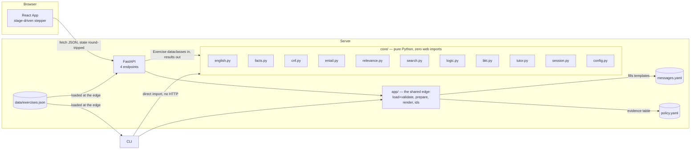

# FACTS — progress report evidence

Facts only. Every number below has its source command or file next to it, so it can be
re-checked rather than taken on trust. No interpretation, no prose — that is the students' job
(`REPORT_OUTLINE.md` has the guiding questions for that).

**Stamp.** Commit `9d5b0bf022ea16633ed1a955a5db6ac517904f84` (short `9d5b0bf`), generated
2026-10-12. Source: `git rev-parse HEAD`.

---

## 1. Repository

- **URL:** `https://github.com/ujwal2311/proofpilot.git` — source: `git remote get-url origin`.
- **Latest commit:** `9d5b0bf022ea16633ed1a955a5db6ac517904f84`, 2026-10-12 20:33:23 +0530 —
  source: `git log -1`.
- **Total commits:** 70 — source: `git log --format=%H | wc -l`.

### CI (last 20 runs, all on `main`)

Source: `gh run list --branch main --limit 20`, run 2026-10-12.

| Status | Workflow | Run | Duration | Pushed |
|---|---|---|---|---|
| success | tests | 38267441881 | 2m19s | 2026-10-12T15:03:35Z |
| success | tests | 38229045152 | 2m21s | 2026-10-12T09:18:31Z |
| success | tests | 38228266890 | 2m13s | 2026-10-12T09:11:21Z |
| success | tests | 38227751028 | 2m22s | 2026-10-12T09:06:30Z |
| success | tests | 38227697393 | 2m22s | 2026-10-12T09:06:01Z |
| success | tests | 38227371069 | 2m21s | 2026-10-12T09:02:55Z |
| success | tests | 38226151523 | 2m21s | 2026-10-12T08:51:18Z |
| success | tests | 38225417378 | 2m24s | 2026-10-12T08:44:22Z |
| success | tests | 38225150713 | 2m20s | 2026-10-12T08:41:48Z |
| success | tests | 38223063315 | 2m24s | 2026-10-12T08:21:22Z |
| success | tests | 38222974467 | 2m23s | 2026-10-12T08:20:29Z |
| success | tests | 38157752704 | 2m25s | 2026-10-11T16:59:33Z |
| success | tests | 38156151768 | 2m22s | 2026-10-11T16:36:11Z |
| success | tests | 38154411687 | 1m37s | 2026-10-11T16:11:24Z |
| success | tests | 38142374743 | 2m18s | 2026-10-11T13:14:19Z |
| success | tests | 38132161577 | 2m22s | 2026-10-11T10:30:04Z |
| success | tests | 38131360204 | 1m43s | 2026-10-11T10:16:27Z |
| success | tests | 38126689577 | 2m15s | 2026-10-11T08:58:19Z |
| success | tests | 38126532525 | 1m35s | 2026-10-11T08:55:37Z |
| success | tests | 38124983064 | 1m33s | 2026-10-11T08:29:34Z |

**20/20 of the last 20 runs succeeded.** Re-run: `gh run list --branch main --limit 20`.

---

## 2. What is built

Source: `ls backend/src/core backend/src/app backend/src/api frontend/src` plus `docs/HLD.md`
§4's module table, read 2026-10-12.

### `backend/src/core/` — pure Python, zero web imports (M1 complete)

| Module | Status |
|---|---|
| `english.py` | built |
| `facts.py` | built |
| `cnf.py` | built |
| `entail.py` | built |
| `relevance.py` | built |
| `search.py` | built |
| `logic.py` | built |
| `bkt.py` | built |
| `tutor.py` | built |
| `session.py` | built |
| `config.py` | built |
| `models.py` | built |
| `translation.py` (M2) | **NOT BUILT** — file does not exist |
| `narrate.py` (M2) | **NOT BUILT** — file does not exist |

### `backend/src/app/` — the shared edge (M1 complete)

`data.py`, `render.py`, `view.py`, `audit.py`, `__init__.py` — all built.

### `backend/src/api/` and CLI (M1 complete)

`main.py`, `schemas.py` built. `backend/src/cli.py` built (the HARD GATE: a full practice
session plays with no web layer, per `docs/HLD.md` §4).

### `frontend/src/` (M1 complete, M2 not started)

`App.jsx`, `ReadFacts.jsx`, `ProveBoard.jsx`, `Explanation.jsx`, `Feedback.jsx`,
`MasteryBars.jsx`, `api.js`, `labels.js`, `storage.js`, `useSession.js`, `main.jsx`, `index.css`
— all built (Read & Facts, Prove, Explanation stages). No `Translate` stage component exists.

**M2 status: not started.** `core/translation.py`, `core/narrate.py`, the API's `translate`
action handler (currently `raise NotImplementedUntilM2` in `backend/src/api/main.py`), and the
frontend's Translate stage are all unbuilt. Source: file listing above plus
`grep NotImplementedUntilM2 backend/src/api/main.py`.

---

## 3. Tests

Source: `python -m pytest backend/tests -q`, run 2026-10-12.

```
804 passed, 1 skipped in 22.62s
```

The 1 skip is `backend/tests/test_search_budget.py`'s 400-case production-budget sweep, which
only runs with `PROOFPILOT_SLOW=1` set (it was run and passed earlier in this sprint — see
`AI_USAGE_LOG.md`, block S8 — but is skipped by default because the suite runs on every push).

---

## 4. Mutation testing

Source: `docs/experiments/mutation_log.md`. **This table reflects Phase 6a (2026-10-11,
commit `f1eaf28`) — the last point mutation testing was run.** Modules built since then in
sprint blocks S1–S8 (`tutor.py`'s S2 rewrite, `session.py`, the API, the frontend, the pilot
tooling) have **not** been mutation-tested; that is scheduled for sprint block S9, not yet run.

| Module | Mutants | Caught |
|---|---|---|
| `bkt.py` | 10 | 10 |
| `cnf.py` | 15 | 15 |
| `english.py` | 10 | 10 |
| `entail.py` | 10 | 10 |
| `facts.py` | 10 | 10 |
| `logic.py` | 7 | 7 |
| `models.py` | 2 | 2 |
| `relevance.py` | 8 | 8 |
| `search.py` | 10 | 10 |
| **Total (as of Phase 6a)** | **82** | **82** |

Regenerate: `python tools/mutate.py` (see `docs/experiments/mutation_log.md` for the isolation
method — mutations are applied only inside a detached git worktree, never to the real files).

---

## 5. Differential testing

Source: `docs/experiments/differential.md`.

**Agreement rate: 940 / 940 = 100%.** Truth-table entailment and resolution-closure refutation
existence were compared on 940 generated cases (D1: 200+360 cases across 4 seeds; D2: 200 cases;
D3: 180 cases) and never disagreed. Regenerate: `python -m pytest backend/tests/test_differential.py -q -s`.

---

## 6. Simulation (BKT stopping rule vs. a fixed-length baseline)

Source: `docs/results_simulation.csv`, generated by `python scripts/run_experiments.py --write`,
commit `8b76db3`, seed `20261012`, N=500 simulated learners per arm.

| policy | premature-release % | mean exercises | mean over-practice |
|---|---|---|---|
| baseline (fixed-N) | 21.00 | 8.00 | 4.45 |
| adaptive-matched | 2.60 | 7.57 | 2.67 |
| adaptive-mismatched | 4.80 | 11.51 | 3.78 |

Graph: `docs/results.png`. CSV: `docs/results_simulation.csv`. Full table with hint-soundness
and search-cost results: `docs/experiments/run_experiments.md`.

**Caveats, stated exactly as the script and design record them — do not drop these when citing
the numbers:**

- **The adaptive-mismatched arm uses MORE exercises than the baseline (11.51 vs 8.00) and is
  NOT budget-matched to it.** Only `adaptive-matched`'s mean (7.57) was used to set the
  baseline's fixed N=8. The correct claim about the mismatched arm is: *it still keeps
  premature release low (4.8%) at roughly 50% more practice than the matched arm* — not that it
  beats the baseline at an equal budget, because no such equal-budget comparison was run for it.
- **"The simulation tests only the stopping rule under the model's own assumptions"** — HLD §14
  item 9, verbatim. It is not evidence that students learn more; the mismatched arm partly
  mitigates this but does not remove it.
- One BKT-tracked skill is simulated per learner, not three, because the three real skills
  (CLASH, RESOLVE, STRATEGY) update independently under identical dynamics — see
  `scripts/run_experiments.py`'s module docstring for the argument.
- The mismatched arm's "true" slip/transit parameters are a **labelled design decision**, not a
  fit to any real data (`MISMATCH_SLIP`, `MISMATCH_TRANSIT` in `scripts/run_experiments.py`).

---

## 7. Search latency

Source: `docs/experiments/search_latency.md`. Machine: Intel64 Family 6 Model 154, Windows 11,
CPython 3.12.10. Measured 2026-10-10, commit `f651d3b`, budget `MAX_SEARCH_WORK = 60,000`.

| Proof length | Clauses | Work units | Wall time | Hint |
|---|---|---|---|---|
| 3 | 6 | 28 | 0.3 ms | yes |
| 4 | 7 | 167 | 1.6 ms | yes |
| 5 | 8 | 1,051 | 12.7 ms | yes — deepest proof in the bank |
| 6 | 9 | 6,921 | 88 ms | yes |
| 7 | 10 | 47,305 | 691 ms | yes — deepest the budget answers |
| 8 | 11 | 60,000 (exhausted) | 835 ms | no — rule-based fallback |

| Workload | p50 | p95 | max |
|---|---|---|---|
| Bank worst case (8 clauses, 5-step proof), 15 runs | 11.0 ms | 11.7 ms | 11.7 ms |
| Own-question worst case (10 clauses, 7-step proof), 5 runs | 582.8 ms | 585.4 ms | 586.3 ms |
| Random sweep, bank shape, 200 cases | 0.10 ms | 624.87 ms | 1,766.28 ms |
| Random sweep, own shape, 200 cases | 2.18 ms | 816.28 ms | 1,573.46 ms |

Work grows ≈7× per proof step (not a budget artifact — BFS over clause *sets*). Regenerate:
`python -m pytest backend/tests/test_search_budget.py -q -s` (add `PROOFPILOT_SLOW=1` for the
full sweep).

---

## 8. Evaluation sets and pilot

- **`data/eval/tfl_simple_tier_15.json`** — exists, valid JSON, **15 items** (source:
  `python -c "import json; print(len(json.load(open('data/eval/tfl_simple_tier_15.json'))))"`
  → `15`). Each item's `"source"` field reads `"AI-generated (Claude)"`.
- **`data/eval/tfl_stress_set_15.json`** — exists, valid JSON, **15 items** (same check → `15`).
  Each item's `"source"` field also reads `"AI-generated (Claude)"`.
- **Neither file is tracked by git** (`git status --short data/eval/` → `?? data/eval/`) **and
  no script in the repository reads them** (`grep -rl "data/eval" --include="*.py" .` →
  no matches). They are **NOT YET WIRED** to any evaluation script. `scripts/heldout_eval.py`
  (built, S8) reads a *different* file, `data/heldout_paragraphs.json`, which **does not exist
  yet** — it is written by the student and classmates after the parser is frozen, never by
  Claude (CLAUDE.md rule 6).
- **T1 (held-out parser generalisation): NOT YET RUN.** `scripts/heldout_eval.py` reports
  "Not yet run" honestly when the input file is absent — verified by running it:
  `python scripts/heldout_eval.py` → prints exactly that, no fabricated numbers.
- **Pilot (E5): NOT YET RUN.** `docs/pilot/template.csv` has a header row only, no participant
  rows. The results file `analyze_pilot.py --write` would produce does not exist yet.
  `scripts/analyze_pilot.py` reports `N = 0 participants` when run against the empty template —
  verified by running it.

---

## 9. Architecture



Source: `docs/HLD.md` §4 (M2-only nodes `translation.py`/`narrate.py` and
`heldout_paragraphs.json` omitted above since they are not built/not present).

### Module responsibilities, one line each

Source: `docs/HLD.md` §4's module table.

| Module | Owns |
|---|---|
| `core/english.py` | Normalize, tokenize, keyword scan, parse → AST, the 7 error codes |
| `core/facts.py` | Embedded-negation extraction, normalization, canonical keys, symbol assignment, manual merges |
| `core/cnf.py` | AST → clauses via the textbook 3-step algorithm |
| `core/entail.py` | Truth-table entailment, inconsistency, counterexample row |
| `core/relevance.py` | Fact-graph BFS; which clauses are needed |
| `core/search.py` | Exact BFS distance, best next step, productivity, work budget, fallback hint |
| `core/logic.py` | Literal normalization, resolvents, 6-code step diagnosis |
| `core/bkt.py` | Single-skill Bayesian update, parameter validation, the done check |
| `core/tutor.py` | Policy: stage×action transition table, evidence mapping, hint ladders, next-exercise selection |
| `core/session.py` | Mechanics: the pipeline (`analyse`), and every edit to a `State` |
| `core/config.py` | Every numeric limit and seed, as named constants |
| `core/models.py` | The dataclasses crossing the edge↔core boundary |
| `app/data.py` | The only module that reads a data file; validates each at startup |
| `app/render.py` | Code → wording, filling a `messages.yaml` template |
| `app/view.py` | The board's clause ids, assigned once and stable |
| `app/__init__.py` | `Runtime.load()` and `prepare()`, the single text entry point every adapter calls |
| `api/main.py`, `api/schemas.py` | Thin HTTP adapter: parse a body, call `app`, return JSON |
| `cli.py` | Thin terminal adapter: read a line, call `app`, print — the HARD GATE |
| `frontend/src` | Render, post actions, persist to localStorage |

### Pipeline ordering

Source: `docs/HLD.md` §7, verbatim. **This is a 6-stage ordering, not 9** — if the assignment
brief specifies a 9-stage pipeline, that does not match anything in the frozen design
(`docs/HLD.md` v2.11) or the code, and the students should clarify the brief rather than this
document inventing a 9th stage to match it:

```
parse → facts → consistency → entailment → relevance → proof
```

`test_pipeline_order_enforced` asserts `relevance` and `search` raise if invoked before
consistency/entailment are resolved.

### Syllabus-unit mapping

Source: `README.md` (verbatim): "Unit 2 Search (BFS), Unit 4 Logic (resolution, refutation),
Unit 5 Uncertainty (Bayes' rule, BKT)."

### Known limitations

Source: `docs/HLD.md` §14, verbatim (all 11 items, including 7b):

1. The grammar is flat. No connective may nest inside another: *"If A then (B and if C then
   D)"* is unsupported. Write it as two sentences.
2. A connective word inside a fact phrase cannot be detected. *"We sell bread and butter"*
   parses as `bread ∧ butter` — two bogus facts — because the parser cannot know "bread and
   butter" is one noun phrase without a lexicon, which would be topic-specific knowledge and is
   banned by the no-hardcoding principle. The Facts confirmation screen is the explicit safety
   net: every fact the system extracted is shown to the user before any proving begins, so a
   mis-split is visible, not silent. `test_connective_inside_fact_mis_splits_visibly` pins this
   behaviour so it can never regress into something worse (a silent wrong answer).
3. Fact matching misses synonyms and antonyms with no shared stems (*"cancelled"* vs *"goes
   ahead"*) unless the user merges them manually.
4. The suffix stripper is naive: no double-consonant handling (*"running"* → `runn` vs *"runs"*
   → `run`, a missed merge) and `-es` before `-s` can leave short irregulars unstemmed
   (*"goes"* → `goes` vs *"go"* → `go`). Missed merges only — never a false merge.
5. Tense is deliberately collapsed (*"the bus came"* ≡ *"the bus comes"*), consistent with tense
   reasoning being out of scope.
6. `"Only if B, A"` is rejected, not interpreted.
7. SOS-free search means own-question paragraphs well beyond 7 relevant clauses fall back to a
   rule-based hint labelled "a suggestion, not necessarily the best step".
7b. Hints run out at proof depth 8 (measured). Search explores clause *sets*, so its cost grows
    ≈7× per proof step: 1,051 work units for a 5-step proof, 47,305 for 7, past the budget at 8.
    An own question needing eight or more resolution steps gets the rule-based fallback instead
    of the best step. This is a property of BFS over sets, not of the budget. Bank exercises are
    unaffected: the deepest proof the bank contains is 5 steps, which leaves ~57× headroom.
8. BKT parameters are assumed, not fitted; `g,s < 0.5` individually is not enforced beyond the
   required `g+s < 1`.
9. The simulation tests only the stopping rule under the model's own assumptions — it is not
   evidence that students learn more.
10. Held-out results are reported as first-run numbers, including bad ones.

### Screenshots

**NOT AVAILABLE.** `docs/screenshots/` does not exist, and this task is restricted to writing
only under `docs/report/`, so no screenshot files were created here. The frontend was verified
live in a browser during sprint block S5 (see `AI_USAGE_LOG.md`); the students should capture
screenshots of the following screens themselves by running the app (`README.md`'s quick start):
the Facts confirmation screen with multiple phrases under one symbol, the Prove board mid-proof
with a named mistake (e.g. `NO_CLASH`) displayed, the Explanation panel after a solved proof, and
(if the pilot has run) the Pilot ID field and a `FACTS_CONFIRMED`/`MERGE_RESET` banner.
