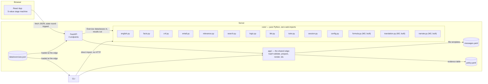

# FACTS — progress report evidence

Facts only. Every number below has its source command or file next to it, so it can be
re-checked rather than taken on trust. No interpretation, no prose — that is the students' job
(`REPORT_OUTLINE.md` has the guiding questions for that).

**Stamp.** Local working commit `e0b3acab1f1985eeaca49b128f70dd6f0d5fc97f` (short `e0b3aca`),
generated 2026-10-25. Source: `git rev-parse HEAD`. **Pushed and CI-verified** — commit `e0b3aca`
is the tip of `origin/main` as of this stamp (`gh run list` confirms a green run against it).
Every number in this file was measured against this exact commit.

---

## 1. Repository

- **URL:** `https://github.com/ujwal2311/proofpilot.git` — source: `git remote get-url origin`.
- **Latest local commit:** `e0b3acab1f1985eeaca49b128f70dd6f0d5fc97f`, 2026-10-25 21:00:43 +0530 —
  source: `git log -1`.
- **Latest pushed/CI-verified commit:** `e0b3aca`, same commit — fully in sync.
- **Total commits:** 95 — source: `git log --format=%H | wc -l`.

### CI (last 20 pushed runs, all on `main`)

Source: `gh run list --branch main --limit 20`, run 2026-10-25.

| Status | Workflow | Run | Pushed |
|---|---|---|---|
| success | tests | 40209116142 | 2026-10-25T15:54:02Z |
| success | tests | 40205800253 | 2026-10-25T15:12:00Z |
| success | tests | 40176077053 | 2026-10-25T08:18:11Z |
| success | tests | 40170203521 | 2026-10-25T06:45:01Z |
| success | tests | 40168197104 | 2026-10-25T06:11:02Z |
| success | tests | 40122677467 | 2026-10-24T18:52:08Z |
| success | tests | 40122398719 | 2026-10-24T18:48:31Z |
| success | tests | 40121969820 | 2026-10-24T18:42:56Z |
| success | tests | 40121617719 | 2026-10-24T18:38:21Z |
| success | tests | 40121000927 | 2026-10-24T18:30:18Z |
| success | tests | 40119498026 | 2026-10-24T18:10:40Z |
| **failure** | tests | 40008592562 | 2026-10-23T19:05:10Z |
| **failure** | tests | 40000223858 | 2026-10-23T18:03:55Z |
| **failure** | tests | 39998457963 | 2026-10-23T17:51:06Z |
| success | tests | 38267441881 | 2026-10-12T15:03:35Z |
| success | tests | 38229045152 | 2026-10-12T09:18:31Z |
| success | tests | 38228266890 | 2026-10-12T09:11:21Z |
| success | tests | 38227751028 | 2026-10-12T09:06:30Z |
| success | tests | 38227697393 | 2026-10-12T09:06:01Z |
| success | tests | 38227371069 | 2026-10-12T09:02:55Z |

**17/20 succeeded; 3 failures, consecutive, 2026-10-23** (same 3 historical failures still inside
the 20-run window; every run since, including all of tonight's 5 pushes, is green). Root cause
of the 3 failures (found and fixed 2026-10-24): `data/eval/tfl_simple_tier_15.json` and
`tfl_stress_set_15.json` were referenced by `docs/report/CONTRIBUTION_TEMPLATE.md`/`FACTS.md` but
never committed to git, so every fresh CI checkout failed
`test_no_doc_or_workflow_points_at_a_file_that_does_not_exist`. Fixed by committing the two files
(commit `d090e8f`). Re-run: `gh run list --branch main --limit 20`.

---

## 2. What is built

Source: `ls backend/src/core backend/src/app backend/src/api frontend/src`, read 2026-10-25.

### `backend/src/core/` — pure Python, zero web imports

| Module | Status | Milestone |
|---|---|---|
| `english.py` | built (+ 2026-10-25: 8 new grammar phrases — `is necessary for`, `is sufficient for`, `implies`, `not both...and...`, `whenever`, `provided that`, `given that`, `, otherwise`) | M1 |
| `facts.py` | built | M1 |
| `cnf.py` | built | M1 |
| `entail.py` | built | M1 |
| `relevance.py` | built | M1 |
| `search.py` | built | M1 |
| `logic.py` | built | M1 |
| `bkt.py` | built | M1 |
| `tutor.py` | built | M1 (+ v2.12: `translate_trigger`, the universal Translate routing) |
| `session.py` | built | M1 (+ v2.12: `record_translation`, the "nothing to translate" skip in `enter_stage`) |
| `config.py` | built | M1 |
| `models.py` | built | M1 |
| `formula.py` | **built** (S6, 2026-10-24) | M2 |
| `translation.py` | **built** (S6, 2026-10-24) | M2 |
| `narrate.py` | **built** (S6, 2026-10-24) | M2 |

### `backend/src/app/` — the shared edge

`data.py`, `view.py`, `audit.py`, `__init__.py` — built, unchanged tonight. `render.py` — built,
gained `clause_english()`/`clause_english_map()` tonight (2026-10-25): renders a board clause's
literals as the student's own confirmed phrases, wired as a `clause_english` field alongside
`state` in every `/api/next`, `/api/parse` and `/api/act` response.

### `backend/src/api/` and CLI

`main.py`, `schemas.py` built. `backend/src/cli.py` built (the HARD GATE: a full practice
session plays with no web layer, per `docs/HLD.md` §4). `api/main.py`'s `translate` action
handler is **still a stub** — `grep NotImplementedUntilM2 backend/src/api/main.py` → 3 matches
(the exception class, its raise site, its status-code mapping). Deliberately deferred; see §2a.

### `frontend/src/` (M1 complete, M2 not started)

`App.jsx`, `ReadFacts.jsx`, `ProveBoard.jsx`, `Explanation.jsx`, `Feedback.jsx`,
`MasteryBars.jsx`, `StartScreen.jsx`, `api.js`, `labels.js`, `storage.js`, `useSession.js`,
`main.jsx`, `index.css` — all built (Read & Facts, Prove, Explanation screens). No
`TranslateStep.jsx` exists. **Added 2026-10-25:** a symbol legend and per-clause plain-English
sidebar on the Prove screen (reusing `state.facts`/`clause_english`, no new backend data model);
all three stage tabs are now independently clickable (view-only, never calls the API — a past
stage renders read-only, a not-yet-reached stage shows a placeholder); a `← Back` button beside
the tabs steps back one stage at a time through the same view-only path.

### 2a. M2 status — the honest middle ground

`core/formula.py`, `core/translation.py`, `core/narrate.py` are built and unit-tested (6/6/3
mutants caught each, §4 below). `core/tutor.py`'s `translate_trigger` (evidence-mapping dispatch)
and `core/session.py`'s `record_translation` (the attempt record) are built. The stage machine
now routes every exercise through `"translate"` universally (`docs/HLD.md` v2.12).

**What is NOT built, by explicit, recorded decision (not an oversight):** a reference-formula
renderer (there is no way to recover a sentence's reference formula from `State` alone — it is
never populated and the API is stateless across requests), the six `messages.yaml` diagnosis
entries, `app/render.py`'s translate method, `api/main.py`'s real `_translate` handler, and
`frontend/src/TranslateStep.jsx`. Until that lands, `session.enter_stage` treats every exercise
as having nothing to translate (`SentenceRec.formula` is `None` everywhere, always, today) and
skips straight through to `"prove"` — which reproduces pre-v2.12 behaviour exactly, not a hack.
See `docs/HLD.md`'s v2.12 change-log entry for the budget reason the renderer was deferred
(`core_session` would cross its cap; `api_cli` is already over its *ceiling*).

---

## 3. Tests

Source: `python -m pytest backend/tests -q`, run 2026-10-25 against commit `e0b3aca`.

```
864 passed, 1 skipped in ~31s
```

Confirmed under `PYTHONHASHSEED=0` and `PYTHONHASHSEED=4242` — same count, same result, both
runs today. Up from 842 at the last stamp: new tests tonight cover the 8 new grammar phrases
(`test_english.py`), the new `backend/tests/test_render.py` (clause-to-English rendering),
`clause_english` wired end-to-end in `test_api.py`, and one more the dead-reference guard's own
dynamic collection picked up for this file's new sibling, `docs/report/demo_paragraphs.md`. The 1
skip is `test_search_budget.py`'s 400-case production-budget sweep, which only runs with
`PROOFPILOT_SLOW=1` (CI's dedicated `slow` job sets it and passes with nothing skipped — see
`.github/workflows/ci.yml`).

`ruff check .` and `ruff format --check .`: both clean, run 2026-10-25.

---

## 4. Mutation testing

Source: `docs/experiments/mutation_log.md`. Two scopes, each labelled with the suite size it ran
against — do not add the totals together, they are different modules at different suite sizes.

**Phase 6a, 2026-10-11, commit `f1eaf28`, suite of 416 tests:**

| Module | Mutants | Caught |
|---|---|---|
| `bkt.py` | 10 | 10 |
| `cnf.py` | 15 | 15 |
| `english.py` | 10 | 10 |
| `entail.py` | 10 | 10 |
| `facts.py` | 10 | 10 |
| `logic.py` | 7 | 7 |
| `models.py` | 2 | 2 |
| `relevance.py` | 8 | 8 |
| `search.py` | 10 | 10 |
| **Subtotal** | **82** | **82** |

**S11, 2026-10-25, commit `fef68ba`, suite of 842 tests — every module built since Phase 6a with
no score on record, run for the first time:**

| Module | Mutants | Caught |
|---|---|---|
| `session.py` | 12 | 12 |
| `tutor.py` | 14 | 14 |
| `config.py` | 2 | 2 |
| `formula.py` | 6 | 6 |
| `translation.py` | 6 | 6 |
| `narrate.py` | 3 | 3 |
| **Subtotal** | **43** | **43** |

Two genuine survivors were found and fixed by adding a missing test each (never by excusing the
gap or weakening a mutant) — `translation.py`'s TR6 (a fallback path with no test at all) and
`narrate.py`'s N1+N2 (the module's whole purpose — distinguishing given/goal/derived wording —
was untested). Detail in `docs/experiments/mutation_log.md`.

Regenerate: `python tools/mutate.py` (isolation method — a detached `git worktree`, never the
real files — documented in `docs/experiments/mutation_log.md`).

---

## 5. Differential testing

Source: `docs/experiments/differential.md`, generated v2.9 (2026-10-09/10), **unchanged tonight**
— `entail.py`, `logic.py` and `search.py` were not touched by this gate's work. Regression-
checked today: `python -m pytest backend/tests/test_differential.py -q -s` → `7 passed`
(D1: 26 entailed / 174 not / 16 inconsistent per-seed sample shown; D2: 200 checked, all dropped
a clause; D3: 180 fully-connected, nothing dropped — see the doc file for the full 940-case
aggregate across all seeds).

**Agreement rate: 940 / 940 = 100%**, as originally generated. No disagreement found then or in
tonight's regression run.

---

## 6. Simulation (BKT stopping rule vs. a fixed-length baseline)

Source: `docs/results_simulation.csv`, generated by `python scripts/run_experiments.py --write`,
commit `8b76db3`, seed `20261012`, N=500 simulated learners per arm. **Unchanged tonight** —
`bkt.py` was not touched by this gate's work.

| policy | premature-release % | mean exercises | mean over-practice |
|---|---|---|---|
| baseline (fixed-N) | 21.00 | 8.00 | 4.45 |
| adaptive-matched | 2.60 | 7.57 | 2.67 |
| adaptive-mismatched | 4.80 | 11.51 | 3.78 |

Graph: `docs/results.png`. CSV: `docs/results_simulation.csv`. Full table with hint-soundness
and search-cost results: `docs/experiments/run_experiments.md`.

**Caveats, stated exactly as the script and design record them — do not drop these when citing
the numbers:**

- **The adaptive-mismatched arm uses MORE exercises than the baseline (11.51 vs 8.00) and is
  NOT budget-matched to it.** Only `adaptive-matched`'s mean (7.57) was used to set the
  baseline's fixed N=8. The correct claim about the mismatched arm is: *it still keeps
  premature release low (4.8%) at roughly 50% more practice than the matched arm* — not that it
  beats the baseline at an equal budget, because no such equal-budget comparison was run for it.
- **"The simulation tests only the stopping rule under the model's own assumptions"** — HLD §14
  item 9, verbatim. It is not evidence that students learn more; the mismatched arm partly
  mitigates this but does not remove it.
- One BKT-tracked skill is simulated per learner, not three, because the three real skills
  (CLASH, RESOLVE, STRATEGY) update independently under identical dynamics — see
  `scripts/run_experiments.py`'s module docstring for the argument.
- The mismatched arm's "true" slip/transit parameters are a **labelled design decision**, not a
  fit to any real data (`MISMATCH_SLIP`, `MISMATCH_TRANSIT` in `scripts/run_experiments.py`).

---

## 7. Search latency

Source: `docs/experiments/search_latency.md`, measured 2026-10-10, commit `f651d3b`. **Unchanged
tonight** — `search.py` was not touched by this gate's work. Machine: Intel64 Family 6 Model 154,
Windows 11, CPython 3.12.10. Budget `MAX_SEARCH_WORK = 60,000`.

| Proof length | Clauses | Work units | Wall time | Hint |
|---|---|---|---|---|
| 3 | 6 | 28 | 0.3 ms | yes |
| 4 | 7 | 167 | 1.6 ms | yes |
| 5 | 8 | 1,051 | 12.7 ms | yes — deepest proof in the bank |
| 6 | 9 | 6,921 | 88 ms | yes |
| 7 | 10 | 47,305 | 691 ms | yes — deepest the budget answers |
| 8 | 11 | 60,000 (exhausted) | 835 ms | no — rule-based fallback |

| Workload | p50 | p95 | max |
|---|---|---|---|
| Bank worst case (8 clauses, 5-step proof), 15 runs | 11.0 ms | 11.7 ms | 11.7 ms |
| Own-question worst case (10 clauses, 7-step proof), 5 runs | 582.8 ms | 585.4 ms | 586.3 ms |
| Random sweep, bank shape, 200 cases | 0.10 ms | 624.87 ms | 1,766.28 ms |
| Random sweep, own shape, 200 cases | 2.18 ms | 816.28 ms | 1,573.46 ms |

Work grows ≈7× per proof step (not a budget artifact — BFS over clause *sets*). Regenerate:
`python -m pytest backend/tests/test_search_budget.py -q -s` (add `PROOFPILOT_SLOW=1` for the
full sweep).

---

## 8. Evaluation sets and pilot

- **`data/eval/tfl_simple_tier_15.json`** — 15 items, `"source": "AI-generated (Claude)"` on
  every item. **Now committed to git and wired** (changed tonight's predecessor gate, S11 Block
  1/4; `git ls-files data/eval/` → both files tracked).
- **`data/eval/tfl_stress_set_15.json`** — 15 items, same source tag. Different schema (no
  `conclusion`/`expected_follows` field — per-sentence translation drills only), so it is not
  scored, only counted.
- **`scripts/ai_eval_tfl.py`** (S11 Block 4) checks the simple tier's `expected_follows` against
  ProofPilot's own entailment pipeline: **15/15 agree**, last run against commit `3b8c5ea` (not
  re-run tonight — `ai_eval_tfl.py` and the modules it exercises were untouched). Report:
  `docs/experiments/ai_eval_tfl.md`. Deliberately a separate script from `scripts/heldout_eval.py`
  — see that script's own docstring for why reusing it would have risked the exact blur CLAUDE.md
  rule 6 warns against.
- **`data/heldout_paragraphs.json` still does not exist** — `ls data/heldout_paragraphs.json` →
  no such file, re-verified 2026-10-25 against commit `e0b3aca`. It is written by the student and
  classmates after the parser is frozen, never by Claude. **T1 (held-out parser generalisation):
  still NOT YET RUN** — `python scripts/heldout_eval.py` → prints "Not yet run".
- **Pilot (E5): still NOT YET RUN.** `docs/pilot/template.csv` has a header row only (`wc -l` →
  1). `python scripts/analyze_pilot.py` → `N = 0 participants`, re-verified 2026-10-25 against
  commit `e0b3aca`.

---

## 9. Architecture



Source: `docs/HLD.md` §4, re-checked against `backend/src/core/` 2026-10-25.
`data/heldout_paragraphs.json` omitted above since it is not present (§8).

### Module responsibilities, one line each

Source: `docs/HLD.md` §4's module table.

| Module | Owns |
|---|---|
| `core/english.py` | Normalize, tokenize, keyword scan, parse → AST, the 7 error codes |
| `core/facts.py` | Embedded-negation extraction, normalization, canonical keys, symbol assignment, manual merges |
| `core/cnf.py` | AST → clauses via the textbook 3-step algorithm |
| `core/entail.py` | Truth-table entailment, inconsistency, counterexample row |
| `core/relevance.py` | Fact-graph BFS; which clauses are needed |
| `core/search.py` | Exact BFS distance, best next step, productivity, work budget, fallback hint |
| `core/logic.py` | Literal normalization, resolvents, 6-code step diagnosis |
| `core/bkt.py` | Single-skill Bayesian update, parameter validation, the done check |
| `core/tutor.py` | Policy: stage×action transition table, evidence mapping (incl. `translate_trigger`), hint ladders, next-exercise selection |
| `core/session.py` | Mechanics: the pipeline (`analyse`), every edit to a `State`, the "nothing to translate" skip |
| `core/config.py` | Every numeric limit and seed, as named constants |
| `core/models.py` | The dataclasses crossing the edge↔core boundary |
| `core/formula.py` | Typed-formula parser and truth-table evaluator (M2) |
| `core/translation.py` | Truth-table equivalence, 3 fixed diagnoses, counterexample (M2) |
| `core/narrate.py` | Finished proof → English prose (M2) |
| `app/data.py` | The only module that reads a data file; validates each at startup |
| `app/render.py` | Code → wording, filling a `messages.yaml` template; clause → the student's own confirmed phrases (`clause_english`) |
| `app/view.py` | The board's clause ids, assigned once and stable |
| `app/__init__.py` | `Runtime.load()` and `prepare()`, the single text entry point every adapter calls |
| `api/main.py`, `api/schemas.py` | Thin HTTP adapter: parse a body, call `app`, return JSON |
| `cli.py` | Thin terminal adapter: read a line, call `app`, print — the HARD GATE |
| `frontend/src` | Render, post actions, persist to localStorage |

### Three numbers that are easy to conflate — keep them separate

Source: `docs/HLD.md` §7 (pipeline) and `core/tutor.py` `STAGES` (verbatim), re-checked
2026-10-25. **If an assignment brief asks for a single "N-stage" number, none of the three below
is a safe default — say which one you mean:**

1. **3 UI screens** the frontend currently renders: Read & Facts, Prove, Explanation. (A fourth,
   Translate, is reachable in the state machine but has no component yet — §2a.)
2. **A 5-value session state machine** (`core/tutor.py` `STAGES`): `read → facts → translate →
   prove → explain`. `translate` is now universal (v2.12), not M2-conditional.
3. **A 6-step internal verification pipeline** (`docs/HLD.md` §7, run once per `/api/parse`
   call, nothing to do with the stage machine above): `parse → facts → consistency → entailment →
   relevance → proof`. `test_pipeline_order_enforced` asserts `relevance` and `search` raise if
   invoked before consistency/entailment are resolved.

### Syllabus-unit mapping

Source: `README.md` (verbatim): "Unit 2 Search (BFS), Unit 4 Logic (resolution, refutation),
Unit 5 Uncertainty (Bayes' rule, BKT)."

### Known limitations

Source: `docs/HLD.md` §14, verbatim (all items, including 7b):

1. The grammar is flat. No connective may nest inside another: *"If A then (B and if C then
   D)"* is unsupported. Write it as two sentences.
2. A connective word inside a fact phrase cannot be detected. *"We sell bread and butter"*
   parses as `bread ∧ butter` — two bogus facts — because the parser cannot know "bread and
   butter" is one noun phrase without a lexicon, which would be topic-specific knowledge and is
   banned by the no-hardcoding principle. The Facts confirmation screen is the explicit safety
   net: every fact the system extracted is shown to the user before any proving begins, so a
   mis-split is visible, not silent. `test_connective_inside_fact_mis_splits_visibly` pins this
   behaviour so it can never regress into something worse (a silent wrong answer).
3. Fact matching misses synonyms and antonyms with no shared stems (*"cancelled"* vs *"goes
   ahead"*) unless the user merges them manually.
4. The suffix stripper is naive: no double-consonant handling (*"running"* → `runn` vs *"runs"*
   → `run`, a missed merge) and `-es` before `-s` can leave short irregulars unstemmed
   (*"goes"* → `goes` vs *"go"* → `go`). Missed merges only — never a false merge.
5. Tense is deliberately collapsed (*"the bus came"* ≡ *"the bus comes"*), consistent with tense
   reasoning being out of scope.
6. `"Only if B, A"` is rejected, not interpreted.
7. SOS-free search means own-question paragraphs well beyond 7 relevant clauses fall back to a
   rule-based hint labelled "a suggestion, not necessarily the best step".
7b. Hints run out at proof depth 8 (measured). Search explores clause *sets*, so its cost grows
    ≈7× per proof step: 1,051 work units for a 5-step proof, 47,305 for 7, past the budget at 8.
    An own question needing eight or more resolution steps gets the rule-based fallback instead
    of the best step. This is a property of BFS over sets, not of the budget. Bank exercises are
    unaffected: the deepest proof the bank contains is 5 steps, which leaves ~57× headroom.
8. BKT parameters are assumed, not fitted; `g,s < 0.5` individually is not enforced beyond the
   required `g+s < 1`.
9. The simulation tests only the stopping rule under the model's own assumptions — it is not
   evidence that students learn more.
10. Held-out results are reported as first-run numbers, including bad ones.
11. **(new, 2026-10-25)** The Translate stage exists in the state machine for every exercise but
    has no real check behind it yet (§2a) — every exercise today is routed straight through to
    Prove. This is not a silent gap: it is recorded as deferred scope in `docs/HLD.md`'s v2.12
    change log, with the budget reason, and `session.enter_stage`'s behaviour is deliberate, not
    a bug.

### Screenshots

**NOT AVAILABLE.** `docs/screenshots/` does not exist, and this task is restricted to writing
only under `docs/report/`, so no screenshot files were created here. The frontend was verified
live in a browser during sprint block S5, and again tonight (2026-10-25) via Playwright against
the real running app for every feature added — the symbol legend, the per-clause English
sidebar, the Back button, and a full combined walkthrough exercising all of it together — but
those screenshots live in a session-scratch temp directory, never committed to the repo. The
students should capture their own screenshots for the report by running the app (`README.md`'s
quick start): the Facts confirmation screen with multiple phrases under one symbol, the Prove
board mid-proof with a named mistake (e.g. `NO_CLASH`) displayed, the Explanation panel after a
solved proof, and (if the pilot has run) the Pilot ID field and a `FACTS_CONFIRMED`/`MERGE_RESET`
banner.
