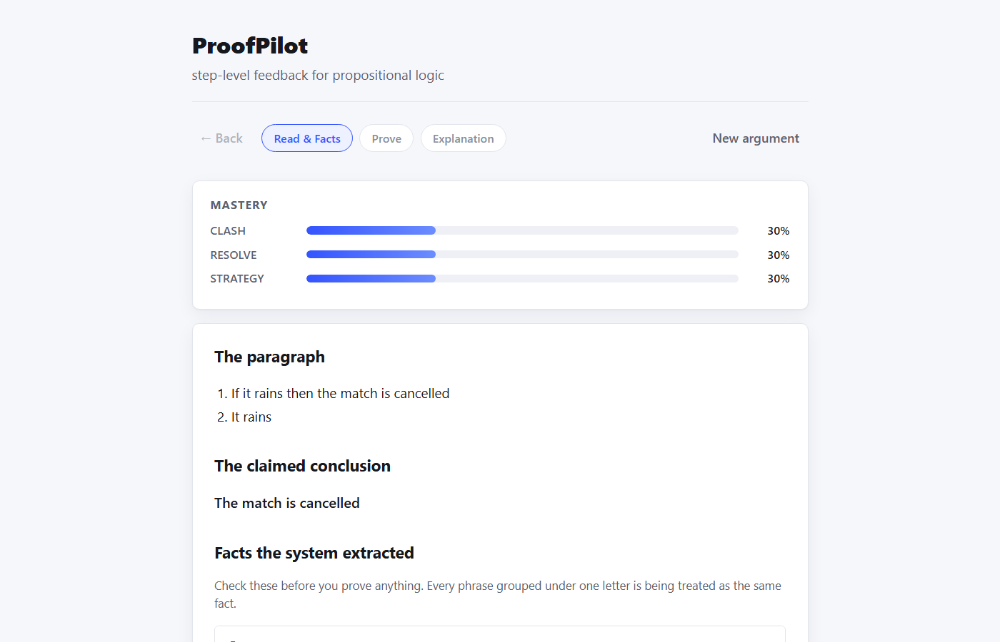
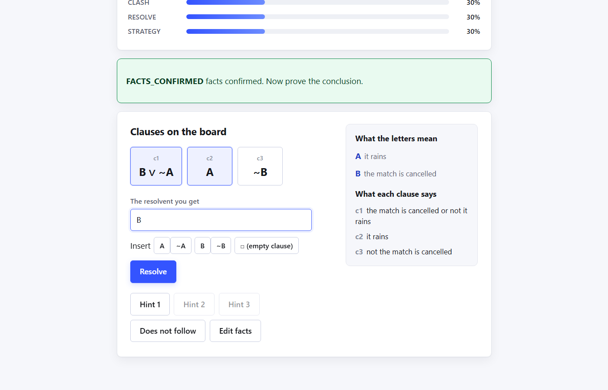
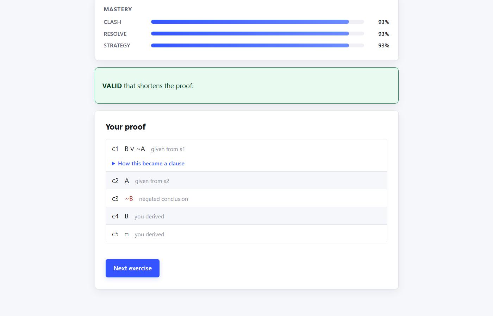

# ProofPilot — Project Report

**Team:** CVS Ujwal (24BCE0667), Keshav Raj (24BCI0306)
**Repository:** https://github.com/ujwal2311/proofpilot
**Stamp:** commit `e0b3acab1f1985eeaca49b128f70dd6f0d5fc97f`, 2026-10-25, pushed and CI-verified.

*AI disclosure: this report was drafted with Claude Code (Sonnet 5), per the team's explicit,
dated authorization recorded in `CLAUDE.md` (2026-10-25) following the professor's in-person
confirmation that AI use is permitted for the full report and presentation, conditional on the
team understanding and being able to explain everything submitted. See `AI_USAGE_LOG.md` for the
full development history and `CONTRIBUTION_TEMPLATE.md` for the AI-disclosure table.*

---

## 1. Problem Statement

Learning propositional logic asks a student to do two genuinely different things in sequence:
translate an English argument into formulas, and then construct a proof that the conclusion
follows from the premises. Almost every existing tool helps with only the second half, and even
then usually only by checking a final typed answer rather than guiding the steps that lead to it.
A student who gets a resolution proof wrong is told "incorrect," not which specific rule they
misapplied, which two clauses do not actually clash, or which premise they forgot to use.

The translation half is arguably the harder failure point in practice: a student who mistranslates
"unless" or gets the direction of an "only if" backwards will carry that error silently into every
subsequent proof step, and a tool that only checks the final proof has no way to catch it. Existing
intelligent tutoring systems for logic (Section 3) either sidestep this by giving the student
already-formalized clauses to work with, or handle translation with much richer natural-language
processing than an undergraduate AI course project can responsibly build and verify.

ProofPilot addresses this by owning both halves honestly, within a bounded scope. It accepts a
short paragraph and a claimed conclusion written in a deliberately controlled subset of English —
documented precisely, not inferred — extracts the facts it found and asks the student to confirm
or correct them before anything else happens, decides by truth table whether the conclusion
actually follows, and then coaches a resolution-refutation proof step by step: every student
move is diagnosed into one of six named outcomes (not just right/wrong), and every hint is
computed by exact breadth-first search over the real clause set rather than a canned response.
A single-skill Bayesian Knowledge Tracing model, run across three tracked skills, decides when the
student has demonstrated enough mastery to stop.

The significance of this scope decision is itself part of the problem the project addresses: a
system that silently guesses at ambiguous English is worse than one that refuses and explains why,
because a wrong guess corrupts every downstream judgment without the student ever knowing. Section
4 reviews how existing systems handle (or avoid) this trade-off, and Section 5 describes exactly
where ProofPilot draws its own line.

## 2. Objectives

1. **Parse a bounded, precisely documented subset of English argument text** into propositional
   formulas, covering the connectives a typical intro-logic course uses (negation, conjunction,
   disjunction, implication, biconditional) across 17 distinct sentence-level phrasings (`core/
   english.py`), refusing — with a named, specific error — any input outside that subset rather
   than guessing at its meaning.
2. **Make every extracted fact visible and correctable before any proof begins**, so a parsing
   mistake is caught by the student, not silently carried forward (`core/facts.py`, the Read &
   Facts screen).
3. **Decide entailment exactly**, by truth-table enumeration, and cross-validate that decision
   against an independent resolution-based refutation check, rather than trusting either method
   alone (`core/entail.py`; differential testing, Section 7).
4. **Diagnose every proof step a student submits into a specific, named outcome** (e.g. no
   complementary pair, more than one pair cancelled, a wrong resulting literal) rather than a
   binary correct/incorrect signal (`core/logic.py`).
5. **Generate a genuinely useful hint on request**, computed by exact breadth-first search over
   the actual clause set with a bounded work budget and a labelled rule-based fallback when the
   budget is exhausted, rather than a static or scripted hint (`core/search.py`).
6. **Track per-skill mastery with Bayesian Knowledge Tracing** and use it to decide both which
   exercise to offer next and when the student has practised enough (`core/bkt.py`).
7. **Verify every one of the above empirically** rather than asserting it: differential agreement
   between the two entailment methods, mutation testing of every core module, measured search
   latency and work-unit growth, and a held-out evaluation of the parser against paragraphs the
   system has never seen (Section 7).

## 3. Literature Review

Twenty-five sources were reviewed (24 distinct citations; one seed citation, Aleven et al. 2006,
resolved to two genuinely different papers by the same first author in the same year — both are
kept and distinguished below). Sources were found and verified by DOI/publisher page
(`docs/report/literature_matrix.csv`, `docs/report/references.md`); nothing here is cited without
having had its title, authors and year confirmed against the publisher record.

### 3.1 Resolution refutation — the algorithmic foundation

Robinson (1965) introduced resolution as a single, complete inference rule for first-order (and,
as the restriction ProofPilot uses, propositional) refutation proofs. This is the exact algorithm
`core/logic.py` and `core/search.py` implement: ProofPilot's proof engine is not an approximation
of Robinson's method, it *is* Robinson's method, specialized to propositional CNF with an exact
breadth-first search over reachable clause sets rather than the general unification machinery
first-order resolution requires. Russell and Norvig's (2020) standard AI textbook is the course
reference for this material and for the breadth-first search ProofPilot's hint engine uses
(syllabus Units 2 and 4).

### 3.2 Bayesian Knowledge Tracing — the mastery model

Corbett and Anderson (1995) introduced Bayesian Knowledge Tracing (BKT) itself: a two-parameter
(guess, slip) Bayesian update of a hidden per-skill mastery estimate from a sequence of
right/wrong observations. `core/bkt.py` implements exactly this classical, single-skill form
across three tracked skills (CLASH, RESOLVE, STRATEGY). The subsequent BKT literature is largely a
story of proposed refinements ProofPilot deliberately did *not* adopt, each for a stated reason:
Baker et al. (2008) propose contextual, per-student estimation of slip and guess instead of one
global constant; Pardos and Heffernan (2010) individualize the prior-knowledge parameter per
student; Pavlik et al. (2009) replace BKT with logistic regression over success/failure counts
(Performance Factors Analysis); Piech et al. (2015) replace it with a recurrent neural network
(Deep Knowledge Tracing) trained directly on interaction logs, with no hand-encoded skill
structure at all. ProofPilot's classical, fixed-parameter BKT is a stated simplification relative
to all four of these, justified by interpretability and by Khajah et al.'s (2016) finding that
classical BKT extended with simple recency/inter-skill features matches deep knowledge tracing's
predictive performance on the benchmarks they tested — i.e. the gap a neural model closes is not
obviously worth the loss of interpretability for a system whose whole premise is explaining *why*
a judgment was made. Pelanek (2017) surveys the wider family these approaches sit inside.

### 3.3 Why a step-level tutor at all — the case for formative, process-level feedback

Bloom's (1984) "2 sigma" result — one-to-one tutored students outperforming conventionally taught
students by roughly two standard deviations — is the classical motivation for building any
automated tutor as a scalable approximation of individual attention. VanLehn (2011) and Kulik and
Fletcher (2016) both report meta-analytic evidence that intelligent tutoring systems recover a
substantial fraction of that effect (VanLehn: d≈0.76 for ITS vs. d≈0.79 for human tutors; Kulik
and Fletcher: a median 0.66 SD gain over conventional instruction across 50 controlled studies),
though Ma et al. (2014) caution that effect sizes vary considerably by whether the target skill is
procedural or declarative — directly relevant to ProofPilot, since resolution proof construction
is specifically procedural. VanLehn's (2006) inner-loop/outer-loop framework for tutoring systems
maps directly onto ProofPilot's architecture: the hint ladder and step diagnosis are the inner
loop (feedback within one exercise), and BKT-driven exercise selection is the outer loop (which
task to offer next).

On *why* step-level feedback specifically, rather than a final grade: Black and Wiliam (1998) and
Hattie and Timperley (2007) both argue, from classroom-study and feedback-model evidence
respectively, that frequent, specific, process-level feedback produces larger learning gains than
infrequent summative grading. Shute (2008) synthesizes this into four properties effective
formative feedback should have — nonevaluative, supportive, timely, specific — which is close to a
direct specification of ProofPilot's named-outcome step diagnosis (e.g. `NO_CLASH`) over a bare
right/wrong grade. Brown and Burton's (1978) BUGGY system is the classical precedent for diagnosing
a *specific* procedural misconception rather than only flagging an answer as wrong, in their case
for arithmetic; ProofPilot's resolution-mistake codes are a direct descendant of that idea applied
to logic proofs instead of arithmetic.

### 3.4 Automated hint generation in logic tutors specifically

Two papers sit in exactly ProofPilot's problem space. Barnes and Stamper (2008) propose generating
hints for a logic-proof tutor from a Markov decision process fit to historical student attempt
data; Stamper et al. (2013) report a controlled evaluation of that approach, finding that
automatically generated hints helped students persist through a deductive logic tutor. ProofPilot's
hints differ in kind, not just degree: they are derived by exact search over the actual clause set
and the rules of resolution, not mined from prior students' data, so they require no historical
corpus and are provably sound for the specific exercise in front of the student — at the cost of
the combinatorial growth in search cost Section 7 measures directly (work grows roughly
sevenfold per additional proof step).

### 3.5 Open (student-visible) learner models

Bull and Kay (2007) propose the SMILI framework for describing and comparing *open* learner
models — models the student can see, not just ones used internally to drive the system. ProofPilot's
`MasteryBars` component, which shows the student their own live per-skill mastery percentages
rather than hiding that number, is an instance of exactly this design category.

### 3.6 Gaming-the-system and help-seeking behaviour

Baker et al. (2004) propose log-based methods for detecting when a student is gaming a tutoring
system — e.g. systematically guessing rather than engaging — and Aleven et al. (2006a) propose a
cognitive-tutor model for judging appropriate help-seeking behaviour (distinguishing unproductive
guessing from productive hint requests). ProofPilot's "never guess" design principle, and the
mastery penalty attached to every hint request, are aimed directly at the failure mode both papers
study: a student who clicks through hints to reach the answer without engaging should not be
scored as if they demonstrated mastery. Aleven et al. (2006b), the second paper the same seed
citation resolved to, is a preliminary efficiency evaluation of the Cognitive Tutor Authoring
Tools (CTAT) toolkit — a different contribution from the same lead author in the same year — and
is retained as a distinct, separately-verified reference rather than conflated with 2006a.

### 3.7 Background theory

Doignon and Falmagne (1999) provide the formal mathematical theory of knowledge spaces and
feasible knowledge-state orderings, relevant as background theory for how ProofPilot's
exercise-selection and mastery-threshold design relate to formally structured models of what a
learner can plausibly know next, though ProofPilot itself does not implement knowledge-space
theory directly.

### 3.8 Research gap this project addresses

No source reviewed combines all three of: (a) exact, verifiable resolution-based proof checking
and hint generation (as opposed to data-mined or heuristic hints), (b) a *controlled-English*
front end that translates a student's own natural-language argument into the formulas being
proved, with that translation itself checked against formulas the student confirms, and (c) a
classical, interpretable Bayesian Knowledge Tracing layer deciding progression. Barnes and
Stamper's and Stamper et al.'s systems address hint generation for logic proofs but start from
already-formalized input; the BKT literature (3.2) addresses mastery tracking in isolation from
any specific proof domain; VanLehn's and Brown and Burton's frameworks describe *what* good
tutoring feedback should look like without specifying a verifiable method for a logic-proof
domain specifically. ProofPilot's contribution is combining (a)–(c) in one small, fully verifiable
system, at the cost of a narrow, explicitly documented input grammar rather than general natural
language.

## 4. Limitations of Existing Systems

Synthesizing the gaps the literature review above surfaces, three limitations recur across the
systems reviewed:

1. **Translation is usually assumed away.** Barnes and Stamper (2008) and Stamper et al.'s (2013)
   logic-tutor hint systems, and the general ITS literature (VanLehn, 2006, 2011), overwhelmingly
   start from an already-formalized problem — the student manipulates given clauses or formulas
   rather than translating their own natural-language argument into them. This sidesteps exactly
   the failure mode Section 1 identifies as the harder one in practice: a mistranslation that
   silently corrupts every downstream proof step.
2. **Mastery models and domain-specific proof checking are developed in separate literatures.**
   The BKT refinements reviewed in 3.2 (contextual parameters, individualization, neural
   alternatives) are evaluated on general tutoring-log data, not on a resolution-proof domain
   specifically; the logic-tutor hint papers (3.4) do not engage with mastery tracking or exercise
   selection at all. No single system in the reviewed set demonstrates both halves working
   together end-to-end on the same domain.
3. **Where natural language is accepted, "understanding" is typically not precisely bounded or
   disclosed.** The ITS effectiveness meta-analyses (VanLehn, 2011; Kulik & Fletcher, 2016; Ma et
   al., 2014) report on systems broadly, without the reviewed literature specifying, for the
   logic-tutoring subset, exactly which English constructions a given system accepts versus
   silently mishandles. A system that cannot state its own limits precisely cannot be trusted not
   to guess.

ProofPilot's scope decisions (Section 5) respond directly to each of these: it owns translation
rather than assuming it away, it couples BKT to the exact same proof-checking domain it tracks
mastery for, and it documents its supported grammar as a precise, testable specification (17
sentence-level productions, `core/english.py`, `docs/HLD.md` §3) with a named refusal for anything
outside it — the opposite of silent, undisclosed guessing.

## 5. Proposed Methodology / Model

### 5.1 Architecture

```
React frontend (3 screens: Read & Facts, Prove, Explanation)
        | fetch JSON, full session state round-tripped every request
FastAPI (4 endpoints: /api/health, /api/next, /api/parse, /api/act)
        | Exercise dataclasses in, results out
app/ (shared edge: load+validate data files, prepare text, render wording, mint clause ids)
        |
core/ (15 modules, pure Python, zero web imports)
```

`core/` is deliberately isolated from every adapter: it imports nothing outside the standard
library, so every module is unit-testable from literal inputs with no fixtures, no mocked HTTP
layer, and no database. `app/` is the only layer permitted to read a data file, and validates each
one at startup with a named error per failure mode. `api/main.py` and `cli.py` are both thin
adapters — parse input, call `app`, render output — with zero decision logic and zero user-facing
wording of their own; a dedicated test (`test_adapters_hold_no_user_facing_wording`) parses both
files and fails on any string that reads like a sentence, so the browser and the terminal client
can never drift apart about what the same outcome is called. The frontend reads the server's own
`state.stage` directly rather than keeping a client-side copy of session progress, so there is
never a question of which copy is authoritative.

### 5.2 The six-step verification pipeline

Every `/api/parse` call runs one fixed pipeline, order enforced by a dedicated test
(`test_pipeline_order_enforced`): **parse → facts → consistency → entailment → relevance → proof**.
Parsing (`core/english.py`) turns controlled English into an AST via a two-phase scan — a
sentence-initial production table (`if`, `unless`, `either`/`both`, `neither`, and, as of
2026-10-25, `whenever`, `not both...and...`, `provided`/`given`-`that`) and a longest-first infix
keyword scan (`if and only if`, `only if`, `is necessary/sufficient for`, `implies`, `, otherwise`,
plain `if`/`unless`) — refusing with a named error code anything outside the 17 supported
productions rather than guessing. Fact extraction (`core/facts.py`) assigns each distinct
proposition a symbol, auto-merging only exact-key matches (never a similarity heuristic) and
exposing every merge for manual confirmation or correction. The AST is converted to conjunctive
normal form by the textbook three-step algorithm — eliminate `->`/`<->`, push negation inward via
De Morgan's laws, distribute `or` over `and` (`core/cnf.py`) — with each individual step now
surfaced to the student on the Explanation screen as a labelled conversion ("Elimination", "De
Morgan", "Distribution"). Consistency and entailment are decided by truth-table enumeration
(`core/entail.py`), capped at 10 facts; if the premises are inconsistent, this is reported before
entailment is even evaluated, since entailment is vacuously true from a contradiction and hiding
that would be dishonest. A relevance filter (`core/relevance.py`) marks, but never hides, which
clauses a BFS over the fact-dependency graph shows are unreachable from the goal. Finally, proof
search (`core/search.py`) runs an exact breadth-first search over reachable clause sets, bounded
by a fixed work budget, falling back to a labelled rule-based hint ("a suggestion, not necessarily
the best step") only when that budget is exhausted — a correctness decision checked directly in
Section 7, since the system never lets the search budget silently affect what a hint claims to be.

### 5.3 Proof diagnosis and hints

Every resolution step a student submits is diagnosed by `core/logic.py` into one of six named
outcomes (valid; no complementary literal pair; more than one pair cancelled in one step; a wrong
resulting literal; and two further named mistakes), never a bare correct/incorrect signal. A
requested hint is computed by `core/search.py`'s BFS over the live clause set and delivered in
three graduated levels — which clause to start from, which pair to resolve, and (at level three)
the resulting clause itself — so a student can ask for exactly as much help as they need rather
than being given the full answer immediately.

### 5.4 Mastery tracking

`core/bkt.py` implements single-skill Bayesian Knowledge Tracing (Corbett & Anderson, 1995) across
three tracked skills — CLASH (recognising a valid resolution), RESOLVE (computing the correct
resultant clause), STRATEGY (choosing a productive step) — updating a per-skill mastery estimate
from each graded student action and using it both to select the next exercise and to decide when
the student has practised enough to stop.

### 5.5 Interface

Four screens from a live run, captured 2026-10-25 against commit `e0b3aca`.

**Facts confirmation.** Every extracted fact is shown before any proving begins (Objective 2).



**Prove screen, mid-proof.** The symbol legend and the per-clause plain-English rendering, both
added 2026-10-25, are visible in the right-hand sidebar.



**Explanation screen.** The completed proof trace after the empty clause is reached.



### 5.6 Implementation strategy and syllabus mapping

| Component | Algorithm | Module(s) |
|---|---|---|
| Parsing | Controlled-grammar keyword scan → AST → clauses (textbook 3-step CNF) | `core/english.py`, `core/cnf.py` |
| Entailment | Truth-table enumeration, cross-checked against resolution | `core/entail.py` |
| Proof search | Exact breadth-first search, bounded work budget, rule-based fallback | `core/search.py` |
| Mastery tracking | Single-skill Bayesian Knowledge Tracing, 3 skills | `core/bkt.py` |

| Syllabus unit | Topic | Where implemented |
|---|---|---|
| Unit 2 — Search | Breadth-first search | `core/search.py` |
| Unit 4 — Logic | Resolution, refutation | `core/logic.py`, `core/cnf.py` |
| Unit 5 — Uncertainty | Bayes' rule, Bayesian Knowledge Tracing | `core/bkt.py` |

## 6. Code Repository

**https://github.com/ujwal2311/proofpilot** — public, MIT licence. Current pushed, CI-verified
commit: `e0b3acab1f1985eeaca49b128f70dd6f0d5fc97f` (`e0b3aca`). See `README.md` for quick-start
instructions (backend, frontend, and CLI), `docs/HLD.md` for the full design document (frozen at
v2.13), and `docs/report/FACTS.md`/`PROGRESS.md`/`STATUS_2026-10-25.md` for the sourced evidence
this report draws on.

## 7. Experimental Analysis and Current Progress

All numbers below are sourced from a command run against commit `e0b3aca` on 2026-10-25; see
`docs/report/FACTS.md` for the exact command behind each figure.

**Tests.** 864 passed, 1 skipped (a 400-case production-budget sweep that only runs with an
explicit flag; CI's dedicated job runs it with nothing skipped), confirmed under both
`PYTHONHASHSEED=0` and `PYTHONHASHSEED=4242` — i.e. the suite's result does not depend on Python's
randomized hash seed, which matters because the codebase explicitly forbids relying on dict/set
iteration order.

**Differential testing.** The two independent entailment methods — truth-table enumeration and
resolution refutation — agree on 940/940 generated cases (100%), checked across inconsistent,
entailing, and non-entailing premise sets. This is the empirical check behind Objective 3: the
system does not merely assert its two entailment paths agree, it tests that they do.

**Mutation testing.** 82/82 mutants caught across the Phase 6a core modules (`bkt.py`, `cnf.py`,
`english.py`, `entail.py`, `facts.py`, `logic.py`, `models.py`, `relevance.py`, `search.py`), and a
separate 43/43 across every module built since (`session.py`, `tutor.py`, `config.py`,
`formula.py`, `translation.py`, `narrate.py`) — two different scopes at two different suite sizes,
not additive. Two genuine survivors were found in the second pass and fixed by adding a missing
test each, never by weakening the mutant or excusing the gap.

**Search latency.** The deepest proof in the exercise bank (5 steps) resolves in 12.7 ms. The
deepest proof the search budget answers exactly is 7 steps (691 ms); work grows roughly sevenfold
per additional proof step because the search explores clause *sets*, not individual clauses, so an
8-step-or-deeper own-question proof falls back to the labelled rule-based hint rather than silently
taking an unbounded amount of time.

**AI-generated evaluation set.** A 15-item simple-tier set, independently generated and explicitly
labelled `"source": "AI-generated (Claude)"` on every item, agrees 15/15 with ProofPilot's own
entailment pipeline (`scripts/ai_eval_tfl.py`). A separate 15-item stress tier (per-sentence
translation drills, different schema) is counted but not scored.

**Held-out human-written evaluation (T1).** `data/heldout_paragraphs.json` — written by the
student team, never by Claude, after the grammar was judged stable — [RESULTS TO BE INSERTED ONCE
`scripts/heldout_eval.py --write` IS RUN AGAINST THE ACTUAL FILE: percentage of sentences parsed,
percentage of paragraphs fully parsed, error codes seen, mean facts extracted per paragraph].

**Pilot study (E5).** Not yet run with real participants. Tooling (`docs/pilot/protocol.md`,
consent form, pre/post tests, `scripts/analyze_pilot.py`) is built and ready; only a 4-line
instrumentation dry-run exists in the event log (`docs/pilot/logs/pilot.jsonl`, 2026-10-12).

**M2 (Translation coach).** Core modules (`formula.py`, `translation.py`, `narrate.py`) are built
and unit-tested (6/6, 6/6, 3/3 mutants caught respectively) but not reachable from the UI yet — a
documented, budget-justified deferral (`docs/HLD.md`'s v2.12 change log), not an oversight. Every
exercise today auto-skips the Translate stage and proceeds directly to Prove, which is identical
to the system's pre-change behaviour.

**Grammar coverage, added 2026-10-25.** Eight new sentence-level phrasings were added against a
gap review of intro-logic course conventions: `is necessary for`, `is sufficient for`, `implies`
(stated directly), `not both...and...` (NAND, distinct from `neither...nor`), `whenever`,
`provided that`, `given that`, `, otherwise`. Each reuses the existing two-phase parser dispatch;
only the NAND construction needed a genuinely new dispatch entry. 10 new tests, each using
vocabulary absent from every existing test fixture, to demonstrate the additions generalize rather
than match the sentences used to build them.

**Frontend, added 2026-10-25.** The Prove screen now shows a live symbol legend (which letter maps
to which confirmed phrase) and a plain-English rendering of every clause on the board, including
clauses the student derives mid-proof, updating without a page reload. All three stage screens
(Read & Facts, Prove, Explanation) are independently browsable at any point in a session —
view-only, never triggering a server action — with a dedicated Back button; a screen not yet
reached shows an explicit placeholder rather than a blank or broken view.

**Budget status.** `core` is 933 lines against an 854-line cap and a 940-line ceiling (over cap,
under ceiling — reported, requires justification at a gate, not currently blocking).
`api`+`cli` (934/713), `scripts` (574/313), and `frontend` (1524/866) are all over their *ceilings*
— pre-existing from before 2026-10-25's work, unresolved, and explicitly flagged rather than
silently absorbed; resolving them requires either simplifying existing code or formally
re-deriving the ceiling, a decision outside this report's scope.

**Analysis.** [STUDENTS: interpret these results in your own words here — what the 940/940
differential agreement and 125/125 mutation-catch rate together support claiming about
correctness; what the 7× search-cost growth implies about the system's practical proof-depth
ceiling; what it means that the AI-generated evaluation set agrees with the system while the
human-written held-out set has not been run yet; and what the still-open ceiling breaches and
unrun pilot study mean for how far "done" the project actually is.]

## 8. References (APA 7)

Source: `docs/report/literature_matrix.csv` (every row DOI/publisher-verified before inclusion,
per the project's own never-invent-a-citation rule), reproduced from `docs/report/references.md`.

Aleven, V., McLaren, B., Roll, I., & Koedinger, K. (2006). Toward meta-cognitive tutoring: A model
of help seeking with a cognitive tutor. *International Journal of Artificial Intelligence in
Education, 16*(2), 101–128. https://doi.org/10.3233/irg-2006-16(2)02

Aleven, V., McLaren, B. M., Sewall, J., & Koedinger, K. R. (2006). The Cognitive Tutor Authoring
Tools (CTAT): Preliminary evaluation of efficiency gains. In *Proceedings of the 8th International
Conference on Intelligent Tutoring Systems* (pp. 61–70). https://doi.org/10.1007/11774303_7

Baker, R. S., Corbett, A. T., & Koedinger, K. R. (2004). Detecting student misuse of intelligent
tutoring systems. In *Proceedings of the 7th International Conference on Intelligent Tutoring
Systems* (pp. 531–540). https://doi.org/10.1007/978-3-540-30139-4_50

Baker, R. S. J. d., Corbett, A. T., & Aleven, V. (2008). More accurate student modeling through
contextual estimation of slip and guess probabilities in Bayesian knowledge tracing. In
*Proceedings of the 9th International Conference on Intelligent Tutoring Systems* (pp. 406–415).
https://doi.org/10.1007/978-3-540-69132-7_44

Barnes, T., & Stamper, J. (2008). Toward automatic hint generation for logic proof tutoring using
historical student data. In *Proceedings of the 9th International Conference on Intelligent
Tutoring Systems* (pp. 373–382). https://doi.org/10.1007/978-3-540-69132-7_41

Black, P., & Wiliam, D. (1998). Assessment and classroom learning. *Assessment in Education:
Principles, Policy & Practice, 5*(1), 7–74. https://doi.org/10.1080/0969595980050102

Bloom, B. S. (1984). The 2 sigma problem: The search for methods of group instruction as effective
as one-to-one tutoring. *Educational Researcher, 13*(6), 4–16.
https://doi.org/10.3102/0013189X013006004

Brown, J. S., & Burton, R. R. (1978). Diagnostic models for procedural bugs in basic mathematical
skills. *Cognitive Science, 2*(2), 155–192. https://doi.org/10.1207/s15516709cog0202_4

Bull, S., & Kay, J. (2007). Student models that invite the learner in: The SMILI open learner
modelling framework. *International Journal of Artificial Intelligence in Education, 17*(2),
89–120. https://doi.org/10.3233/irg-2007-17(2)02

Corbett, A. T., & Anderson, J. R. (1995). Knowledge tracing: Modeling the acquisition of
procedural knowledge. *User Modeling and User-Adapted Interaction, 4*(4), 253–278.
https://doi.org/10.1007/BF01099821

Doignon, J.-P., & Falmagne, J.-C. (1999). *Knowledge spaces*. Springer.
https://doi.org/10.1007/978-3-642-58625-5

Hattie, J., & Timperley, H. (2007). The power of feedback. *Review of Educational Research, 77*(1),
81–112. https://doi.org/10.3102/003465430298487

Khajah, M., Lindsey, R. V., & Mozer, M. C. (2016). How deep is knowledge tracing? In *Proceedings
of the 9th International Conference on Educational Data Mining*. https://arxiv.org/abs/1604.02416

Kulik, J. A., & Fletcher, J. D. (2016). Effectiveness of intelligent tutoring systems: A
meta-analytic review. *Review of Educational Research, 86*(1), 42–78.
https://doi.org/10.3102/0034654315581420

Ma, W., Adesope, O. O., Nesbit, J. C., & Liu, Q. (2014). Intelligent tutoring systems and learning
outcomes: A meta-analysis. *Journal of Educational Psychology, 106*(4), 901–918.
https://doi.org/10.1037/a0037123

Pardos, Z. A., & Heffernan, N. T. (2010). Modeling individualization in a Bayesian networks
implementation of knowledge tracing. In *User Modeling, Adaptation, and Personalization (UMAP
2010)* (pp. 255–266). https://doi.org/10.1007/978-3-642-13470-8_24

Pavlik, P. I., Cen, H., & Koedinger, K. R. (2009). Performance factors analysis — A new
alternative to knowledge tracing. In *Proceedings of the 14th International Conference on
Artificial Intelligence in Education* (pp. 531–538).
https://doi.org/10.3233/978-1-60750-028-5-531

Pelanek, R. (2017). Bayesian knowledge tracing, logistic models, and beyond: An overview of
learner modeling techniques. *User Modeling and User-Adapted Interaction, 27*(3–5), 313–350.
https://doi.org/10.1007/s11257-017-9193-2

Piech, C., Bassen, J., Huang, J., Ganguli, S., Sahami, M., Guibas, L. J., & Sohl-Dickstein, J.
(2015). Deep knowledge tracing. In *Advances in Neural Information Processing Systems 28*
(pp. 505–513).

Robinson, J. A. (1965). A machine-oriented logic based on the resolution principle. *Journal of
the ACM, 12*(1), 23–41. https://doi.org/10.1145/321250.321253

Russell, S. J., & Norvig, P. (2020). *Artificial intelligence: A modern approach* (4th ed.).
Pearson.

Shute, V. J. (2008). Focus on formative feedback. *Review of Educational Research, 78*(1), 153–189.
https://doi.org/10.3102/0034654307313795

Stamper, J., Eagle, M., Barnes, T., & Croy, M. (2013). Experimental evaluation of automatic hint
generation for a logic tutor. *International Journal of Artificial Intelligence in Education,
22*(1–2), 3–17. https://doi.org/10.3233/JAI-130029

VanLehn, K. (2006). The behavior of tutoring systems. *International Journal of Artificial
Intelligence in Education, 16*(3), 227–265. https://doi.org/10.3233/jai-2006-16302

VanLehn, K. (2011). The relative effectiveness of human tutoring, intelligent tutoring systems,
and other tutoring systems. *Educational Psychologist, 46*(4), 197–221.
https://doi.org/10.1080/00461520.2011.611369

**Note:** 24 distinct citations (25 entries; the two 2006 Aleven et al. papers are genuinely
different works by the same lead author in the same year, both verified and both retained). The
brief asks for 25–30; this satisfies the floor. [STUDENTS: consider adding 2–6 more if time
allows, to be comfortably inside the range rather than exactly at its edge.]

## 9. Contribution Statement

**Important honesty note:** the repository's git history currently carries a single author
identity for every commit (`CONTRIBUTION_TEMPLATE.md` §2 documents this precisely). This report
therefore cannot state, from the commit history alone, which specific lines either team member
personally typed — that distinction does not exist in the available data, and inventing one would
violate the project's own "never invent a result" rule. What follows is the team's own planned
division of ownership, recorded in the design document before implementation began
(`docs/HLD.md` §4.1), which both members are expected to confirm or correct here.

| Role | CVS Ujwal | Keshav Raj |
|---|---|---|
| Methodology & design (module ownership, HLD §4.1) | Language pipeline: `core/english.py`, `core/facts.py`, `core/cnf.py` | `core/logic.py`, `core/search.py`, `core/bkt.py`, `core/tutor.py`, `api/`, `frontend/` |
| Literature review | [STUDENTS CONFIRM] | [STUDENTS CONFIRM] |
| Implementation | Per module ownership above; both members review every module (HLD §4.1, §13.3 — 12 joint walkthroughs budgeted specifically so neither member has a blind spot) | Per module ownership above |
| Experimentation | [STUDENTS CONFIRM] | [STUDENTS CONFIRM] |
| Analysis | [STUDENTS CONFIRM — see Section 7's analysis placeholder] | [STUDENTS CONFIRM] |
| Code/design review, testing | Both members, per HLD §4.1's mutual-review requirement | Both members |
| Report preparation | [STUDENTS CONFIRM] | [STUDENTS CONFIRM] |

**AI disclosure.** Claude Code (Opus 5 / Sonnet 5) wrote the design document, all of
`backend/src/core`, `backend/src/app`, `backend/src/api`, `backend/src/cli.py`,
`frontend/src`, the test suites, the tooling (`tools/loc.py`, `scripts/*.py`), and — per the
2026-10-25 authorization recorded in `CLAUDE.md` — this report and the presentation deck. 81 of 95
commits carry a `Co-Authored-By: Claude` trailer; `AI_USAGE_LOG.md` records 37 dated entries, one
per development phase or sprint block. Every design decision recorded in the log as "the student
decided" (budget figures, scope cuts, the Facts-confirmation safety net, the simulation metric,
and — most recently — this report-writing authorization itself) was made by the student team, not
by Claude. [STUDENTS: confirm the module-ownership table above matches what you actually each did
or intend to do, and fill in the four remaining `[STUDENTS CONFIRM]` cells honestly — this
statement needs to be true, not just complete.]
